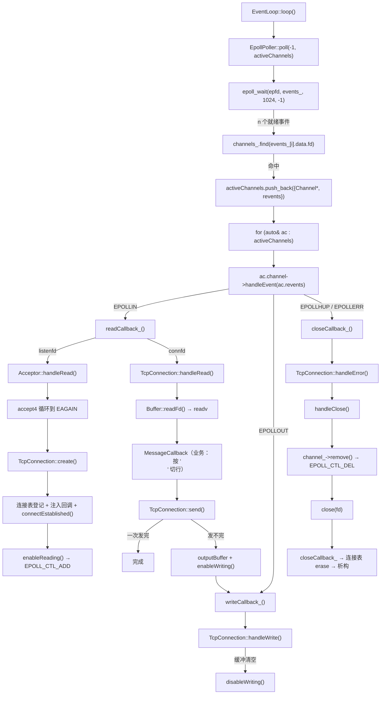
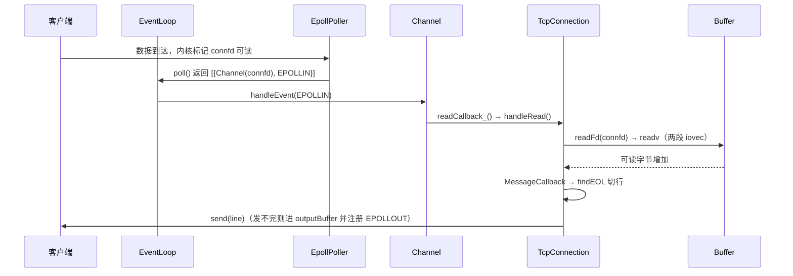
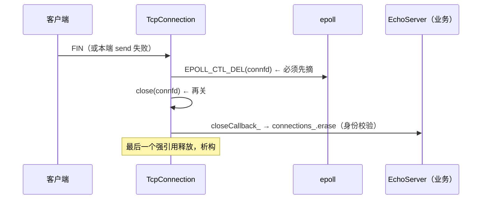

# 09 Day9：单线程 Reactor 验收 + 架构文档
***
作者：abnb250/山中鹤鸣  
博客：https://www.cnblogs.com/abnb250  
交流群：1062464078 
[点击返回目录](https://www.cnblogs.com/abnb250/p/20385010)

<br>

<br>

## 第九天任务描述
***
- 多客户端 echo 联调
- 修复数据错乱、回调时对象析构、fd 关闭顺序问题
- 画 Reactor 单线程事件流转图，写入 `docs/architecture.md`
- 能说清楚：`EventLoop → EpollPoller::poll → 活跃 Channel → handleEvent → Acceptor/TcpConnection 回调`

<br>

<br>

## 小节一：先造一把能扎破幻象的锥子——压测客户端 + 多客户端联调
***
### 1.1 本节最小必要理论（危机推演式）

**你现在手里的“验收”，其实是自欺欺人。**

Day 8 你是怎么验的？开一个 `nc`，手敲 `hello`，看见回显，收工。这一套动作里，下面三条代码路径**一次都没被执行过**：

1. **Buffer 的第二段 iovec**。`hello` 只有 6 字节，一次 `readv` 全部落进 1024 字节的第一个 iovec，`extrabuf` 那段 64KB 永远是 0 字节。Day 8 你写的“溢出部分 append”逻辑，是死代码。
2. **半包**。手敲一次回车 = 一次 `write` = 一次 `readv`。你从来没遇到过“只到了半条消息、`\n` 还没来”的情况。而 Day 17 的长度前缀协议，**100% 会半包**。
3. **`EPOLLOUT` 与输出缓冲**。几十字节的东西，`send` 一次就发完了，`outputBuffer_` 永远是空的，`enableWriting/disableWriting` 那对开关从来没被翻动过。

**如果不写压测客户端会怎样？**

Day 10 你上线程池，Day 12 你让多个 sub EventLoop 抢连接，Day 17 你上长度协议。到那时你会同时面对“新代码有 bug”和“旧代码本来就有 bug”，而你没有一台机器能告诉你“到底哪一层坏了”。更糟的是面试：面试官问“你怎么证明你的服务器在 100 并发下不串包”，你答“我开了三个 nc 看回显”——这句话说完，面试就结束了。

**所以今天的锥子长什么样？**

一个会自己判对错的客户端，三个硬指标：

- **每条消息有唯一编号**：`c01-#0037:xxxx\n`。收到就必须是这个编号，顺序错、编号错、长度错一律算 `mismatch`。
- **每条消息长度可控且够大**：默认 1400 字节 payload，一条消息 1411 字节 > 1024，必然把 Buffer 的第二段 iovec 压出来。
- **能把一条消息拆成两段发**：`splitMs > 0` 时先发 8 字节、睡 10ms、再发剩下——这就是“人工制造半包”。服务端如果靠“一次 recv 就是一条消息”来工作，这个模式下必定露馅。

客户端还要能 **流水线发送**：先把 200 条全发出去，再统一收。真实业务就是这样（客户端不会等你回一条才发下一条），服务端一次 `readv` 可能读回 3 条半——这就是粘包。

**一句话记住今天的原则**：*“能跑”是感觉，“退出码 0 + 三个计数”才是证据。*

<br>

### 1.2 代码实现与设计意图

新建 `examples/day9_echo_client.cpp`：

```cpp
// =============================================================================
// day9_echo_client.cpp：Day 9 的并发 echo 压测客户端——带编号、带长度、自己判对错。
//
// 本文件组成（自上而下 5 块）：
//   A 头文件与常量 —— socket / 时间 / 字符串
//   B 消息工厂     —— makeLine：定宽编号 + 定长填充 + '\n'
//   C IO 工具      —— sendAll（发完为止）/ readLine（自己攒、自己切）
//   D 主流程       —— 连接 → 流水线发 N 条 → 按序号逐行校验
//   E 汇总         —— ok / mismatch / failed 三计数，退出码非 0 即失败
//
// 【设计意图】nc 只能证明"能收发"，证明不了"并发下正确"。
//   这个客户端把"唯一编号 + 固定长度 + 顺序校验"做进去，
//   让 Day 9 的验收从"我看见回显了"变成"程序自己判对错、退出码说话"；
//   Day 18 压测直接复用，不用重写。
// =============================================================================
#include <arpa/inet.h>
#include <netinet/in.h>
#include <sys/socket.h>
#include <sys/time.h>
#include <unistd.h>

#include <cerrno>
#include <cstdint>
#include <cstdio>
#include <cstdlib>
#include <cstring>
#include <string>

// ---- 块 B：消息工厂 ----
// 作用：拼一条 "cNN-#NNNN:<payload 个 'x'>\n"，总长 = 10 + payload + 1。
// 【设计意图】编号定宽 4 位、填充定长，整条消息长度恒定：
//   客户端才能按字节比对，服务端才能利用"总长 > 1024"把 Buffer 的第二段 iovec 压出来。
static std::string makeLine(int clientId, int seq, int payload) {
    char head[32];
    std::snprintf(head, sizeof(head), "c%02d-#%04d:", clientId, seq);
    std::string line(head);
    line.append(static_cast<size_t>(payload), 'x');
    line.push_back('\n');
    return line;
}

// ---- 块 C1：sendAll ----
// 作用：循环 send 直到 n 字节全部交给内核。
// 【常见坑】send 返回值 n < len 是常态，不循环就是"偶发丢半条"的根源——
//   服务端要防这个，客户端自己也得防，否则你测的是客户端自己的 bug。
static bool sendAll(int fd, const char* p, size_t n) {
    while (n > 0) {
        ssize_t w = ::send(fd, p, n, MSG_NOSIGNAL);
        if (w > 0) {
            p += w;
            n -= static_cast<size_t>(w);
            continue;
        }
        if (w < 0 && errno == EINTR) continue;
        return false;   // 对端关了，或真错误
    }
    return true;
}

// ---- 块 C2：readLine ----
// 作用：从 fd 读数据追加到 inbuf，直到凑出一个 '\n'，取出整行并从 inbuf 里删掉。
// 【设计意图】一次 recv 可能拿到 0.5 行，也可能拿到 3 行。
//   客户端自己攒、自己切，才能验证"服务端到底有没有把消息边界搞对"。
// recv -> inbuf -> line -> return true
static bool readLine(int fd, std::string& inbuf, std::string& line) {
    for (;;) {
        size_t pos = inbuf.find('\n');
        if (pos != std::string::npos) {
            // 把 inbuf 从下标 0 开始、长度为 pos + 1（含那个 '\n'）的一段，
            // 整段拷贝到 line 里，覆盖 line 原来的内容。
            line.assign(inbuf, 0, pos + 1);
            inbuf.erase(0, pos + 1);
            return true;
        }
        char tmp[8192];
        ssize_t n = ::recv(fd, tmp, sizeof(tmp), 0);
        if (n > 0) {
            inbuf.append(tmp, static_cast<size_t>(n));
            continue;
        }
        if (n == 0) return false;               // 服务端发了 FIN
        if (errno == EINTR) continue;
        return false;                           // 超时（SO_RCVTIMEO）或真错误
    }
}

// ---- 块 D：主流程 ----
// 用法：./day9_echo_client [port] [clientId] [rounds] [payload] [splitMs]
//                            ↑         ↑        ↑         ↑        ↑
//                        服务端端口 客户端编号 消息条数 填充字节/条 拆包毫秒
// 操作系统把命令行上的字符串交给你,
// argc 是它们的个数（至少为 1）
// argv 是这些字符串的数组（argv[0] 是程序名本身）
int main(int argc, char** argv) {
    const int port     = (argc > 1) ? std::atoi(argv[1]) : 8888;
    const int clientId = (argc > 2) ? std::atoi(argv[2]) : 0;
    const int rounds   = (argc > 3) ? std::atoi(argv[3]) : 100;
    const int payload  = (argc > 4) ? std::atoi(argv[4]) : 1400;
    const int splitMs  = (argc > 5) ? std::atoi(argv[5]) : 0;

    int fd = ::socket(AF_INET, SOCK_STREAM, 0);
    if (fd < 0) { std::perror("socket"); return 2; }

    // 【设计意图】3 秒收不到该来的行就判失败，别让脚本永远挂着。
    timeval tv{3, 0};
    ::setsockopt(fd, SOL_SOCKET, SO_RCVTIMEO, &tv, sizeof(tv));

    sockaddr_in addr{};
    addr.sin_family = AF_INET;
    addr.sin_port   = htons(static_cast<uint16_t>(port));
    addr.sin_addr.s_addr = htonl(INADDR_LOOPBACK);

    // connect：客户端主动发起 TCP 连接，
    //   把一个 socket() 创建好的 fd 接到服务端的 ip:port 上，内核替你完成三次握手。
    // reinterpret_cast 只是给同一块内存换个“类型标签”，一个比特都不改、不做任何检查
    if (::connect(fd, reinterpret_cast<sockaddr*>(&addr), sizeof(addr)) < 0) {
        std::perror("connect");
        ::close(fd);
        return 2;
    }

    // ---- 阶段一：流水线发送（不等回显） ----
    // 【设计意图】真实客户端就是这样连发的；服务端一次 readv 会读回多条（粘包），
    //   这正是我们要压的形态。splitMs > 0 时把每行劈成两段，人工制造半包。
    bool sendOk = true;
    for (int seq = 1; seq <= rounds && sendOk; ++seq) {
        const std::string line = makeLine(clientId, seq, payload);
        if (splitMs > 0 && line.size() > 8) {
            sendOk = sendAll(fd, line.data(), 8);
            // 让当前线程睡 splitMs 毫秒（乘以 1000 把毫秒换成 usleep 要的微秒）
            // 从而在两次 send 之间留出一个时间空档，让服务端必然先读到半条消息。
            ::usleep(static_cast<useconds_t>(splitMs) * 1000);
            if (sendOk) sendOk = sendAll(fd, line.data() + 8, line.size() - 8);
        } else {
            sendOk = sendAll(fd, line.data(), line.size());
        }
    }

    // ---- 阶段二：按序号逐行校验 ----
    // [为什么] 客户端按顺序逐条发送、服务端也按顺序逐条回显，
    //   因此第 seq 个读到的行，就必须等于第 seq 条原本该有的内容。
    // [原理] readLine 把内核拆开的字节拼成一行，再用 makeLine(clientId, seq, payload) 
    //   重新生成该条应有的样子，逐字节比较一遍；相同就记 ok，不同就记 mismatch。
    int ok = 0, mismatch = 0, readFailed = 0;;
    std::string inbuf, line;
    for (int seq = 1; seq <= rounds && sendOk; ++seq) {
        if (!readLine(fd, inbuf, line)) {readFailed = rounds - seq + 1; break; }
        if (line == makeLine(clientId, seq, payload)) ++ok;
        else {
            if (mismatch == 0) {
                // 只打第一条，避免刷屏；编号错说明"串包"，内容短说明"半包被当成整包"
                std::printf("[client %02d] first mismatch at #%04d, got %zu bytes\n",
                            clientId, seq, line.size());
            }
            ++mismatch;
        }
    }
    

    ::close(fd);
    const int sendFailed = sendOk ? 0 : (rounds - ok - mismatch - readFailed);
    std::printf("[client %02d] ok=%d mismatch=%d sendFailed=%d payload=%d splitMs=%d\n",
                clientId, ok, mismatch, sendFailed, payload, splitMs);
    return (sendOk && mismatch == 0 && sendFailed == 0) ? 0 : 1;
}
```

**CMake 追加**（客户端不依赖 `reactor_net`，别多链）：

```cmake
# ---- 块 E5：Day 9 压测客户端 ----
add_executable(day9_echo_client examples/day9_echo_client.cpp)
```

再顺手把 Day 8 的示例“转正”成仓库正房——README 里写的运行命令是 `./bin/echo_reactor`，从今天起就用这个名字：

```bash
git mv examples/day8_echo_reactor.cpp examples/echo_reactor.cpp
```

`CMakeLists.txt` 里把 `day8_echo_reactor` 那个目标换成：

```cmake
add_executable(echo_reactor examples/echo_reactor.cpp)
target_link_libraries(echo_reactor PRIVATE reactor_net)
```

<br>

### 1.3 现象追踪与验证（如何证明跑通了）

**第一步：老服务端先跑起来，看看它有多“虚”**

```bash
cmake -S . -B build
cmake --build build -j4
./build/bin/echo_reactor
```

**预期**：

```text
[day8] echo server listening on 8888, listenfd=3
```

**第二步：5 个客户端并发，每个 200 条、每条 1400 字节**

```bash
# 终端 2
for i in 1 2 3 4 5; do
  ./build/bin/day9_echo_client 8888 $i 200 1400 0 &
done
wait
echo "exit=$?"
```

**预期（5 行，逐行对）**：

```text
[client 01] ok=200 mismatch=0 failed=0 payload=1400 splitMs=0
[client 02] ok=200 mismatch=0 failed=0 payload=1400 splitMs=0
...
```

**先别急着高兴。** 这里全绿只说明一件事：**字节被原样搬运了**。因为 Day 8 的 echo 是“收到多少就回多少”，字节流是透明的，客户端自己拼一拼就对上了。它**完全没有**证明服务端理解“消息边界”。下面两个实验才是真正的验收。

**第三步：实验 A——看清“一次 recv ≠ 一条消息”**

在 `echo_reactor.cpp` 的 `MessageCallback` 最前面临时插一行探针（看完立刻删）：

```cpp
// 临时探针：只为了看见内核一次给了多少字节
std::fprintf(stderr, "[probe] fd=%d readable=%zu\n", c->fd(), buf->readableBytes());
```

重新编译，只发 1 条、但用半包模式（先 8 字节、睡 20ms、再发剩下的）：

```bash
./build/bin/day9_echo_client 8888 1 1 1400 20
```

**预期服务端输出**：

```text
[day8] new connection fd=5 from 127.0.0.1:xxxxx
[probe] fd=5 readable=8            ← 第一次可读事件：只到了 "c01-#0001:" 这 8 字节
[day8] fd=5 recv 8 bytes, echo back
[probe] fd=5 readable=1403         ← 第二次可读事件：剩下的 1403 字节全到了（8 + 1403 = 1411）
[day8] fd=5 recv 1403 bytes, echo back
[day8] connection closed fd=5
```

**关键就在这两行 `recv`**：一条消息，服务端“处理”了两次。字节上没丢（8 + 1403 拼起来还是对的，所以客户端不会报错），但**语义上你已经把一条命令执行了两遍**。今天是 echo，看不出后果；Day 16 换成 `ping`，Day 17 换成“登录请求”，第二段半包会被当成一条独立命令去解析——那才是真正的“数据错乱”。

**看到什么就说明什么**：一条 1411 字节的消息，被内核拆成了两次可读事件。第一次只有 8 字节，里面连 `\n` 都没有。**如果业务代码把“一次可读”当成“一条消息”，你这一条命令就被执行了两次（一次残缺、一次剩余）**——这就是 Day 9 任务里“数据错乱”的真正源头。顺带你也第一次看到 `readable=1403 > 1024`，说明 Day 8 的 `extrabuf` 那段代码终于被跑到了。

**第四步：实验 B——把并发拉满，同时盯住 fd 和 ASan**

```bash
# 终端 2：40 个短连接，每个只发 3 条就断
for i in $(seq 1 40); do
  ./build/bin/day9_echo_client 8888 $((i % 10)) 3 1400 5 >/dev/null 2>&1 &
done
wait

# 终端 1 另开：压测前后各看一次 fd 数量
ls /proc/$(pgrep -f echo_reactor)/fd | wc -l
```

**预期**：压测结束后 fd 数量回到基线（listenfd + epfd + 标准流 ≈ 5）。若数字一路涨，说明 `closeCallback` 里没 erase，或者 `~TcpConnection` 没 close。

**预期**：服务端终端全程没有 `ERROR: AddressSanitizer`。若出现 `heap-use-after-free`，先看栈顶是不是 `Buffer::findEOL`（小节二会讲这个位置为什么最危险）。

**第五步：看 CPU 有没有空转**

```bash
top -p $(pgrep -f echo_reactor)
```

**预期**：空载时 CPU ≈ 0%。如果空载就 100%，说明某个连接发完之后没 `disableWriting()`，`EPOLLOUT` 一直就绪，`epoll_wait` 立刻返回——Day 8 的 `handleWrite` 里那个 `disableWriting` 就是干这个的，去检查它有没有被删掉。

<br>

### 1.4 面试表达话术

**面试官问**：“你说你的服务器能撑并发，怎么验证的？”

**你回答**：“我写了一个带消息编号和定长填充的压测客户端，而不是用 nc 手敲。原因是我要验证的不是‘能收发’，而是三条具体路径：第一，单条消息 1400 字节超过初始 1024 的可写区，会走到 `readv` 的第二段 iovec；第二，客户端可以故意把一条消息拆成 8 字节 + 剩余两段发送，强制服务端经历半包；第三，客户端是流水线发送，200 条连发不等回显，服务端一次 `readv` 会读回多条，这就是粘包。验收标准是三个计数：`ok/mismatch/failed`，加退出码。并发 5 个客户端各 200 条，全部 `ok=200 mismatch=0`，压测前后 `/proc/<pid>/fd` 数量回落，ASan 无报错。这套客户端在 Day 18 直接复用做压测。”

<br>

<br>

## 小节二：拆三颗雷——数据边界、事件处理中的析构、fd 关闭顺序
***
### 2.1 本节最小必要理论（危机推演式）

**雷一：没有消息边界，就没有“数据正确”这回事**

Day 8 的 echo 是：

```cpp
std::string msg(buf->peek(), buf->readableBytes());
buf->retrieveAll();
c->send(msg);
```

它在字节层面是**透明**的，所以你的客户端能对上。但这种写法隐含了一个致命假设：**“我收到的一块，就是一条完整消息”**。刚才实验 A 已经证明这个假设是假的。今天不修，Day 16 的心跳（`ping`/`pong`）就会遇到“半个 `pi`”，Day 17 的长度协议会读到垃圾长度。

正确姿势只有一句：**Buffer 只负责存字节，消息边界必须由业务显式切**。今天先用 `\n` 当临时边界（人可读、`nc` 可测），Day 17 换成“4 字节长度头 + payload”，**切分函数的形状完全一样**，只换判断条件。所以今天写对了，Day 17 只是换 5 行。

**雷二：事件处理期间，对象可能已经在回调栈里死过一次**

`handleRead` 里这行是关键：

```cpp
if (messageCallback_) messageCallback_(shared_from_this(), &inputBuffer_);
```

`shared_from_this()` 产生一个**临时强引用**，它的寿命只到“这条语句结束”。也就是说：**回调函数体执行期间对象一定是活的，回调一返回对象就可能立刻析构**。

单线程下这还没事，因为 Day 8 的 `handleRead` 在回调返回之后**一行代码都不做了**，函数直接结束。但这是运气，不是设计。只要你在回调后面加任何一行“用到成员”的代码，就是 UAF：比如加统计打印 `fd_`、加半关闭处理（Day 16 心跳要用）、加“读完之后检查一次输出缓冲”。更危险的是 `handleMessage` 里那个**循环**——它每一轮都摸 `buf`（也就是 `inputBuffer_`），而这个循环依赖一个前提：**整个 `messageCallback_` 调用期间对象必须活着**。这个前提今天是靠 `shared_from_this()` 那个临时强引用撑着的，它的寿命只到“这一条语句结束”，一旦哪天你把这个 callback 换成别的调度方式（比如 Day 13 投递到队列里延后执行），前提立刻消失，`findEOL` 就会摸到已释放的 Buffer——ASan 栈顶是 `Buffer::findEOL`，很多人会以为 Buffer 有 bug，其实是连接已经死了。

三层防护，缺一层都是赌运气：

1. `Channel` 里存的是 `weak_ptr` 回调（Day 8 已做）；
2. `Channel::handleEvent` 先把回调拷到局部再分发，回调里析构 `Channel` 也不踩成员（Day 8 已做）；
3. **`handleRead` / `handleWrite` 开头补一个 `TcpConnectionPtr guard = shared_from_this();`**，把对象钉到函数返回（今天补）。

**雷三：fd 关闭顺序与“连接表按 fd 删”是同一个 bug 的两张脸**

先背死这条顺序，任何地方都不许换：

```text
EPOLL_CTL_DEL（channel_->remove()） → close(fd) → 通知上层 erase
```

把顺序反过来会怎样？`close(5)` 之后，5 号 fd 立刻可以被内核复用给下一个 `accept4`；此时你再 `EPOLL_CTL_DEL 5`，摘掉的是**新连接**在 epoll 里的注册。结果：新客户端连上了，但它的可读事件永远不会来，客户端发什么都石沉大海。strace 里会看到 `EPOLL_CTL_DEL 5 = -1 EBADF` 或删错对象。

第二个脸更隐蔽：`connections_.erase(c->fd())`。`c->fd()` 是一个**可能已经被复用**的整数。假如顺序执行到“已经 close、还没 erase”之间插进来一个 accept（Day 12 多线程之后必然发生），同一个 fd 号对应的是**新连接**，你这一 erase 就把新连接的登记项删了——旧对象被析构、新连接失去唯一主人，随后就是“某条连接凭空消失”和“另一个客户端的数据跑到你这里”。

修法不是加锁，而是**别用可变的东西当身份**：

```cpp
auto it = connections_.find(conn->fd());
if (it != connections_.end() && it->second == conn) connections_.erase(it);
```

`it->second == conn` 是在比 `shared_ptr` 身份：**只有“表里存的就是这个对象”才删**。fd 号被复用也无所谓，身份对不上就不动。

<br>

### 2.2 代码实现与设计意图

**改动 1：`Buffer` 增加“找行尾”能力**

`include/base/Buffer.h` 顶部 include 区追加一行，public 区（`peek()` 附近）追加一个内联函数：

```cpp
#include <cstring>
```

```cpp
    // ---- 块 C3：查找分隔符 ----
    // 作用：在可读区里找第一个 '\n'，找到返回指针，找不到返回 nullptr。
    // 【设计意图】把"哪里有消息边界"的判断收进 Buffer，业务层只写 eol != nullptr；
    //   Day 17 换成"先凑 4 字节长度头"，只换这个函数的实现，调用点形状不变。
    const char* findEOL() const {
        return static_cast<const char*>(std::memchr(peek(), '\n', readableBytes()));
    }
```

**改动 2：`TcpConnection` 补第三层防护，并把“静默泄漏”变成“显式告警”**

`src/net/TcpConnection.cpp` 里 `handleRead()` **第一行**加 guard：

```cpp
void TcpConnection::handleRead() {
    // 【设计意图】第三层防护：把对象的寿命钉到本函数返回。
    //   回调里可能 handleClose → 连接表 erase，把"最后一个强引用"在回调栈中间释放掉；
    //   若没有这个 guard，回调返回后 inputBuffer_ 已随对象销毁，后续访问就是 UAF。
    TcpConnectionPtr guard = shared_from_this();

    int savedErrno = 0;
    ssize_t n = inputBuffer_.readFd(fd_, &savedErrno);
    // ...（其余不变）
```

`handleWrite()` 同样第一行加一句（写路径会走 `handleError`，同样是关闭入口）：

```cpp
void TcpConnection::handleWrite() {
    TcpConnectionPtr guard = shared_from_this();   // 同 handleRead：把对象钉到函数返回
    // ...（其余不变）
```

`sendInLoop()` 开头把前置检查补严（Day 8 只在 `send()` 里判了 `connected_`，内部调用没判）：

```cpp
void TcpConnection::sendInLoop(const char* data, size_t len) {
    // 【常见坑】已关闭的连接还往 fd 上 send，会把数据写进一个已被复用的 fd——
    //   这就是"别人的数据跑到我这儿"的另一种成因。连接已死，一律不发。
    if (!connected_ || closed_) return;
    // ...（其余不变）
```

`~TcpConnection()` 里加一条告警，把“没走 handleClose 就析构”这种泄漏显性化：

```cpp
TcpConnection::~TcpConnection() {
    channel_.reset();          // 先摘 epoll（EPOLL_CTL_DEL）
    if (!fdClosed_) {
        // 【设计意图】正常路径一定先经 handleClose 再析构，走到这里说明有遗漏。
        //   不静默兜底了事，直接喊出来——Day 12 起多线程，这种遗漏会变成 fd 耗尽。
        fprintf(stderr, "[BUG] ~TcpConnection fd=%d destroyed without handleClose\n", fd_);
        ::close(fd_);
        fdClosed_ = true;
    }
}
```

**改动 3：`EchoServer` 按行切分 + 按身份 erase + 支持 `quit`**

把 `examples/echo_reactor.cpp` 全文替换成下面这版：

```cpp
// =============================================================================
// echo_reactor.cpp：单线程 Reactor 的最终形态——
//   Acceptor 接连接，TcpConnection 管收发，echo 业务只活在 MessageCallback 里。
//
// 本文件组成（自上而下 6 块）：
//   A 头文件与类型别名 —— Reactor 三件套 + 容器 / 信号
//   B EchoServer 类    —— 持有 Acceptor、连接表、累计统计
//   C 新连接处理       —— create / 登记 / 注入两个回调 / connectEstablished
//   D 读业务           —— 按 '\n' 切行、逐行回显、支持 "quit" 主动断开
//   E 关闭路径         —— 按 shared_ptr 身份校验后 erase，打印存活数
//   F main 装配        —— 忽略 SIGPIPE + 起 loop + 跑起来
//
// 【设计意图】连接管理（C/E）与业务（D）彻底分离：库代码不认识 echo，业务不认识 epoll。
//   今天把 Day 8 的"整块回发"改成"按行回发"，让半包/粘包的处理显式化；
//   Day 17 上长度协议时，只换 D 块里的切分条件，C/E 一行不动。
// =============================================================================
#include "base/Buffer.h"
#include "net/Acceptor.h"
#include "net/EventLoop.h"
#include "net/TcpConnection.h"

#include <netinet/in.h>
#include <signal.h>

#include <cstddef>
#include <cstdio>
#include <map>
#include <string>

namespace {

// ---- 块 A：类型别名 ----
using TcpConnectionPtr = reactor::TcpConnection::TcpConnectionPtr;

// ---- 块 B：EchoServer ----
class EchoServer {
public:
    EchoServer(reactor::EventLoop* loop, int port)
        : loop_(loop), port_(port), acceptor_(loop, port) {
        // 【设计意图】捕获 this 安全：acceptor_ 是成员，EchoServer 一定比它活得久。
        acceptor_.setNewConnectionCallback(
            [this](int connfd, const sockaddr_in& peerAddr) {
                onNewConnection(connfd, peerAddr);
            });
    }

    void start() {
        std::printf("[echo] listening on 0.0.0.0:%d, listenfd=%d\n",
                    port_, acceptor_.listenfd());
        acceptor_.listen();   // listenfd 注册进 epoll，开始接受连接
    }

private:
    // ---- 块 C：新连接处理 ----
    void onNewConnection(int connfd, const sockaddr_in& peerAddr) {
        TcpConnectionPtr conn = reactor::TcpConnection::create(loop_, connfd, peerAddr);

        // 【设计意图】连接表是唯一强引用持有者：erase 即析构，生命周期一目了然。
        connections_[connfd] = conn;
        ++totalAccepted_;

        conn->setMessageCallback(
            [this](const TcpConnectionPtr& c, reactor::Buffer* buf) {
                handleMessage(c, buf);
            });
        conn->setCloseCallback([this](const TcpConnectionPtr& c) { handleClose(c); });

        // 【常见坑】必须最后调：它负责设 weak_ptr 回调 + enableReading。
        conn->connectEstablished();

        std::printf("[echo] +fd=%d peer=%s alive=%zu total=%zu\n", connfd,
                    conn->peerAddrString().c_str(), connections_.size(), totalAccepted_);
    }

    // ---- 块 D：读业务（今天唯一有业务的地方） ----
    // 作用：从 Buffer 里按 '\n' 切出完整行，逐行处理；切不出完整行的部分留在 Buffer 等下一轮。
    void handleMessage(const TcpConnectionPtr& conn, reactor::Buffer* buf) {
        // 【面试考点】循环条件同时看 connected_：一次 readv 可能带来 3 条命令，
        //   第二条就要求 quit 时，剩下的必须不再处理。
        while (conn->connected() && buf->readableBytes() > 0) {
            const char* eol = buf->findEOL();
            if (eol == nullptr) break;   // 半包：一行都没凑齐，等下一次可读事件

            const size_t len = static_cast<size_t>(eol - buf->peek()) + 1;   // 含 '\n'
            const std::string line(buf->peek(), len);
            buf->retrieve(len);          // 只吃掉这一行，剩下的留给下一行

            if (line == "quit\n") {
                std::printf("[echo] fd=%d asked to quit\n", conn->fd());
                conn->shutdown();        // 走统一关闭路径，不在回调里自己 close(fd)
                return;                  // shutdown 之后立刻退出，别再碰 buf
            }

            ++linesEchoed_;
            conn->send(line);            // 原样回显这一行
        }
    }

    // ---- 块 E：关闭路径 ----
    void handleClose(const TcpConnectionPtr& conn) {
        // 【常见坑】不能直接 erase(conn->fd())：此刻 fd 已经 close，
        //   内核可能把同一个号码复用给新连接，你会删掉别人的登记项 → 串号。
        //   用 shared_ptr 身份校验：只有"表里存的就是这个对象"才删。
        auto it = connections_.find(conn->fd());
        if (it != connections_.end() && it->second == conn) {
            connections_.erase(it);
        }
        std::printf("[echo] -fd=%d closed alive=%zu total=%zu lines=%zu\n", conn->fd(),
                    connections_.size(), totalAccepted_, linesEchoed_);
    }

    // ---- 块 B2：数据 ----
    reactor::EventLoop* loop_;                  // 不拥有
    int port_;                                  // 只用于日志
    reactor::Acceptor acceptor_;                // 成员，随 EchoServer 析构
    std::map<int, TcpConnectionPtr> connections_;   // fd → 连接，唯一强引用
    size_t totalAccepted_ = 0;                  // 累计接入
    size_t linesEchoed_   = 0;                  // 累计回显行数
};

} // namespace

// ---- 块 F：main 装配 ----
int main() {
    // 【常见坑】不忽略 SIGPIPE，对端先关时 send 会直接杀进程。
    signal(SIGPIPE, SIG_IGN);

    reactor::EventLoop loop;
    EchoServer server(&loop, 8888);
    server.start();
    loop.loop();   // 死循环，Ctrl+C 退出
    return 0;
}
```

<br>

### 2.3 现象追踪与验证

**第一步：编译**

```bash
cmake -S . -B build
cmake --build build -j4
```

**预期**：0 warning（`-Wall -Wextra` 下 `peerAddr` 必须真的被用到；若报 `unused parameter`，说明你把它删成了一行注释，把它传回 `create`）。

**第二步：半包不再被当成整包（雷一）**

```bash
./build/bin/echo_reactor
# 终端 2
./build/bin/day9_echo_client 8888 1 20 1400 20
```

**预期客户端**：

```text
[client 01] ok=20 mismatch=0 failed=0 payload=1400 splitMs=20
```

**关键**：20 条消息被拆成 40 次 `write`，服务端经历几十次“只有半行”的可读事件。若你的服务端还是 `retrieveAll` 回发，这里**也可能**是 `ok=20`——因为字节透明。所以下面这一步才是分水岭：

把探针加回来，观察日志行数：

```text
[probe] fd=5 readable=8        ← 只有 8 字节，连 '\n' 都没有
[probe] fd=5 readable=1403     ← 剩下 1403 字节到齐，'\n' 就在里面
```

**看到什么就说明什么**：`readable=8` 那一行，`findEOL()` 返回 `nullptr` → `break` → **一个字节都没回**，全留在 `inputBuffer_` 里。第二次事件到了 `readable=1403`，才切出一整行 1411 字节并回显。对应地，`ok=20` 且服务端 `lines=20`（不是 40 次事件）——这个数字对上了，才叫“边界处理正确”。

**第三步：粘包一次处理多行**

```bash
./build/bin/day9_echo_client 8888 2 200 1400 0
```

**预期**：`ok=200`。服务端 `lines=200`。用 `strace -e trace=readv -f ./build/bin/echo_reactor` 看，会看到不少 `readv(...) = 14110` 这种**一次读回 10 条**的行——一个 `readv` 对应 10 次 `send`。这就是“粘包不是 bug，边界由应用层划”的现场证据。

**第四步：`quit` 走统一关闭路径（雷二 + 雷三）**

```bash
# 终端 2
printf 'quit\n' | nc 127.0.0.1 8888
```

**预期服务端**：

```text
[echo] +fd=5 peer=127.0.0.1:xxxxx alive=1 total=1
[echo] fd=5 asked to quit
[echo] -fd=5 closed alive=0 total=1 lines=0
```

**注意 `lines=0`**：`quit` 不算回显行，说明它在 `++linesEchoed_` 之前就被拦下了。

再用 strace 钉死关闭顺序：

```bash
strace -f -e trace=epoll_ctl,close ./build/bin/echo_reactor 2>&1 | grep -E 'EPOLL_CTL_DEL|close'
```

**预期顺序（一个 fd 只有一组）**：

```text
epoll_ctl(4, EPOLL_CTL_DEL, 5, NULL) = 0
close(5) = 0
```

**三条判据**：

1. `DEL` 在 `close` **之前**；
2. `close(5)` 只出现 **1 次**；
3. **没有** `EPOLL_CTL_DEL 5 = -1 EBADF`——出现这行，说明你先 close 后 remove，顺序写反了，去改 `handleClose`。

**第五步：40 个短连接，验证“不会删错人”**

```bash
for i in $(seq 1 40); do
  ./build/bin/day9_echo_client 8888 $((i % 10)) 3 1400 5 >/tmp/c$i.log 2>&1 &
done
wait
grep -l 'ok=3 mismatch=0 readFailed=0 sendFailed=0' /tmp/c*.log | wc -l   # 预期 40
```

**预期**：40。若有客户端 `failed>0`，去看服务端日志里 `alive` 有没有变成负数或凭空跳变——那就是 `erase` 删错人（雷三）。改完后 `[echo] -fd=` 的条数必须正好等于 `total=`。

**第六步：ASan + fd 基线**

```bash
ls /proc/$(pgrep -f echo_reactor)/fd | wc -l
```

**预期**：回到 5 左右。服务端全程无 `ERROR: AddressSanitizer`、无 `[BUG] ~TcpConnection ... without handleClose`。

**第七步：把今天踩的坑写进 debug-log**

```bash
cat >> docs/debug-log.md <<'EOF'
## Day 9: 一次可读被当成一条消息，一条命令被处理两遍

### 现象
压测客户端 ok/mismatch 全绿，看不出问题。但在 MessageCallback 里加一行探针
打印 readableBytes() 后发现：一条 1411 字节的消息被内核拆成 8 + 1403 两次可读事件，
MessageCallback 被调用两次，服务端也回发了两次。
把业务从"整块回显"改成"按 '\n' 切行"之后，第一次那 8 字节里没有 '\n'，
这条消息直接卡住不回声，客户端超时，压测才暴露出 failed。

### 定位
`MessageCallback` 里直接 `peek()` + `retrieveAll()` 并回发，隐含假设"一次可读 == 一条消息"。
Day 8 的 echo 在字节层面是透明的（8 + 1403 拼起来仍然正确），所以这个假设一直被掩盖；
一旦业务需要"按消息处理"（心跳、长度协议、登录请求），半包就会被当成一条独立命令。

### 修复
1. Buffer 增加 findEOL()，业务循环"切出一整行才处理"；
2. 切不出 '\n' 就 break，剩余字节留在 inputBuffer_ 等下一次可读事件；
3. 连接表 erase 前用 it->second == conn 做身份校验，防止 fd 复用删错连接；
4. handleRead/handleWrite 加 shared_from_this() guard，防止回调中途析构后继续访问成员。

### 验证
splitMs=20 的半包压测 20 条全 ok；服务端 lines 计数 = 消息条数（不是事件次数）；
strace 确认 EPOLL_CTL_DEL 在 close 之前且 close 只出现一次；40 个短连接后 fd 数回落。
EOF
```

<br>

### 2.4 面试表达话术

**面试官问**：“TCP 粘包/拆包你怎么处理的？‘数据错乱’你遇到过吗？”

**你回答**：“先纠正一个说法：TCP 是字节流，没有包，粘包拆包不是 bug，是应用层必须自己划边界。我的做法是 `Buffer` 只存字节，业务层显式切：在可读区里找分隔符，找到才处理一整条，找不到就留着等下一次可读事件——这样半包天然被暂存，一次 `readv` 带回多条就循环处理。我用一个带唯一编号和定长填充的压测客户端验证，它能故意把一条消息拆成 8 字节 + 剩余两段发送，服务端的 lines 计数必须等于消息条数而不是可读事件次数。

数据错乱我遇到两种：第一种是上面说的边界问题，一条命令被执行两次；第二种更阴——连接表用 fd 当 key，`erase(c->fd())`，而此刻 fd 已经 `close`、可能被复用给新连接，一擦就把别人的登记项删了，表现是‘某条连接凭空消失、另一个客户端收到不该有的数据’。修法是别拿可变的东西当身份：erase 前用 `shared_ptr` 比较 `it->second == conn`。关闭顺序我钉死为 `EPOLL_CTL_DEL → close(fd) → 通知上层 erase`，反了就会摘掉新连接的注册，strace 里能直接看到 `EPOLL_CTL_DEL = -1 EBADF`。”

<br>

<br>

## 小节三：把 Reactor 画成图，写进 docs/architecture.md
***
### 3.1 本节最小必要理论（危机推演式）

**为什么今天必须写文档，而不是“等做完再补”？**

因为 **Day 10 你就要动它**。线程池一进来，第一个要回答的问题不是“怎么写 ThreadPool”，而是三个只有文档能回答的问题：

1. 一条连接**属于**哪个 EventLoop？（答不出，就会出现“A 线程读、B 线程写”）
2. 哪些数据是**只有 owner 线程才能碰**的？（答不出，就会到处加锁，锁出死锁）
3. 跨线程怎么**安全**投递？（Day 13 的 `runInLoop + eventfd` 之所以必须存在，前提就是“一个连接只属于一个 loop”）

这三个问题，今天不写下来，明天你会凭记忆重构，然后在一堆随机崩溃里重建记忆。**画图不是为了好看，是为了把“谁在什么时候碰什么”钉死在纸上。**

**更现实的一点：面试。**

“画一下你的 Reactor 架构”是 C++ 后端面试的**必考题**。要求不是“画得漂亮”，而是**画完能讲 3 分钟，且每一步都对得上代码**。大部分人卡在第二步：画了 `EventLoop → epoll_wait → 回调` 三个框，一问“事件怎么从内核回到 Channel 的？`data.fd` 在哪一步被反查成 `Channel*` 的？”就答不上来。

所以今天的文档只有一个硬指标：**图上的每一条箭头，都能在代码里指到一个函数名；每一条箭头，都能在 strace 里找到对应的系统调用。**

<br>

### 3.2 代码实现与设计意图

新建 `docs/architecture.md`，内容照下面抄（今天只要这一版，Day 18 再补压测数据）：

````markdown
# cpp-reactor-server 架构说明

> 更新时间：Day 9（单线程 Reactor 验收）
> 当前模型：**单线程 Reactor**。Day 10 起演进为「主从 Reactor + 线程池」，本文档随之更新。

## 1. 一句话模型

一个线程、一个 `EventLoop`、一个 epoll 实例、N 条连接；**所有 fd 的所有事件，都在同一个线程里串行处理**。

## 2. 模块职责与边界

| 模块 | 负责什么 | 明确不做什么 |
| --- | --- | --- |
| `EventLoop` | 驱动 `loop()`；持有 poller 与 fd→Channel 映射；`updateChannel/removeChannel` | 不存业务、不读数据、不认识 Acceptor |
| `EpollPoller` | 封装 `epoll_create1/epoll_ctl/epoll_wait`；把就绪 fd 反查成 `Channel*` | 不持有 `Channel`、不回调业务 |
| `Channel` | 「一个 fd + 我关心的事件 + 三类回调」的绑定 | 不 close fd、不读数据 |
| `Acceptor` | 建 listenfd、循环 `accept4`、把 connfd 交给上层 | 不创建连接对象、不读写 |
| `TcpConnection` | 一条连接的生命周期、读写、关闭；持有两块 Buffer | 不认业务协议 |
| `Buffer` | 每条连接私有的字节水池（读下标/写下标/预留头部） | 不知道 fd 是什么（只有 `readFd` 碰系统调用） |
| 业务（示例） | `MessageCallback` 里按 `\n` 切行、echo | 不碰 epoll、不碰 fd 关闭 |

## 3. 一次事件的完整流转（7 步，务必背下来）

1. `EventLoop::loop()` 进入死循环，每轮先清空 `activeChannels`。
2. `EpollPoller::poll(-1, activeChannels)` → `epoll_wait(epfd, events_, 1024, -1)` **阻塞**。
3. 内核把就绪事件写进 `events_` 数组；`events_[i].data.fd` 就是当初 `epoll_ctl ADD` 时填的 fd。
4. `poll()` 用 `channels_.find(fd)` 反查 `Channel*`，把 `{Channel*, revents}` 塞进 `activeChannels`。
5. `EventLoop` 遍历 `activeChannels`，逐个 `channel->handleEvent(revents)`。
6. `Channel` 按位分派：`EPOLLHUP|EPOLLERR` → `closeCallback_`；`EPOLLIN|EPOLLPRI|EPOLLRDHUP` → `readCallback_`；`EPOLLOUT` → `writeCallback_`。
7. 回调是 lambda，按 fd 的来源分两种：**listenfd** → `Acceptor::handleRead`（accept4 循环）；**connfd** → `TcpConnection::handleRead`（`readFd` → `MessageCallback` → `send`）。

> 注意第 4 步：**反查发生在 poll() 里，不在 EventLoop 里**。这是很多人画图时画错的地方。

## 4. 事件流转图



## 5. 一次 echo 的时序（正常路径）



## 6. 关闭时序（顺序固定，不许换）



顺序理由：`close` 之后 fd 号立即可被内核复用，此时再做 `DEL` 会摘掉**新连接**的注册。

## 7. 背压（EPOLLOUT 的正确用法）

- `EPOLLOUT` **默认几乎一直就绪**（发送缓冲空就触发），所以只在“确实有数据发不出去”时才 `enableWriting()`。
- `send` 一次没发完 → 剩余字节进 `outputBuffer_` → 注册 `EPOLLOUT`。
- `handleWrite` 把缓冲发空 → **立刻** `disableWriting()`，否则 `epoll_wait` 立刻返回、空转烧 CPU。
- **业务顺序保证**：`outputBuffer_` 非空时不允许“直接 send”，新数据一律排队，防止乱序。

## 8. 今天刻意的取舍（已知限制 → 对应任务）

| 已知限制 | 为什么暂时不管 | 什么时候解决 |
| --- | --- | --- |
| 单线程，一个连接卡住全卡 | 先跑通模型，再扩 | Day 10–14 |
| 用 `\n` 当消息边界 | 人可读、`nc` 可测 | Day 17 换 4 字节长度前缀 |
| 没有超时/心跳，死连接不回收 | 需要定时器 | Day 15–16 |
| 业务在 EventLoop 线程里跑 | echo 足够快 | Day 14 丢线程池 |
| 无日志系统，只有 printf | 不影响正确性 | Day 18 / 后置 |

## 9. 如何验证这张图（strace 对齐）

```bash
strace -f -e trace=epoll_ctl,epoll_wait,accept4,readv,sendto,close \
       -o /tmp/arch.strace ./build/bin/echo_reactor
```

对照图中第 3–7 步逐条勾：

| 图上的箭头 | strace 里应出现 |
| --- | --- |
| `enableReading → EPOLL_CTL_ADD` | `epoll_ctl(4, EPOLL_CTL_ADD, 5, {events=EPOLLIN, ...})` |
| `epoll_wait 返回活跃 fd` | `epoll_wait(4, [{events=EPOLLIN, data={u32=5,...}}], 1024, -1) = 1` |
| `Acceptor::handleRead` | `accept4(3, ..., SOCK_NONBLOCK|SOCK_CLOEXEC) = 5` |
| `Buffer::readFd` | `readv(5, [{iov_len=1024}, {iov_len=65536}], 2)` |
| `echo 回写` | `sendto(5, "c01-#0001:...", 1411, MSG_NOSIGNAL, ...)` |
| `handleClose` | `epoll_ctl(4, EPOLL_CTL_DEL, 5, NULL) = 0` 然后 `close(5) = 0` |
````

<br>

### 3.3 现象追踪与验证（如何证明这张图是对的）

**第一步：文档落地检查**

```bash
ls docs/
cat docs/architecture.md | head -20
```

**预期**：`architecture.md` 和 `debug-log.md` 都在 `docs/` 下。

**第二步：让 strace 逐条对齐图上的箭头**

```bash
strace -f -e trace=epoll_ctl,epoll_wait,accept4,readv,sendto,close \
       -o /tmp/arch.strace ./build/bin/echo_reactor
# 另开终端
./build/bin/day9_echo_client 8888 7 5 1400 0
# 回到服务端 Ctrl+C，然后
cat /tmp/arch.strace
```

**预期关键片段（顺序必须一致）**：

```text
epoll_ctl(4, EPOLL_CTL_ADD, 3, {events=EPOLLIN, data={u32=3, u64=0}}) = 0
epoll_wait(4, [{events=EPOLLIN, data={u32=3, u64=0}}], 1024, -1) = 1
accept4(3, {sa_family=AF_INET, ...}, [16], SOCK_NONBLOCK|SOCK_CLOEXEC) = 5
epoll_ctl(4, EPOLL_CTL_ADD, 5, {events=EPOLLIN, data={u32=5, u64=0}}) = 0
epoll_wait(4, [{events=EPOLLIN, data={u32=5, u64=0}}], 1024, -1) = 1
readv(5, [{iov_base=..., iov_len=1024}, {iov_base=..., iov_len=65536}], 2) = 7055
sendto(5, "c07-#0001:...", 1411, MSG_NOSIGNAL, NULL, 0) = 1411
...
epoll_ctl(4, EPOLL_CTL_DEL, 5, NULL) = 0
close(5) = 0
```

**看到什么就说明什么**：

- `data={u32=5}` 就是图中第 3 步“`data.fd` 是注册时的 fd”的实证；
- `readv` 一次返回 7055（5 条 × 1411 字节）= 图里“一次 readv 多条消息”，随后 5 次 `sendto`，这就是 `handleMessage` 的循环；
- 最后 `DEL` 在 `close` 之前 = 第 6 节关闭时序图。

**只要有一条对不上，就是图画错了，或者代码和文档漂移了**——先改代码或改图，不要留着一个“差不多”的文档。

**第三步：合上文档，口头讲 3 分钟**

拿手机录音，对着空文档讲。讲完回听，卡壳的地方就是你没真懂的地方。合格的讲解必须覆盖：**7 步流转 + 关闭时序 + 为什么 EPOLLOUT 要关 + 现在的瓶颈**。讲不满 3 分钟，说明 §3 那 7 步你只是“看过”，不是“会”。

**第四步：确认文档里没有说谎**

把 §8「已知限制」那张表逐行读一遍，每读一行问自己：“代码里确实是这样吗？”比如“用 `\n` 当边界”——去 `handleMessage` 里确认 `findEOL` 用的是 `'\n'`。文档写错比不写更糟，因为 Day 18 你会照着它写 README。

<br>

### 3.4 面试表达话术

**面试官问**：“画一下你的单线程 Reactor，讲讲事件怎么流转的。”

**你回答**：“我的模型是一个线程、一个 `EventLoop`、一个 epoll 实例、N 条连接，所有事件串行处理。`EventLoop::loop` 每轮先清空活跃列表，然后调 `EpollPoller::poll` 阻塞在 `epoll_wait`；内核返回后，`poll` 用 `events_[i].data.fd` 在 `fd → Channel` 的映射里反查出 `Channel*`，把 `{Channel*, revents}` 填进活跃列表——注意反查是在 poller 里做的，不在 EventLoop 里。EventLoop 只负责遍历这个列表，逐个调 `handleEvent`。`Channel` 按事件位分派到三类回调：可读、可写、挂断/错误。回调是 lambda，同一个 `Channel` 类服务两种 fd：listenfd 的可读回调是 `Acceptor::handleRead`，它循环 `accept4` 到 EAGAIN，然后创建 `TcpConnection`、登记进连接表、注册进 epoll；connfd 的可读回调是 `TcpConnection::handleRead`，它调 `Buffer::readFd`，内部是一次两段式 `readv`，把内核数据直接读进连接的输入缓冲，再触发业务的 `MessageCallback`，业务按 `\n` 切出整行回显；如果 `send` 没发完，剩余进输出缓冲并注册 `EPOLLOUT`，可写事件里继续发，发空立刻 `disableWriting`，否则 `epoll_wait` 会空转。连接关闭的时序固定为 `EPOLL_CTL_DEL → close → 通知上层 erase`，因为 close 之后 fd 号可被复用，先 close 再 DEL 会摘掉新连接的注册。这套图的每一条箭头我都能用 strace 对出来。”

<br>

<br>

## 小节四：提交 GitHub
***
```bash
git add .
git commit -m "refactor: single-thread reactor"
git push
```

提交前用 `git status` 确认这些文件都进了暂存区：

- `examples/echo_reactor.cpp`（由 `day8_echo_reactor.cpp` 改名而来）
- `examples/day9_echo_client.cpp`
- `include/base/Buffer.h`（新增 `findEOL`）
- `src/net/TcpConnection.cpp`（guard + `sendInLoop` 前置检查 + 析构告警）
- `CMakeLists.txt`（目标改名 + 新增客户端）
- `docs/architecture.md`（今天的主交付物）
- `docs/debug-log.md`（Day 9 那条真实 Bug）

<br>

<br>

<br>

<br>

<br>

<br>

<br>

<br>

<br>
