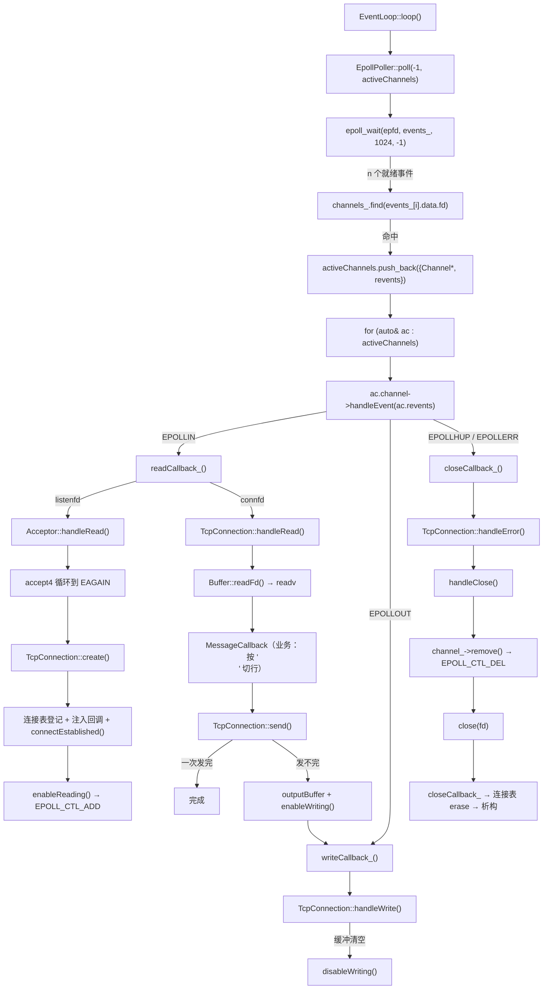
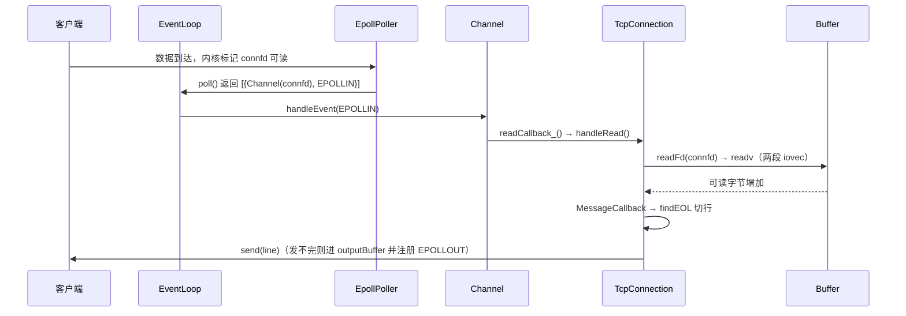
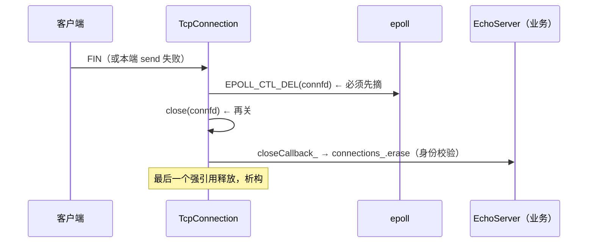

# 10 第一阶段总结
***
作者：abnb250/山中鹤鸣  
博客：https://www.cnblogs.com/abnb250  
交流群：1062464078 
[点击返回目录](https://www.cnblogs.com/abnb250/articles/23526793)

<br>

<br>

## 01 阶段描述
***
单线程Reactor重构

<br>

<br>

## 02 各模块总结
***
### 术语卡

词|定义
|---|---|
拥有（own）	|决定它何时析构，持 shared_ptr/unique_ptr
持有/借用（store/borrow）	|只存指针或 fd 数字，不负责释放
输入	|别人给它的（注入的依赖、外部方法调用、数据字节）
中间产物	|它自己系统调用拿到的（accept4 的 connfd、epoll_wait 的结果），归“做什么”
EPOLLIN / 可读	|有数据可读（或对端关闭）
EPOLLOUT / 可写	|发送缓冲区有空位，可以继续发

<br>

### EventLoop

**输入：**  
EpollPoller 的活跃事件列表；  
别人调 loop() / updateChannel() / removeChannel()  

**输出：**  
调 channel->handleEvent(revents)；  
把 Channel 转交给 EpollPoller 做 epoll_ctl  

**做什么：**  
服务器的死循环，驱动 poller_->poll(-1, activeChannels)，  
    每轮清空活跃列表；  
同时调度Channel和EpollPoller；  
获取EpollPoller给的活跃事件列表，  
    遍历列表，对每个Channel调handleEvent(revents)；  
获取Channel给的要添加/删除的channel，驱使Epollpoller负责添加/删除  

**不做什么：**  
不读数据、不认业务、不 close fd、不持有 Channel  

**设计细节：**
unique_ptr指向EpollPoller；  
poll 返回 EINTR 时不退出、直接重试。  


<br>

### EpollPoller

**输入：**  
EventLoop给的要添加/删除的channel；  
EventLoop给的超时时间；  
内核(epoll_wati)给的就绪事件fd和事件类型；  

**输出：**  
给EventLoop的活跃事件列表；  

**做什么：**  
封装epoll，管理epfd，维护fd查channel表；  
获取EventLoop给的channel，使用epoll_ctl()添加到/删除自 epoll；  
获取EventLoop给的超时时间，使用epoll_wait()等待就绪事件，  
    将就绪fd和事件类型添加到就绪事件列表。  


**不做什么：**  
不持有channel、不调业务回调、不读数据、不决定关心哪些事件  

**设计细节：**
使用有序红黑树(map)存fd查channel的表；  
将channel同步到epoll，自动判断ADD还是MOD；  
channel先从epfd摘掉，再从有序红黑树(map) erase  

<br>

### Channel

**输入：**  
服务器的loop，对应的fd；  
回调的function；  
已发生的事件  

**输出：**  
访问器，关心的事件类型；  
访问器，对应的fd；  

**做什么：**  
保存三个回调（read/write/close）；  
设置关心的事件类型；  
对已发生事件按revents 位分派到对应回调；  
驱使EventLoop安排epoll_ctl  

**不做什么：**   
不用有fd，不读数据，不碰epoll_ctl，不close fd  

**设计细节：**  
handleEvent()，回调先拷贝再分发，防止回调过程中自行析构；  
handleEvent(), 先读后写：读可能触发关闭，  
    写之前状态已变，所以必须分开判断”。  

<br>

### Acceptor

**输入：**  
所属loop，要监听的端口port；  
新连接回调；  
自己创建的socket()返回的监听fd；  
自己调用accept4()返回的connfd   


**输出：**  
监听fd、监听状态；  
把accept4()得到的connfd和对端地址peerAddr交给回调  

**做什么：**  
使用socket()请内核创建一个套接字，并返回监听fd；  
对监听fd进行bind、listen、set_nonblocking；  
设置新连接回调；  
让监听fd关心可读事件，由Channel安排同步到epfd；  
accept4()，并回调新连接回调，循环到EAGAIN  


**不做什么：**  
不读写、不注册connfd，不创建TcpConnection  

**设计细节：**  
监听fd有对应channel；  
使用unique_ptr指向acceptChannel；  
先reset acceptChannel，再close监听fd；  

<br>

### Buffer

**输入：**  
可读区要消费的字节长度；  
要写入可读区的内容起点位置和字节长度；  
要读入数据的fd；

**输出：**  
前置区大小、可读区大小、可写区大小；
可读区开头位置指针、指向'\n'的指针；  
读fd的可用数据实际读到的字节数；  
读fd的可用数据时的errno(上一次系统调用失败的原因编号)。  

**做什么：**  
维护一个char类型的vector作为输入输出缓存；  
使用两个下标维护缓存的前置区、可读区、可写区；  
告诉外界前置区、可读区、可写区的相关信息(大小、位置);  
把前 len 字节标记为已消费（只挪读下标，不搬内存）；  
向可写区写入从data位置长度len字节的内容(必要扩容)；  
从指定fd读入可用数据，可读字节数和errno传给上级。  

**不做什么：**  
不知道 fd 是什么语义、不决定消息边界、不 close 任何东西  

**设计细节：**  
确认要不要扩容时，能够通过移动来促使放入成功，就不扩容；  
内部区域移动/写入可写区 使用copy。

<br>

### TcpConnection

**输入：**  
所属的循环loop、已建立连接的已连接套接字fd、对端地址；  
收到消息时的回调、连接关闭时的回调；  
要发送给内核缓冲区的字符串data；  

**输出：**  
连接fd、连接状态、客户端地址(字符串)；  
传给业务端(messageCalback)的对自己临时强引用和buffer指针；  
向内核缓冲区发送得到的字符串data；  


**做什么：**  
设置收到消息的回调、连接关闭时的回调；  
设置连接fd对应channel的三个回调并设置channel关心可读；  
向内核发送字符串data；  
关闭连接，移除channel，close fd，调用关闭回调；  
    remove() → close(fd) → closeCallback() 顺序不可换；  
有错误时调用handleError，从socket取出内核记录的异步错误码再关闭  

**不做什么：**  
不认识 echo/登录等任何业务；不知道 listenfd 存在  

**设计细节：**
连接fd有对应channel；  
inputBuffer管理从内核读到的内容，ouputBuffer管理要给内核的内容；  
要send时，先判断buffer可读区，为空直接发给内核，  
    非空，追加到buffer，设置关心可写；  
使用弱指针的lock()来确定连接对象是否还活着；  
handleRead/handleWrite 开头  
    TcpConnectionPtr guard = shared_from_this()，  
    把对象钉到函数返回”；  
所有回调必须捕获 weak_ptr（shared_ptr 会循环引用，this 会 UAF）；  
sendInLoop 里 EAGAIN 不是错误，只有非 EAGAIN/EINTR 才 handleError；  
析构时先reset channel，再close 连接fd；  
close做成幂等的；  

<br>

<br>

## 03 一句话模型
***

一个线程、一个 `EventLoop`、一个 epoll 实例、N 条连接；**所有 fd 的所有事件，都在同一个线程里串行处理**。

<br>

<br>

## 04 模块职责与边界
***

| 模块 | 负责什么 | 明确不做什么 |
| --- | --- | --- |
| `EventLoop` | 驱动 `loop()`；持有 poller 与 fd→Channel 映射；`updateChannel/removeChannel` | 不存业务、不读数据、不认识 Acceptor |
| `EpollPoller` | 封装 `epoll_create1/epoll_ctl/epoll_wait`；把就绪 fd 反查成 `Channel*` | 不持有 `Channel`、不回调业务 |
| `Channel` | 「一个 fd + 我关心的事件 + 三类回调」的绑定 | 不 close fd、不读数据 |
| `Acceptor` | 建 listenfd、循环 `accept4`、把 connfd 交给上层 | 不创建连接对象、不读写 |
| `TcpConnection` | 一条连接的生命周期、读写、关闭；持有两块 Buffer | 不认业务协议 |
| `Buffer` | 每条连接私有的字节水池（读下标/写下标/预留头部） | 不知道 fd 是什么（只有 `readFd` 碰系统调用） |
| 业务（示例） | `MessageCallback` 里按 `\n` 切行、echo | 不碰 epoll、不碰 fd 关闭 |

<br>

<br>

## 05 一次事件的完整流转（7 步，务必背下来）
***

1. `EventLoop::loop()` 进入死循环，每轮先清空 `activeChannels`。
2. `EpollPoller::poll(-1, activeChannels)` → `epoll_wait(epfd, events_, 1024, -1)` **阻塞**。
3. 内核把就绪事件写进 `events_` 数组；`events_[i].data.fd` 就是当初 `epoll_ctl ADD` 时填的 fd。
4. `poll()` 用 `channels_.find(fd)` 反查 `Channel*`，把 `{Channel*, revents}` 塞进 `activeChannels`。
5. `EventLoop` 遍历 `activeChannels`，逐个 `channel->handleEvent(revents)`。
6. `Channel` 按位分派：`EPOLLHUP|EPOLLERR` → `closeCallback_`；`EPOLLIN|EPOLLPRI|EPOLLRDHUP` → `readCallback_`；`EPOLLOUT` → `writeCallback_`。
7. 回调是 lambda，按 fd 的来源分两种：**listenfd** → `Acceptor::handleRead`（accept4 循环）；**connfd** → `TcpConnection::handleRead`（`readFd` → `MessageCallback` → `send`）。

> 注意第 4 步：**反查发生在 poll() 里，不在 EventLoop 里**。这是很多人画图时画错的地方。

<br>

<br>

## 06 事件流转图
***



<br>

<br>

## 07 一次 echo 的时序（正常路径）
***



<br>

<br>

## 08 关闭时序（顺序固定，不许换）
***



顺序理由：`close` 之后 fd 号立即可被内核复用，此时再做 `DEL` 会摘掉**新连接**的注册。


<br>

<br>

## 09 背压（EPOLLOUT 的正确用法）
***

- `EPOLLOUT` **默认几乎一直就绪**（发送缓冲空就触发），所以只在“确实有数据发不出去”时才 `enableWriting()`。
- `send` 一次没发完 → 剩余字节进 `outputBuffer_` → 注册 `EPOLLOUT`。
- `handleWrite` 把缓冲发空 → **立刻** `disableWriting()`，否则 `epoll_wait` 立刻返回、空转烧 CPU。
- **业务顺序保证**：`outputBuffer_` 非空时不允许“直接 send”，新数据一律排队，防止乱序。

## 10 各文件代码
***

### EventLoop.h
```cpp
// =============================================================================
// EventLoop.h：事件循环——驱动 poller 拿到活跃 Channel，再分发给它们。
//
// 本文件组成（自上而下 4 块）：
//   A 头文件与命名空间 —— memory + 两个前向声明
//   B public 接口       —— 构造析构 / loop() / 增删 Channel
//   C private 数据      —— 唯一成员：poller_
//
// 【设计意图】EventLoop 只做调度，不存 fd、不存回调、不碰 epoll_ctl；
//   epoll 的细节关在 EpollPoller 里，事件的细节关在 Channel 里。
// =============================================================================
#pragma once
#include <memory>

namespace reactor{

// ---- 块 A：前向声明 ----
// 作用：poller_ 是 unique_ptr，析构在 .cpp 里，头文件只需前向声明。
class Channel;
class EpollPoller;

// ---- 块 B：public 接口 ----
// 作用：loop() 是死循环；update/remove 是 Channel 改完事件位后的唯一出口。
class EventLoop{
public:
    EventLoop();
    ~EventLoop();
    void loop();
    void updateChannel(Channel* channel);
    void removeChannel(Channel* channel);
private:
    // ---- 块 C：private 数据 ----
    // 作用：我拥有 poller，poller 拥有 epfd 和 fd→Channel 的反查表。
    std::unique_ptr<EpollPoller> poller_;
};

}//namespace reactor
```

<br>

### EventLoop.cpp
```cpp
// =============================================================================
// EventLoop.cpp：EventLoop 的实现，只有四件事——建 poller、等事件、分发、转发注册。
//
// 本文件组成（自上而下 4 块）：
//   A 头文件包含   —— 自身头 + Channel/EpollPoller 完整类型
//   B 构造 / 析构  —— 建一个 EpollPoller（epfd 在它构造里创建）
//   C loop()       —— 死循环：poll → 遍历活跃 Channel → handleEvent
//   D 转发函数     —— updateChannel / removeChannel 直接转给 poller
//
// 【设计意图】EventLoop 自己不碰 epoll_ctl，也不认识 Acceptor/TcpConnection；
//   只持有 poller 并遍历活跃列表，让"调度"和"多路复用"两件事各自独立。
// =============================================================================
#include "net/EventLoop.h"
#include "net/Channel.h"
#include "net/EpollPoller.h"
#include <iostream>

namespace reactor{

// ---- 块 B：构造 / 析构 ----
// 作用：构造时建 poller（顺带 epoll_create1）；析构时 unique_ptr 自动回收 epfd。
EventLoop::EventLoop() : poller_(std::make_unique<EpollPoller>()) {}
EventLoop::~EventLoop() = default;

// ---- 块 C：loop() 主循环 ----
// 作用：每轮清空活跃列表 → 阻塞在 poll → 把每个活跃 Channel 的事件分发出去。
// 【面试考点】fd→Channel 的反查发生在 poller_->poll() 里面，不在这个循环里；
//   这里只负责"遍历 + 调 handleEvent"，所以 EventLoop 不认识任何 fd。
void EventLoop::loop(){
    std::vector<ActiveChannel> activeChannels;
    while(true){
        activeChannels.clear();
        poller_->poll(-1, activeChannels);
        for(auto& ac : activeChannels){
            ac.channel->handleEvent(ac.revents);
        }
    }
}

// ---- 块 D：转发函数 ----
// 作用：Channel 改完 events_ 位只能经由这里落到 epoll，保证"改事件"只有一个出口。
void EventLoop::updateChannel(Channel* channel){
    poller_ -> updateChannel(channel);
}

void EventLoop::removeChannel(Channel* channel){
    poller_->removeChannel(channel);
}

}//namespace reactor
```

<br>

### EpollPoller.h
```cpp
// =============================================================================
// EpollPoller.h：epoll 的唯一封装——注册/更新/摘除 fd，等待并反查就绪 Channel。
//
// 本文件组成（自上而下 4 块）：
//   A 头文件与命名空间 —— epoll_event / vector / unordered_map
//   B ActiveChannel    —— poll() 的输出项：哪个 Channel + 发生了什么事件
//   C public 接口      —— 构造析构 / updateChannel / removeChannel / poll
//   D private 数据     —— epfd、events_ 落地缓冲、fd→Channel 反查表
//
// 【设计意图】全项目只有这里出现 epoll_ctl / epoll_wait；上层只交 Channel*，
//   由 poller 自己判断该 ADD 还是 MOD，调用方永远只调 updateChannel。
// =============================================================================
#pragma once
#include <cstdint>
#include <sys/epoll.h>
#include <vector>
#include <unordered_map>

namespace reactor{

// ---- 块 B：ActiveChannel ----
// 作用：poll() 返回时告诉 EventLoop"这个 Channel 上发生了什么事件"。
// 【设计意图】直接存 Channel* 而不是 fd，省掉 EventLoop 侧再做一次反查。
class Channel;
struct ActiveChannel{
    Channel* channel;
    uint32_t revents;
};

// ---- 块 C：public 接口 ----
// 作用：update/remove 是注册侧的入口，poll 是等待侧的入口。
class EpollPoller{
public:
    EpollPoller();
    ~EpollPoller();

    void updateChannel(Channel* channel);
    void removeChannel(Channel* channel);

    void poll(int timeoutMs, std::vector<ActiveChannel>& activeChannels);
private:
    // ---- 块 D：private 数据 ----
    // 作用：epfd 归我；events_ 是 epoll_wait 的落地缓冲；channels_ 是反查表。
    int epfd_;
    std::vector<epoll_event> events_;
    std::unordered_map<int, Channel*> channels_;
};

}//namespace reactor
```

<br>

### EpollPoller.cpp
```cpp
// =============================================================================
// EpollPoller.cpp：EpollPoller 的实现——建 epfd、同步事件、等事件、反查 Channel。
//
// 本文件组成（自上而下 4 块）：
//   A 头文件包含   —— 自身头 + Channel 完整定义 + 系统/标准库
//   B 构造 / 析构  —— epoll_create1 建 epfd；析构 close epfd
//   C update/remove —— 把关心事件写进/摘出 epoll，并维护 fd→Channel 映射
//   D poll()       —— epoll_wait + 反查 Channel + 填 activeChannels
//
// 【设计意图】updateChannel 自动判断 ADD/MOD，调用方不用记"这是第几次注册"；
//   摘除时先 EPOLL_CTL_DEL 再从表里 erase，顺序反了会留下悬空映射。
// =============================================================================
#include "net/Channel.h"
#include "net/EpollPoller.h"
#include <cstdio>
#include <cstdlib>
#include <unistd.h>
#include <cerrno>

namespace reactor{

static constexpr int kMaxEvents = 1024;

// ---- 块 B：构造 / 析构 ----
// 作用：构造建 epfd 并预分配事件数组；析构关 epfd。
EpollPoller::EpollPoller() : epfd_(epoll_create1(0)), events_(kMaxEvents){
    // 【常见坑】创建失败说明 fd 耗尽或内核不支持，教学项目直接崩，别带病运行。
    if(epfd_ < 0){
        perror("epoll_create1");
        std::abort();
    }
}

EpollPoller::~EpollPoller(){
    // 【设计意图】channels_ 里存的是 Channel*，不拥有、不 delete——谁创建谁负责。
    if(epfd_ >= 0) close(epfd_);
}

// ---- 块 C：updateChannel ----
// 作用：把 Channel 当前的 events_ 位同步给 epoll；首次注册走 ADD，之后走 MOD。
void EpollPoller::updateChannel(Channel* channel){
    int fd = channel->fd();
    epoll_event ev{};
    ev.events = channel->events();
    ev.data.fd= fd;

    auto it = channels_.find(fd);
    if(it == channels_.end()){
        if(epoll_ctl(epfd_, EPOLL_CTL_ADD, fd, &ev) < 0){
            perror("epoll_ctl add");
            return;
        }
        channels_[fd] = channel;
    }
    else{
        if(epoll_ctl(epfd_, EPOLL_CTL_MOD, fd, &ev) < 0){
            perror("epoll_ctl mod");
            return;
        }
    }
}

// ---- 块 C2：removeChannel ----
// 作用：把 fd 从 epoll 摘掉并删除映射；没登记过就直接返回，保证幂等。
// 【常见坑】必须先 DEL 再 erase；反过来一旦 DEL 失败就查不到 Channel 了。
void EpollPoller::removeChannel(Channel* channel){
    int fd = channel->fd();
    auto it = channels_.find(fd);
    if(it == channels_.end()) return;

    epoll_ctl(epfd_, EPOLL_CTL_DEL, fd, nullptr);
    channels_.erase(fd);
}

// ---- 块 D：poll ----
// 作用：阻塞等就绪事件，再按 data.fd 反查 Channel，装进 activeChannels 交给上层。
// 【面试考点】反查在这里发生：epoll_ctl 时把 fd 塞进 data.fd，epoll_wait 再拿它查表，
//   这是"内核只回 fd，用户态要找回对象"的标准做法。
void EpollPoller::poll(int timeoutMs, std::vector<ActiveChannel>& activeChannels){
    int n = epoll_wait(epfd_, events_.data(), static_cast<int>(events_.size()), timeoutMs);
    if(n < 0){
        // 【常见坑】EINTR 是"被信号打断"，不是错误，直接返回让上层重试。
        if(errno == EINTR) return;
        perror("epoll_wait");
        return;
    }
    for(int i = 0; i < n; i++){
        int fd = events_[i].data.fd;
        auto it = channels_.find(fd);
        if(it != channels_.end()){
            activeChannels.push_back({it->second, events_[i].events});
        }
    }
}

}
```

<br>

### Channel.h
```cpp
// =============================================================================
// Channel.h：一个 fd 的"事件登记簿"——关心什么事件、事件到了调谁。
//
// 本文件组成（自上而下 4 块）：
//   A 头文件与命名空间 —— epoll 常量 / cstdint / std::function
//   B 类型别名与接口   —— EventCallback / 构造析构 / 访问器 / 回调注入 / 事件位操作
//   C handleEvent      —— 按 revents 位分派到三类回调
//   D private 区       —— loop、fd（只借用）、events_、revents_、三个回调
//
// 【设计意图】Channel 只认"事件位 → 回调"，不认识监听/连接的差异；
//   业务差异全部由使用方注入的回调表达，Channel 自己不碰 epoll_ctl、也不 close fd。
// =============================================================================
#pragma once
#include <sys/epoll.h>
#include <cstdint>
#include <functional>

namespace reactor{

// ---- 块 A：前向声明 ----
// 作用：只存 EventLoop*，析构写在 .cpp 里，头文件前向声明即可。
class EventLoop;

// ---- 块 B：public 接口 ----
class Channel{
public:
    // ---- B1 类型别名 ----
    // 作用：回调不带参数——"谁"由闭包自己捕获，"发生了什么"由 Channel 内部判位。
    using EventCallback = std::function<void()>;

    // ---- B2 构造 / 析构 ----
    // 【常见坑】析构放在 .cpp：内部要调 loop_->removeChannel()，需要 EventLoop 完整类型。
    Channel(EventLoop* loop, int fd);
    ~Channel();

    // ---- B3 访问器 ----
    // 作用：fd 给 EpollPoller 注册用；events 给它读关心位；isWriting 判断要不要关 EPOLLOUT。
    int fd() const {return fd_;}
    uint32_t events() const {return events_;}
    bool isWriting() const {return (events_ & EPOLLOUT) != 0;}

    // ---- B4 回调注入 ----
    // 作用：三类事件各一个回调；没设的那个在 handleEvent 里会被判空跳过。
    void setReadCallback(EventCallback cb){readCallback_ = std::move(cb);}
    void setWriteCallback(EventCallback cb) {writeCallback_ = std::move(cb);}
    void setCloseCallback(EventCallback cb) {closeCallback_ = std::move(cb);}

    // ---- B5 事件位操作 ----
    // 作用：只改 events_ 的位，再 update() 同步给 epoll，调用方不必自己写位运算。
    void enableReading();
    void enableWriting();
    void disableWriting();
    void disableAll();

    // 作用：把自己从 epoll 摘掉（转交 EventLoop → EpollPoller 做 EPOLL_CTL_DEL）。
    void remove();

    // 作用：事件到了，按 revents 位分派（由 EventLoop 遍历活跃列表时调用）。
    void handleEvent(uint32_t revents);

private:
    // ---- 块 D：private 区 ----
    // D0 内部方法：把 events_ 同步给 EventLoop
    void update();

    // D1 环境与身份：loop 不拥有；fd 只借用，不负责 close
    EventLoop* loop_;
    int fd_;
    // D2 状态：events_ 是"我关心什么"，revents_ 是"实际发生了什么"
    uint32_t events_ = 0;
    uint32_t revents_ = 0;
    // D3 回调组
    EventCallback readCallback_;
    EventCallback writeCallback_;
    EventCallback closeCallback_;
};

}//namespace reactor
```

<br>

### Channel.cpp
```cpp
// =============================================================================
// Channel.cpp：Channel 的实现——事件位操作 + 事件分发。
//
// 本文件组成（自上而下 4 块）：
//   A 头文件包含   —— 自身头 + EventLoop.h（update/remove 要调它）
//   B 构造 / 析构  —— 绑定 loop 和 fd；析构时把自己从 epoll 摘掉
//   C 事件位操作   —— enableReading/enableWriting/disableWriting/disableAll + update/remove
//   D handleEvent  —— 按 revents 位分派到三类回调
//
// 【设计意图】Channel 从不直接触碰 epoll_ctl：改位 → update() → EventLoop → EpollPoller，
//   一路转交；这样"关心什么"和"怎么注册"彻底分开。
// =============================================================================
#include "net/Channel.h"
#include "net/EventLoop.h"

namespace reactor{

// ---- 块 B：构造 / 析构 ----
// 作用：构造只记 loop 和 fd；析构调 remove()，避免 fd 复用后事件投给已析构对象。
Channel::Channel(EventLoop* loop, int fd) : loop_(loop), fd_(fd) {}
Channel::~Channel() {remove(); }

// ---- 块 C：事件位操作 ----
// 作用：每个函数只做两件事——改 events_ 的位，再 update() 同步。
void Channel::enableReading(){
    events_ |= EPOLLIN;
    update();
}

void Channel::enableWriting(){
    events_ |= EPOLLOUT;
    update();
}

void Channel::disableWriting(){
    // 【常见坑】要先 & 再取反（&= ~EPOLLOUT），直接 ~ 会把其他位也清掉。
    events_ &= ~EPOLLOUT;
    update();
}

void Channel::disableAll(){
    events_ = 0;
    update();
}

// ---- 块 C2：update / remove ----
// 作用：把"改事件""摘注册"两件事转交给 EventLoop，Channel 不碰 epoll。
void Channel::update(){
    loop_->updateChannel(this);
}

void Channel::remove(){
    loop_->removeChannel(this);
}

// ---- 块 D：handleEvent ----
// 作用：把内核给的事件位翻译成三次函数调用。
void Channel::handleEvent(uint32_t revents){
    revents_ = revents;

    // 【面试考点】先把三个回调拷到局部，再分发。
    //   回调里可能把 Channel 自己析构（连接关闭 → 表里 erase → ~TcpConnection → ~Channel），
    //   若直接用成员分发，析构后访问的就是已释放内存；局部拷贝在栈上，仍然有效。
    EventCallback readCb = readCallback_;
    EventCallback writeCb = writeCallback_;
    EventCallback closeCb = closeCallback_;

    // 【常见坑】HUP/ERR 不需要注册也会被报告；优先处理并 return，
    //   不再对已坏的连接做 recv/send（同轮的可读数据会被丢弃，这是有意的）。
    if(revents & (EPOLLHUP | EPOLLERR)){
        if(closeCb) closeCb();
        return;
    }

    // 读优先：读可能触发关闭，改变连接状态，写分支随后自己会再判一次。
    if(revents & (EPOLLIN | EPOLLPRI | EPOLLRDHUP)){
        if(readCb) readCb();
    }

    if(revents & EPOLLOUT){
        if(writeCb) writeCb();
    }
}

}
```

<br>

### Acceptor.h
```cpp
// =============================================================================
// Acceptor.h：监听 fd 的管家——建监听 socket、循环 accept、把新连接交出去。
//
// 本文件组成（自上而下 3 块）：
//   A 头文件与命名空间 —— functional / memory / netinet
//   B public 接口       —— 构造析构 / 访问器 / 回调注入 / listen()
//   C private 区        —— handleRead + createListenFd + 五项数据
//
// 【设计意图】Acceptor 只负责"accept 出一个裸 fd"，不创建 TcpConnection、不读写；
//   连接对象长什么样由业务层决定，换业务时不用动接受连接的逻辑。
// =============================================================================
#pragma once
#include <functional>
#include <memory>
#include <netinet/in.h>

namespace reactor{

// ---- 块 A：前向声明 ----
// 作用：EventLoop* 和 unique_ptr<Channel> 都不需要完整类型，前向声明即可。
class EventLoop;
class Channel;

// ---- 块 B：public 接口 ----
class Acceptor{
public:
    // ---- B1 类型别名 ----
    // 【面试考点】传 sockaddr_in 而不是 std::string：热路径上不做字符串转换，零拷贝。
    using NewConnectionCallback = std::function<void(int sockfd, sockaddr_in& peerAddr)>;

    // ---- B2 构造 / 析构 ----
    // 作用：构造里建 listenfd 并包成 Channel；析构按"先摘 epoll 再 close"收尾。
    Acceptor(EventLoop* loop, int port);
    ~Acceptor();

    // ---- B3 访问器 ----
    int listenfd() const {return listenfd_;}
    bool listening() const {return listening_;}

    // ---- B4 回调注入与开关 ----
    void setNewConnectionCallback(NewConnectionCallback cb);

    // 作用：把 listenfd 注册进 epoll，开始接受连接（不调就是只听不接）。
    void listen();

private:
    // ---- 块 C：private 区 ----
    // C0 内部方法：listenfd 可读时被 Channel 回调，循环 accept4 到 EAGAIN。
    void handleRead();

    // C1 工具方法：socket/bind/listen/setNonBlocking 一条龙，返回非阻塞 listenfd。
    static int createListenFd(int port);

    // C2 环境组
    EventLoop* loop_;
    // C3 身份组
    int listenfd_;
    // C4 通道组：把 listenfd 包成 Channel，readCallback 指向 handleRead。
    std::unique_ptr<Channel> acceptChannel_;
    // C5 回调组
    NewConnectionCallback newConnectionCallback_;
    // C6 状态组
    bool listening_ = false;
};

}// namespace reactor
```

<br>

### Acceptor.cpp
```cpp
// =============================================================================
// Acceptor.cpp：Acceptor 的实现——工具函数 + 建监听 fd + 循环 accept。
//
// 本文件组成（自上而下 5 块）：
//   A 头文件包含     —— 自身头 + EventLoop/Channel + 系统调用头
//   B 工具函数       —— setNonBlocking
//   C createListenFd —— socket/bind/listen/非阻塞 一条龙
//   D 构造 / 析构    —— 建 listenfd、包 Channel、设 read 回调
//   E 行为实现       —— listen() + handleRead()（accept 循环）
//
// 【设计意图】handleRead 只做"accept4 到 EAGAIN + 把 connfd 交给回调"，
//   不创建连接对象、不读写——所以"接连接"这段代码在 Day10 之后可以完全不动。
// =============================================================================
#include "net/Acceptor.h"
#include "net/EventLoop.h"
#include "net/Channel.h"

#include <sys/socket.h>
#include <netinet/in.h>
#include <arpa/inet.h>
#include <fcntl.h>
#include <unistd.h>
#include <cerrno>
#include <cstdio>
#include <cstdlib>

namespace reactor{

// ---- 块 B：工具函数 ----
// 作用：给一个 fd 打上 O_NONBLOCK，失败返回 -1。
static int setNonBlocking(int fd){
    int flags = fcntl(fd, F_GETFL, 0);
    if(flags == -1) return -1;
    return fcntl(fd, F_SETFL, flags | O_NONBLOCK);
}

// ---- 块 C：createListenFd ----
// 作用：建监听 socket 并完成 bind/listen/非阻塞，返回可直接注册进 epoll 的 listenfd。
int Acceptor::createListenFd(int port){
    int listenfd = socket(AF_INET, SOCK_STREAM, 0);
    if(listenfd < 0){
        perror("socket");
        exit(1);
    }

    // 【常见坑】不加 SO_REUSEADDR，Ctrl+C 后立刻重启会报 Address already in use。
    int opt = 1;
    setsockopt(listenfd, SOL_SOCKET, SO_REUSEADDR, &opt, sizeof(opt));

    sockaddr_in addr{};
    addr.sin_family = AF_INET;
    addr.sin_addr.s_addr = htonl(INADDR_ANY);
    addr.sin_port = htons(port);

    if(bind(listenfd, (sockaddr*)& addr, sizeof(addr)) < 0){
        perror("bind");
        exit(1);
    }

    if(::listen(listenfd, SOMAXCONN) < 0){
        perror("listen");
        exit(1);
    }

    // 【常见坑】listenfd 必须非阻塞，否则 handleRead 的 accept 循环第一轮就卡死。
    if(setNonBlocking(listenfd) < 0){
        perror("setNonBlocking");
        exit(1);
    }

    return listenfd;
}

// ---- 块 D：构造 / 析构 ----
// 作用：构造时建 listenfd、包成 Channel、把读事件接到 handleRead。
Acceptor::Acceptor(EventLoop* loop, int port) : loop_(loop), 
    listenfd_(createListenFd(port)), 
    acceptChannel_(std::make_unique<Channel>(loop, listenfd_)) {

    // 【设计意图】lambda 捕获 this 安全：acceptChannel_ 是成员，Acceptor 一定比它活得久。
    acceptChannel_->setReadCallback( [this](){ handleRead(); } );
}

Acceptor::~Acceptor(){
    // 【常见坑】先 reset Channel（触发 EPOLL_CTL_DEL），再 close(listenfd_)；
    //   反过来 fd 号可能已被复用，DEL 就会摘错注册。
    acceptChannel_.reset();
    close(listenfd_);
}

// ---- 块 E2：setNewConnectionCallback ----
void Acceptor::setNewConnectionCallback(NewConnectionCallback cb){
    newConnectionCallback_ = std:: move(cb);
}

// ---- 块 E3：listen ----
// 作用：置位 listening_ 并把 listenfd 注册进 epoll（关心 EPOLLIN）。
void Acceptor::listen(){
    listening_ = true;
    acceptChannel_->enableReading();
}

// ---- 块 E4：handleRead ----
// 作用：listenfd 可读 = 至少有一个握手完成的连接，循环 accept4 直到 EAGAIN。
// 【面试考点】必须循环到底：一次 epoll_wait 只接一个，其余会在队列里堆积，
//   表现为"多开几个客户端，只有第一个有反应"。
void Acceptor::handleRead(){
    for(;;){
        sockaddr_in peer{};
        socklen_t len = sizeof(peer);

        // 【常见坑】accept 返回的新 fd 默认阻塞；accept4 直接带 NONBLOCK+CLOEXEC。
        int connfd = accept4(listenfd_, (sockaddr*)&peer, &len,
                            SOCK_NONBLOCK | SOCK_CLOEXEC);
        
        if(connfd < 0){
            if(errno == EAGAIN || errno == EWOULDBLOCK) break;   // 队列取完了，正常
            if(errno == EINTR) continue;                         // 信号打断，重试
            perror("accept4");
            break;
        }

        if(newConnectionCallback_){
            newConnectionCallback_(connfd, peer);
        }
        else{
            // 没人接就自己关，防止 fd 泄漏——养成习惯。
            close(connfd);
        }
    }
}

}// namespace reactor
```

<br>

### Buffer.h
```cpp
// =============================================================================
// Buffer.h：应用层字节缓冲区——每条连接自己的"字节水池"。
//
// 本文件组成（自上而下 6 块）：
//   A 头文件与命名空间 —— algorithm/cstddef/string/vector/cstring/sys/types
//   B 常量与构造       —— kCheapPrepend（头部预留）、kInitialSize（初始可写区）
//   C 容量查询与 peek  —— 三个水位 + 可读区首字节 + findEOL
//   D 消费与写入       —— retrieve / retrieveAll / append / ensureWritableBytes
//   E 从 fd 读         —— readFd（声明，实现放 .cpp）
//   F private 区       —— begin / makeSpace + 两个下标 + 一段内存
//
// 【设计意图】用「读下标 + 写下标」在同一块连续内存里划出可读、可写两段；
//   消费只动下标不搬内存，头部固定预留 8 字节给 Day17 的协议头。
// =============================================================================
#pragma once
#include <algorithm>
#include <cstddef>
#include <string>
#include <vector>
#include <cstring>
#include <sys/types.h>

namespace reactor{

// ---- 块 B：常量与构造 ----
class Buffer{
public:
    // 作用：kCheapPrepend 是头部预留（8 字节），kInitialSize 是初始可写区（1KB）。
    static constexpr size_t kCheapPrepend = 8;
    static constexpr size_t kInitialSize = 1024;

    // 【设计意图】两个下标都从 kCheapPrepend 起步，前面那 8 字节永远空着给协议头。
    explicit Buffer(size_t initialSize = kInitialSize) : 
        buffer_(kCheapPrepend + initialSize), 
        readerIndex_(kCheapPrepend), 
        writerIndex_(kCheapPrepend) {}

    // ---- 块 C：容量查询与 peek ----
    // 作用：分别回答"可读多少 / 还能写多少 / 前面能挤出多少 / 可读区从哪开始"。
    size_t readableBytes () const {return writerIndex_ - readerIndex_; }
    size_t writableBytes () const {return buffer_.size() - writerIndex_; }
    size_t prependableBytes () const {return readerIndex_; }

    // 作用：指向可读区首字节，不拷贝。
    const char* peek () const {return begin() + readerIndex_; }

    // 作用：在可读区里找第一个 '\n'，找到返回指向它的指针，找不到返回 nullptr。
    // 【常见坑】返回的是指向内部 vector 的指针：append / resize 之后立刻失效，
    //   必须"拿到就算出长度、立刻 retrieve"，不能存起来跨调用用。
    const char* findEOL() const{
        return static_cast<const char*>(std::memchr(peek(), '\n',
                                        readableBytes() ) );
    }

    //// ---- 块 D：消费与写入 ----
    // 作用：吃掉 len 字节（只挪读下标，字节还在内存里）。
    // 【常见坑】len 超过可读量时不会报错，而是直接把可读区清空，
    //   所以解析协议前必须先看 readableBytes()。
    void retrieve(size_t len){
        if(len < readableBytes()) readerIndex_ += len;
        else retrieveAll();
    }

    // 作用：清空可读区，两个下标一起回到 kCheapPrepend。
    void retrieveAll(){
        readerIndex_ = writerIndex_ = kCheapPrepend;
    }

    // 作用：整体取出成 string 并清空（Day8 的整块 echo 用过，Day9 起按行处理）。
    std::string retrieveAllAsString(){
        std::string s(peek(), readableBytes());
        retrieveAll();
        return s;
    }

    // 作用：保证可写区至少 len 字节，不够先 makeSpace。
    void ensureWritableBytes(size_t len){
        if(writableBytes() < len) makeSpace(len);
    }

    // 作用：可写区起始地址、以及"刚写入了 len 字节"后推进写下标。
    char* beginWrite() {return begin() + writerIndex_; }
    void hasWritten(size_t len) {writerIndex_ += len; }

    // 作用：把 data 的 len 字节追加到可读区末尾（不是覆盖）。
    void append(const char* data, size_t len){
        ensureWritableBytes(len);
        std::copy(data, data + len, beginWrite());
        hasWritten(len);
    }

    // 作用：Buffer 唯一碰系统调用的地方——一次 readv 把内核数据读进可写区。
    ssize_t readFd(int fd, int* savedErrno);
    ////

private:
    // ---- 块 F：private 区 ----
    // 作用：begin 给内部用；makeSpace 负责"先搬移、搬不动才扩容"。
    char* begin() {return buffer_.data(); }
    const char* begin() const {return buffer_.data(); }

    // 【面试考点】先 compact 再 resize：把可读区搬到 kCheapPrepend 处复用头部空间，
    //   实在放不下才扩容——这是长连接不把内存吃爆的关键。
    void makeSpace(size_t len){
        if(prependableBytes() + writableBytes() < len + kCheapPrepend){
            buffer_.resize(writerIndex_ + len);
        }
        else{
            size_t readable = readableBytes();
            std::copy(begin() + readerIndex_, begin() + writerIndex_, begin() + kCheapPrepend);
            readerIndex_ = kCheapPrepend;
            writerIndex_ = readerIndex_ + readable;
        }
    }

    // 数据：一段内存 + 两个下标
    std::vector<char> buffer_;
    size_t readerIndex_;
    size_t writerIndex_;
};

}//namespace reactor
```

<br>

### Buffer.cpp
```cpp
// =============================================================================
// Buffer.cpp：Buffer 的唯一非内联实现——readFd。
//
// 本文件组成（自上而下 2 块）：
//   A 头文件包含 —— 自身头 + <sys/uio.h>（readv）+ <cerrno>
//   B readFd()   —— 两段式读取：先填 Buffer 可写区，溢出部分落 64KB 栈缓冲再 append
//
// 【设计意图】"recv 到临时数组再 memcpy 进 Buffer"是两次拷贝；
//   readv 让内核直接写进 Buffer 的可写区，装不下的才走第二段，热路径只多一次必要 append。
// =============================================================================
#include "base/Buffer.h"
#include <sys/uio.h>
#include <cerrno>

namespace reactor{

ssize_t Buffer::readFd(int fd, int* savedErrno){
    // ---- 块 B1：准备两段 iovec ----
    // 作用：第一段是 Buffer 剩余可写区，第二段是栈上兜底区，防止一次来 10KB 时丢包。
    char extrabuf[65536];
    size_t writable = writableBytes();
    iovec vec[2];
    vec[0].iov_base = begin() + writerIndex_;
    vec[0].iov_len = writable;
    vec[1].iov_base = extrabuf;
    vec[1].iov_len = sizeof(extrabuf);

    // 【设计意图】可写区已经 >= 64KB 时只给一段，省掉无意义的第二段。
    size_t iovcnt = (writable < sizeof(extrabuf)) ? 2 : 1;

    // ---- 块 B2：readv + 同步下标 ----
    ssize_t n = ::readv(fd, vec, iovcnt);
    if(n < 0){
        // 【常见坑】失败时把 errno 存进出参，因为 errno 是全局的，函数返回后随时会被覆盖。
        *savedErrno = errno;
    }
    else if(static_cast<size_t>(n) <= writable){
        // 数据全落在 Buffer 里：只需推进写下标，一次拷贝都没有。
        writerIndex_ += static_cast<size_t>(n);
    }
    else{
        // 【常见坑】n > writable 说明第二段也用上了：先把写指针推到末尾，
        //   再把溢出部分 append 进来（顺序反了会把已有数据覆盖掉）。
        writerIndex_ = buffer_.size();
        append(extrabuf, static_cast<size_t>(n) - writable);
    }

    return n;
}

}//namespace reactor;
```

<br>

### TcpConnection.h
```cpp
// =============================================================================
// TcpConnection.h：一条已建立 TCP 连接的对象化表示——收发、缓冲、关闭。
//
// 本文件组成（自上而下 5 块）：
//   A 头文件与命名空间   —— Buffer + functional/memory/netinet/string/utility
//   B 前向声明           —— EventLoop / Channel 只出现指针
//   C public 接口        —— 类型别名 / 工厂 / 生命周期 / 访问器 / 回调注入 / 行为
//   D private 方法       —— 五个 handleXxx + sendInLoop
//   E private 数据       —— 环境 / 身份 / 通道 / 双缓冲 / 状态 / 回调
//
// 【设计意图】TcpConnection 只负责"一条连接"的收发与关闭，业务（echo、登录、匹配）
//   一律通过 MessageCallback 上报，库代码里不出现任何业务；对象由 shared_ptr 持有，
//   注册到 Channel 的回调一律持 weak_ptr，切断"成员持有宿主"的循环引用。
// =============================================================================
#pragma once

#include "base/Buffer.h"

#include <functional>
#include <memory>
#include <netinet/in.h>
#include <string>
#include <utility>

namespace reactor{

// ---- 块 B：前向声明 ----
// 作用：channel_ 是 unique_ptr<Channel>，析构放 .cpp，头文件前向声明即可。
class EventLoop;
class Channel;


// ---- 块 C：public 接口 ----
class TcpConnection : public std::enable_shared_from_this<TcpConnection>{
public:
    // ---- C1 类型别名 ----
    // 【面试考点】MessageCallback 传 Buffer* 而不是 string，避免每次收包都拷贝一份字节。
    using TcpConnectionPtr = std::shared_ptr<TcpConnection>;
    using MessageCallback = std::function<void(const TcpConnectionPtr&, Buffer*)>;
    using CloseCallback = std::function<void(const TcpConnectionPtr&)>;

    // ---- C2 工厂 ----
    // 【设计意图】唯一的正规创建方式：必须让 shared_ptr 接管，
    //   shared_from_this()/weak_from_this() 否则返回空。
    static TcpConnectionPtr create(EventLoop* loop, int sockfd, const sockaddr_in& peerAddr);

    // ---- C3 生命周期 ----
    TcpConnection(EventLoop* loop, int sockfd, const sockaddr_in& peerAddr);
    ~TcpConnection();

    // ---- C4 访问器 ----
    int fd() const {return fd_; };
    bool connected () const {return connected_; }
    const std::string& peerAddrString () const {return peerAddrStr_; }

    // ---- C5 回调注入 ----
    // 作用：业务只注入这两个；Channel 的三个回调由 connectEstablished 内部设好。
    void setMessageCallback(MessageCallback cb) {messageCallback_ = std::move(cb); }
    void setCloseCallback(CloseCallback cb) {closeCallback_ = std::move(cb); }

    // ---- C6 行为 ----
    // 作用：connectEstablished 设 weak_ptr 回调并注册可读；
    //       send 发不完就进 outputBuffer 等 EPOLLOUT；shutdown 主动关闭且幂等。
    void connectEstablished();
    void send(const std::string& data);
    void shutdown();

private:
    // ---- 块 D：private 方法 ----
    // 作用：五个 handleXxx 对应 Channel 的三类回调，sendInLoop 是发送的真正实现。
    void handleRead();
    void handleWrite();
    void handleError();
    void handleClose();
    void sendInLoop(const char* data, size_t len);

    // ---- 块 E：private 数据 ----
    // E1 环境组：只持指针，不拥有
    EventLoop* loop_;
    // E2 身份组：fd 归我所有；peerAddrStr_ 只用于日志
    int fd_;
    // E3 通道组：fd 的事件登记簿
    std::unique_ptr<Channel> channel_;

    // E4 缓冲组：读侧内核→业务，写侧业务→内核（发不完的暂存）
    Buffer inputBuffer_;
    Buffer outputBuffer_;

    // E5 回调组
    MessageCallback messageCallback_;
    CloseCallback closeCallback_;

    // E6 状态组
    // 【常见坑】closed_ 防重复关闭；fdClosed_ 防重复 close；两个都要，职责不同。
    bool closed_ = false;
    bool connected_ = false;
    bool fdClosed_ = false;

    std::string peerAddrStr_;
};

}//namespace reactor
```

<br>

### TcpConnection.cpp
```cpp
// =============================================================================
// TcpConnection.cpp：连接生命周期 + 读写 + 关闭。
//
// 本文件组成（自上而下 8 块）：
//   A 头文件与别名   —— 自身头 + EventLoop/Channel + 系统调用
//   B 工厂/构造/析构 —— make_shared / 地址字符串 / 先摘 epoll 再兜底 close
//   C connectEstablished —— weak_ptr 回调 + 注册读事件
//   D shutdown       —— 主动关闭，先拿 guard 再走统一关闭路径
//   E handleRead     —— readFd → messageCallback；n==0 是对端 FIN
//   F send/sendInLoop —— 直接发 + 发不完进 outputBuffer 并挂 EPOLLOUT
//   G handleWrite    —— 把 outputBuffer 发完，发空立刻关 EPOLLOUT
//   H handleError / handleClose —— 取 SO_ERROR 后按 DEL→close→回调 收尾
//
// 【设计意图】关闭顺序钉死为"DEL → close → 回调"，配合 closed_/fdClosed_ 双标志，
//   无论 recv=0、EPOLLHUP、send 出错还是上层主动 shutdown，都只关一次、只摘一次。
// =============================================================================
#include "net/TcpConnection.h"
#include "net/EventLoop.h"
#include "net/Channel.h"

#include <arpa/inet.h>
#include <sys/socket.h>
#include <unistd.h>
#include <cerrno>
#include <cstdio>
#include <cstring>

namespace reactor{

using TcpConnectionPtr = std::shared_ptr<TcpConnection>;
using MessageCallback = std::function<void(const TcpConnection&, Buffer*)>;
using CloseCallback = std::function<void(const TcpConnection&)>;

// ---- 块 B：工厂 / 构造 / 析构 ----

TcpConnectionPtr TcpConnection::create(EventLoop* loop, int sockfd, const sockaddr_in& peerAddr){
    // 【设计意图】必须走 make_shared：shared_from_this()/weak_from_this() 只认 shared_ptr 的所有权。
    return std::make_shared<TcpConnection>(loop, sockfd, peerAddr);
}

TcpConnection::TcpConnection(EventLoop* loop, int sockfd, const sockaddr_in& peerAddr) : 
    loop_(loop), 
    fd_(sockfd),
    channel_(std::make_unique<Channel>(loop, sockfd)) {

    // 作用：把 sockaddr_in 转成 "ip:port" 字符串，只用于日志。
    // 【常见坑】这里不能设 Channel 回调：此刻对象还没被 shared_ptr 接管，
    //   weak_from_this() 是空的，回调里 lock() 永远失败。回调统一放 connectEstablished()。
    char ip[INET_ADDRSTRLEN] = {0};
    inet_ntop(AF_INET, &peerAddr.sin_addr, ip, sizeof(ip));
    peerAddrStr_ = std::string(ip) + ":" + std::to_string(ntohs(peerAddr.sin_port));
}

TcpConnection::~TcpConnection(){
    // 【设计意图】先把 Channel 从 epoll 摘掉，再兜底 close，顺序不能反：
    //   先 close 的话 fd 可能已被内核复用，DEL 就会摘掉别的连接。
    channel_.reset();
    if(!fdClosed_){
        // 【常见坑】正常路径都先经 handleClose 再析构；走到这里说明有遗漏，
        //   不静默兜底了事，直接喊出来——多线程下这种遗漏会变成 fd 耗尽。
        fprintf(stderr, "[BUG] ~TcpConnection fd=%d destoryed without handleClose\n", fd_);
        ::close(fd_);
        fdClosed_ = true;
    }
    fprintf(stderr, "[day8] ~TcpConnection fd=%d destoryed \n", fd_);
}

// ---- 块 C：connectEstablished ----
// 作用：置 connected_、把三个 Channel 回调设好、注册可读事件。
void TcpConnection::connectEstablished(){
    connected_ = true;
    std::weak_ptr<TcpConnection> weak = weak_from_this();

    // 【面试考点】三处回调全部捕获 weak_ptr，而不是 this / shared_ptr：
    //   捕获 this  → 对象先死、事件后到 → UAF；
    //   捕获 shared_ptr → Channel 是成员、闭包反过来持有宿主 → 循环引用，永远不析构。
    channel_->setReadCallback([weak](){
        if(auto conn = weak.lock()) conn->handleRead();
    });
    channel_->setWriteCallback([weak](){
        if(auto conn = weak.lock()) conn->handleWrite();
    });
    channel_->setCloseCallback([weak](){
        if(auto conn = weak.lock()) conn->handleError();
    });

    channel_->enableReading();
}

// ---- 块 D：shutdown ----
// 作用：上层主动断开；幂等，重复调用只生效一次。
void TcpConnection::shutdown(){
    // 【设计意图】先补一个强引用：关闭过程会通知上层 erase，不能让自己在函数中途析构。
    TcpConnectionPtr guard = shared_from_this();
    if(connected_) handleClose();
}

// ---- 块 E：handleRead ----
// 作用：把内核数据读进 inputBuffer_，再交给业务回调；n==0 表示对端有序关闭。
void TcpConnection::handleRead(){
    // 【设计意图】把对象钉到本函数返回：回调里可能一条链关掉自己，
    //   没有这个 guard，回调返回后访问 inputBuffer_ 就是 UAF。
    TcpConnectionPtr guard = shared_from_this();

    int savedErrno = 0;
    ssize_t n = inputBuffer_.readFd(fd_, &savedErrno);
    if(n > 0){
        // 再补一个临时强引用：即使业务回调里把连接从表里 erase，对象也活到回调返回。
        if(messageCallback_) messageCallback_(shared_from_this(), &inputBuffer_);
    }
    else if(n == 0){
        // 对端发了 FIN：这是"有序关闭"，不是错误。
        handleClose();
    }
    else{
        // 【常见坑】非阻塞 fd 没数据时返回 -1 且 errno=EAGAIN，这是正常的，直接返回。
        if(savedErrno == EAGAIN || savedErrno == EWOULDBLOCK || savedErrno == EINTR) return;
        handleError();
    }
}
//
// ---- 块 F：send / sendInLoop ----
void TcpConnection::send(const std::string& data){
    if(!connected_) return;
    // 【设计意图】单线程直接在本线程发；Day13 会改成 runInLoop 投递到连接所属 EventLoop。
    sendInLoop(data.data(), data.size());
}

void TcpConnection::sendInLoop(const char* data, size_t len){
    if(!connected_ || closed_) return;

    ssize_t nwrote = 0;
    // 【设计意图】outputBuffer 为空才允许"直接 send"（快路径）；
    //   否则一律排队，保证字节顺序，防止新数据插到未发完的旧数据前面。
    if(outputBuffer_.readableBytes() == 0){
        nwrote = ::send(fd_, data, len, MSG_NOSIGNAL);
        if(nwrote < 0){
            nwrote = 0;
            // 【常见坑】这里应写成"errno 不等于 EAGAIN/EWOULDBLOCK/EINTR 时才算真错误"；
            //   写成"!= || != || !=" 会恒为真，导致每次 send 失败都误关连接。
            if(errno != EAGAIN && errno != EWOULDBLOCK && errno != EINTR){
                handleError();
                return;
            }
        }
    }

    // 【常见坑】send 不保证一次发完：剩下的必须进 outputBuffer 并注册 EPOLLOUT。
    if(static_cast<size_t>(nwrote) < len){
        outputBuffer_.append(data + nwrote, len - static_cast<size_t>(nwrote));
        // isWriting() 判一下：已经注册过就别重复 epoll_ctl MOD。
        if(!channel_->isWriting()) channel_->enableWriting();
    }

}
//
// ---- 块 G：handleWrite ----
// 作用：对端可读后把 outputBuffer_ 尽量发完；发空立刻摘掉 EPOLLOUT。
void TcpConnection::handleWrite(){
    TcpConnectionPtr guard = shared_from_this();

    if(outputBuffer_.readableBytes() == 0){
        channel_->disableWriting();
        return;
    }

    ssize_t n = ::send(fd_, outputBuffer_.peek(), outputBuffer_.readableBytes(),
                        MSG_NOSIGNAL);
    if(n > 0){
        outputBuffer_.retrieve(static_cast<size_t>(n));
        if(outputBuffer_.readableBytes() == 0){
            // 【面试考点】发完立刻摘掉 EPOLLOUT：发送缓冲空 => EPOLLOUT 一直就绪，
            //   不 disable 就是 EventLoop 空转烧 CPU。
            channel_->disableWriting();
        }
    }
    else if(n < 0){
        // 【常见坑】EAGAIN/EWOULDBLOCK/EINTR 是"这次没发出去"，不是错误，
        //   应保留 EPOLLOUT 等下一轮；只有其他 errno 才该 handleError。
        if(errno != EAGAIN && errno != EWOULDBLOCK && errno != EINTR)
            handleError();
    }
}

// ---- 块 H：handleError / handleClose ----
// 作用：先查出内核挂着的错误码打日志，再统一走 handleClose。
void TcpConnection::handleError() {
    int err = 0;
    socklen_t len = sizeof(err);
    // 【面试考点】epoll 只告诉你 fd 出问题了，具体原因要问 SO_ERROR（读一次即清除）。
    ::getsockopt(fd_, SOL_SOCKET, SO_ERROR, &err, &len);
    if(err != 0){
        fprintf(stderr, "fd = %d socket error %s\n", fd_, std::strerror(err));
    }
    handleClose();
}

void TcpConnection::handleClose(){
    // 【常见坑】EPOLLIN(recv=0) 与 EPOLLHUP 可能同轮到达；没有这个 guard 就是 double close。
    if(closed_) return;
    closed_ = true;
    connected_ = false;

    // 【设计意图】关闭三步，顺序固定：从 epoll 摘除 → close(fd) → 通知上层 erase。
    channel_->remove();

    if(!fdClosed_){
        ::close(fd_);
        fdClosed_ = true;
    }

    if(closeCallback_) closeCallback_(shared_from_this());
}

}//namespace reactor;
```

<br>

### echo_reactor.cpp
```cpp
// =============================================================================
// echo_reactor.cpp：业务示例——Acceptor 接连接，TcpConnection 管收发，echo 只活在回调里。
//
// 本文件组成（自上而下 6 块）：
//   A 头文件与类型别名 —— Reactor 三件套 + 容器 / 信号
//   B EchoServer 类     —— 持有 Acceptor、连接表、累计统计
//   C 新连接处理        —— create / 登记 / 注入两个回调 / connectEstablished
//   D 读业务            —— 按 '\n' 切行、逐行回显、支持 "quit"
//   E 关闭路径          —— 按 shared_ptr 身份校验后 erase
//   F main 装配         —— 忽略 SIGPIPE + 起 loop + 跑起来
//
// 【设计意图】连接管理（C/E）与业务（D）彻底分离：库代码不认识 echo，业务不认识 epoll；
//   Day17 换成长度前缀协议时，只改 D 块里的切分条件，其余一行不动。
// =============================================================================
#include "net/EventLoop.h"
#include "net/Acceptor.h"
#include "net/TcpConnection.h"
#include "base/Buffer.h"

#include <netinet/in.h>
#include <signal.h>

#include <cstddef>
#include <cstdio>
#include <map>
#include <memory>
#include <string>

namespace {

// ---- 块 A：类型别名 ----
using TcpConnectionPtr = reactor::TcpConnection::TcpConnectionPtr;

// ---- 块 B：EchoServer ----
class EchoServer{
public:
    EchoServer(reactor::EventLoop* loop, int port) :
        loop_(loop), port_(port), acceptor_(loop, port) {

        // 【设计意图】捕获 this 安全：acceptor_ 是成员，EchoServer 一定比它活得久。
        acceptor_.setNewConnectionCallback(
            [this](int connfd, const sockaddr_in& peerAddr){
                onNewConnection(connfd, peerAddr);
            }
        );
    }

    // 作用：打印监听地址并把 listenfd 注册进 epoll，开始接受连接。
    void start(){
        std::printf("[echo] listening on 0.0.0.0:%d, listenfd=%d\n", 
                    port_, acceptor_.listenfd());
        acceptor_.listen();
    }

private:
    // ---- 块 C：新连接处理 ----
    void onNewConnection(int connfd, const sockaddr_in& peerAddr){
        TcpConnectionPtr conn = reactor::TcpConnection::create(loop_, connfd, peerAddr);
        printf("[echo] new connection fd=%d from %s\n", connfd, 
            conn->peerAddrString().c_str());

        // 【设计意图】连接表是唯一强引用持有者：erase 即析构，生命周期一目了然。
        connections_[connfd] = conn;
        ++totalAccepted_;

        conn->setMessageCallback(
            [this](const TcpConnectionPtr& c, reactor::Buffer* buf){
                handleMessage(c, buf);
            }
        );

        conn->setCloseCallback(
            [this](const TcpConnectionPtr& c){
                handleClose(c);
            }
        );

        // 【常见坑】必须最后调：它负责设 weak_ptr 回调 + enableReading。
        conn->connectEstablished();

        std::printf("[echo] +fd=%d peer=%s allive=%zu total=%zu\n", connfd,
                    conn->peerAddrString().c_str(), connections_.size(), 
                    totalAccepted_);
    }

    // ---- 块 D：读业务（本文件唯一有业务的地方） ----
    // 作用：从 Buffer 里按 '\n' 切出完整行，逐行处理；切不出完整行的留在 Buffer 等下次可读。
    void handleMessage(const TcpConnectionPtr conn, reactor::Buffer* buf){
        // 【面试考点】循环条件同时看 connected_：一次 readv 可能带来多条命令，
        //   前面的命令已经要求断开时，后面的必须不再处理。
        while(conn->connected() && buf->readableBytes() > 0){
            const char* eol = buf->findEOL();
            if(eol == nullptr) break;      // 半包：一行都没凑齐，等下一次可读事件

            const size_t len = static_cast<size_t>(eol - buf->peek()) + 1;   // 含 '\n'
            const std::string line(buf->peek(), len);
            buf->retrieve(len);            // 只吃掉这一行，剩下的留给下一行

            if(line == "quit\n"){
                std::printf("[echo] fd=%d asked to quit\n", conn->fd());
                conn->shutdown();          // 走统一关闭路径，不在回调里自己 close(fd)
                return;                    // shutdown 之后立刻退出，别再碰 buf
            }

            ++linesEchoed_;
            conn->send(line);              // 原样回显这一行
        }   
    }

    // ---- 块 E：关闭路径 ----
    void handleClose(const TcpConnectionPtr conn){
        // 【常见坑】不能直接 erase(conn->fd())：此刻 fd 已经 close，可能被复用给新连接，
        //   一擦就删掉别人的登记项。用 shared_ptr 身份校验：只有表里存的就是这个对象才删。
        auto it = connections_.find(conn->fd());
        if(it != connections_.end() && it -> second == conn){
            connections_.erase(it);
        }
        std::printf("[echo] -fd=%d closed alive=%zu total=%zu lines=%zu\n", conn->fd(),
                    connections_.size(), totalAccepted_, linesEchoed_);
    }

    // ---- 块 B2：数据 ----
    reactor::EventLoop* loop_;                      // 不拥有
    int port_;                                      // 只用于日志
    reactor::Acceptor acceptor_;                    // 成员，随 EchoServer 析构
    std::map<int, TcpConnectionPtr> connections_;   // fd → 连接，唯一强引用
    size_t totalAccepted_ = 0;
    size_t linesEchoed_ = 0;

};

}// namespace

// ---- 块 F：main 装配 ----
int main(){
    // 【常见坑】不忽略 SIGPIPE，对端先关时 send 会直接杀进程。
    signal(SIGPIPE, SIG_IGN);

    reactor::EventLoop loop;
    EchoServer server(&loop, 8888);
    server.start();
    loop.loop();   // 死循环，Ctrl+C 退出

    return 0;
}


```

<br>

<br>

<br>

<br>

<br>

<br>

<br>

<br>

