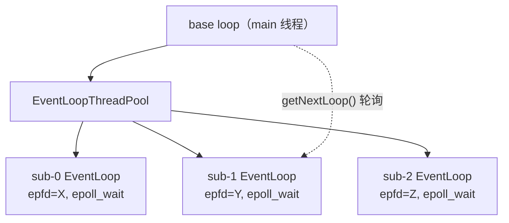

# 12 Day11：EventLoopThread + sub EventLoop
***
作者：abnb250/山中鹤鸣  
博客：https://www.cnblogs.com/abnb250  
交流群：1062464078 
[点击返回目录](https://www.cnblogs.com/abnb250/articles/23526793)

<br>

<br>

## 第十一天任务描述
***
- 实现 `EventLoopThread`：sub Reactor 线程
- 启动多个 sub EventLoop
- 每个 sub EventLoop 独立跑 `epoll_wait`

**验收**

- 多个 sub EventLoop 能启动并运行
- 主线程能管理 sub EventLoop 生命周期

<br>

<br>

## 小节一：给 EventLoop 认主人——线程身份 + 能退出的循环
***
### 1.1 本节最小必要理论（危机推演式）

**先承认一个事实：你现在的 `EventLoop` 是没有主人的。**

Day 9 的 `EventLoop` 长这样：构造函数建 `EpollPoller`，`loop()` 里 `while(true)` 调 `poller_->poll(-1, ...)`。它默认“全世界只有一根线程会用我”，所以内部一个锁都没有——`channels_` 是 `unordered_map`，`events_` 是 `vector`，`activeChannels` 是临时数组。这在单线程下是**正确且高效**的，不是偷懒。

今天你要把它交给 N 根线程。于是问题来了：**如果同一个 `EventLoop` 被两根线程碰到，会发生什么？**

- 线程 A 在 `EpollPoller::updateChannel` 里往 `channels_` 插一个新 fd，触发 rehash；
- 线程 B 同时 `epoll_wait` 返回，在 `channels_.find(fd)` 里遍历同一个桶链；
- B 读到的 `Channel*` 可能是 A 写到一半的旧内存。

结果不是“偶发 bug”，是**随机崩溃 + 数据错乱**，而且 ASan 抓不到——因为它不是 use-after-free，是纯粹的数据竞争。你会在 Day 12 花三天时间怀疑内核、怀疑 epoll、怀疑编译器。

**那要不要给 `EventLoop` 加锁？不要。** 加锁意味着每次 `epoll_wait` 返回、每个事件分发都要抢锁，你把一个“单线程串行模型”硬改成了“多线程共享模型”，复杂度爆掉，还不一定对。

正确的做法是 muduo 走的那条路：**一个 `EventLoop` 只属于一根线程，谁碰它谁就是错，而且必须当场死。** 这不是性能优化，这是**契约**。契约要有执行手段：

| 手段 | 用途 |
| --- | --- |
| `isInLoopThread()` | 给 `if` 用：需要判断“现在能不能直接改连接状态” |
| `assertInLoopThread()` | 给“绝不允许发生”的地方用：违约直接 `abort`，附上 epfd 和两个线程 id |

**第二个必须今天解决的问题：循环怎么退出。**

现在的 `loop()` 是 `while(true)`，唯一的退出方式是 `Ctrl+C` 把整个进程打死。但主线程要“管理 sub loop 生命周期”，第一含义就是：**能叫停、能等它退干净、能 join**。`std::thread` 对象在析构时如果还 `joinable()`，标准库直接 `std::terminate`——你的服务器退出时会以“莫名其妙的 abort”收场。

为什么不用 `pthread_cancel`？它会把线程杀死在**任意一条指令中间**：可能正持着锁、正写到 Buffer 一半、正在 `epoll_ctl`。锁永远不释放，`join` 永远等不到，析构函数永远不跑。**线程只能自愿退休**：置一个退出标志，让它自己跑到循环条件处结束。

但这里有个物理事实：**`epoll_wait` 阻塞在内核里，你不叫醒它，它不会自己回来看你的标志。** 标准解法是 `eventfd`——Day 13 的任务。今天先付代价：把 `poll` 的超时从 `-1` 改成 `1000` 毫秒，也就是**最多 1 秒检查一次退出标志**。

> 这笔债要记清楚：延迟最多 1 秒、空闲时每秒醒一次（CPU 可忽略）。Day 13 用 `eventfd` 把超时改回 `-1` 的那一刻，就是这笔债的还款日。

**为什么 `quit_` 用 `std::atomic<bool>` 而不是加锁？** 写方是主线程、读方是 loop 线程，要么一把锁、要么一个原子。每轮循环都要拿一次锁太贵，而这里只需要“最终可见”，不需要任何顺序保证，`memory_order_relaxed` 就够了。

<br>

### 1.2 代码实现与设计意图

**替换 `include/net/EventLoop.h`：**

```cpp
// =============================================================================
// EventLoop.h：事件循环——调度者 + 线程身份 + 退出开关。
//
// 本文件组成（自上而下 4 块）：
//   A 头文件      —— memory / thread / atomic
//   B 前向声明    —— Channel / EpollPoller（完整类型只在 .cpp 里需要）
//   C public 接口 —— loop / quit / update / remove / 线程身份 / epfd 观测
//   D private 数据—— poller、owner 线程 id、退出标志、运行标志
//
// 【设计意图】从今天起 EventLoop 不只是"跑 epoll_wait 的对象"，它还是
//   "某一根线程的专属资产"：threadId_ 在构造线程写下，任何跨线程调用当场 abort。
//   今天不引入任何锁——"一个 loop 一根线程"是设计前提，不是性能妥协。
// =============================================================================
#pragma once

#include <atomic>
#include <memory>
#include <thread>

namespace reactor{

class Channel;
class EpollPoller;

class EventLoop{
public:
    EventLoop();
    ~EventLoop();

    // ---- 块 C1：主循环与退出 ----
    // 作用：loop() 死循环到 quit() 为止；quit() 只置标志，任何线程都可以调。
    void loop();
    void quit();

    // ---- 块 C2：注册转发 ----
    // 作用：Channel 改完事件位后的唯一出口；今天起它们只接受 owner 线程调用。
    void updateChannel(Channel* channel);
    void removeChannel(Channel* channel);

    // ---- 块 C3：线程身份 ----
    // 【面试考点】isInLoopThread 是"契约查询"，assertInLoopThread 是"违约即死"。
    //   前者给 if 用，后者给"绝不允许发生"的地方用。
    // get_id返回当前正在执行的这根线程的唯一标识（std::thread::id）
    //   EventLoop 就是用它记下“我是被哪根线程构造出来的”
    bool isInLoopThread() const { return threadId_ == std::this_thread::get_id(); }
    void assertInLoopThread() const;

    // ---- 块 C4：观测 ----
    // 作用：只给日志和测试看，业务代码不许拿它去调 epoll_ctl。
    int epfd() const;

private:
    std::unique_ptr<EpollPoller> poller_;
    const std::thread::id threadId_;   // 构造线程 = owner，之后永不变
    std::atomic<bool> quit_;           // atomic(原子类型)提供了不可分割的读写操作：
    bool looping_ = false;             // 只在 owner 线程读写
};

}//namespace reactor
```

**替换 `src/net/EventLoop.cpp`：**

```cpp
// =============================================================================
// EventLoop.cpp：建 poller、认线程、等事件、分发、退出。
//
// 本文件组成（自上而下 6 块）：
//   A 头文件与常量 —— Channel/EpollPoller 完整类型；kPollTimeoutMs
//   B 构造 / 析构  —— 建 poller，把 owner 线程 id 钉死
//   C loop()       —— 断言线程 → poll → 分发 → 看退出标志
//   D quit()       —— 只置原子标志，任何线程可调
//   E 转发函数     —— updateChannel / removeChannel（各自先断言 owner）
//   F 身份与观测   —— assertInLoopThread / epfd
//
// 【设计意图】退出用"标志 + 超时"而不是 pthread_cancel：
//   今天先欠一个"最多 1s 的退出延迟"，Day 13 用 eventfd 唤醒 epoll_wait 把这笔债还掉。
// =============================================================================
#include "net/EventLoop.h"

#include "net/Channel.h"
#include "net/EpollPoller.h"

#include <cstdio>
#include <cstdlib>
#include <iostream>
#include <vector>

namespace reactor{

// ---- 块 A：常量 ----
// 作用：epoll_wait 的等待上限，它直接决定 quit() 之后线程多久能退出。
static constexpr int kPollTimeoutMs = 1000;

// ---- 块 B：构造 / 析构 ----
// 作用：建 poller（顺带 epoll_create1），把"我是谁"钉在这一刻的线程上。
EventLoop::EventLoop()
    : poller_(std::make_unique<EpollPoller>()),
      threadId_(std::this_thread::get_id()),
      quit_(false) {}

EventLoop::~EventLoop() = default;

// ---- 块 C：loop() ----
void EventLoop::loop(){
    // 【常见坑】这一行必须是第一句：所有"跨线程跑 loop"的写法都在这里当场暴露，
    //   而不是半小时后变成 channels_ 被两根线程同时改的随机崩溃。
    assertInLoopThread();
    looping_ = true;

    std::vector<ActiveChannel> activeChannels;
    // 读出原子变量 quit_ 的当前值，再对该值取反
    // memory_order_relaxed：这次读取本身是原子的，不会读到写了一半的数据
    while(!quit_.load(std::memory_order_relaxed)){
        activeChannels.clear();
        poller_->poll(kPollTimeoutMs, activeChannels);
        for(auto& ac : activeChannels){
            ac.channel->handleEvent(ac.revents);
        }
    }
    looping_ = false;
}

// ---- 块 D：quit() ----
// 【设计意图】只置标志，不做任何同步等待：调用方随后 join，
//   由 owner 线程自己跑到循环条件处退出——这才是"线程自愿退休"。
void EventLoop::quit(){
    quit_.store(true, std::memory_order_relaxed);
}

// ---- 块 E：转发函数 ----
// 作用： Channel 改完 events_ 位只能经由这里落到 epoll；写错线程立刻 abort。
void EventLoop::updateChannel(Channel* channel){
    assertInLoopThread();
    poller_->updateChannel(channel);
}

void EventLoop::removeChannel(Channel* channel){
    assertInLoopThread();
    poller_->removeChannel(channel);
}

// ---- 块 F：身份与观测 ----
// 作用：把"谁在错误线程碰了我"打进终端，然后 abort——比随机崩溃好查一百倍。
void EventLoop::assertInLoopThread() const {
    if(isInLoopThread()) return;
    std::fprintf(stderr, "[FATAL] EventLoop(epfd=%d) used from wrong thread\n", epfd());
    // 出错误和诊断信息的标准错误流，它默认输出到终端，不做缓冲
    std::cerr << "        current : " << std::this_thread::get_id()
              << "\n        owner   : " << threadId_ << std::endl;
    std::abort();
}

int EventLoop::epfd() const {
    return poller_->epfd();
}

}//namespace reactor
```

**`include/net/EpollPoller.h` 的 public 区补一行访问器：**

```cpp
    // ---- 块 C5：观测 ----
    // 作用：给日志/测试证明"每个 sub loop 有自己的 epoll 实例"用。
    int epfd() const {return epfd_;}
```

<br>

### 1.3 现象追踪与验证（如何证明跑通了）

**第一步：编译并做回归，Day 9 的功能一行都不能坏**

```bash
cmake -S . -B build
cmake --build build -j4
./build/bin/echo_reactor
```

**预期**：`[echo] listening on 0.0.0.0:8888, listenfd=3`，`nc` echo 一切照旧。

**第二步：让“超时”这个改动在系统调用里现形**

```bash
strace -f -e trace=epoll_wait -o /tmp/el.strace ./build/bin/echo_reactor
# 另开终端敲几个 nc，然后 Ctrl+C 掉服务端
grep 'epoll_wait' /tmp/el.strace | tail -5
```

**预期**：

```text
epoll_wait(4, [], 1024, 1000) = 0     ← 空转一轮：超时返回 0
epoll_wait(4, [], 1024, 1000) = 0
epoll_wait(4, [{events=EPOLLIN, data={u32=3,...}}], 1024, 1000) = 1
```

**看到什么就说明什么**：最后一个参数从 Day 9 的 `-1` 变成了 `1000`。你亲眼看到的就是“今天欠下的债”——空闲时每秒醒一次，退出最多延迟 1 秒。键盘上敲的 `Ctrl+C` 才是现在的退出方式，这不是验收，这只是还没崩。

**第三步：让线程身份在代码里说话**

在 `echo_reactor.cpp` 的 `main` 里 `loop.loop()` 之前临时插两行探针（看完删）：

```cpp
    std::printf("[diag] main isInLoopThread=%d\n", loop.isInLoopThread() ? 1 : 0);
    std::printf("[diag] main tid=%lu\n", static_cast<unsigned long>(::pthread_self()));
```

再把 `echo_reactor.cpp` 换成用一个临时 `std::thread` 去碰这个 loop（记得 `#include <thread>`，只用来验证，别提交）：

```cpp
    // 临时：故意在错误线程碰 loop
    std::thread bad([&loop]{ loop.updateChannel(nullptr); });
    bad.join();
```

**预期**：

```text
[diag] main isInLoopThread=1
        （另一个线程里）
[FATAL] EventLoop(epfd=4) used from wrong thread
        current : 140523...（子线程 id）
        owner   : 140523...（主线程 id）
Aborted (core dumped)          ← exit code 134
```

**看到什么就说明什么**：`isInLoopThread` 在主线程里是 `1`；换到子线程立刻变成“契约违约”，程序**在第一次越界时**就死了，而不是三天后死在某个 `unordered_map` 里。这两行日志就是 Day 12 的护身符。

**第四步：确认没有引入 CPU 空转**

```bash
./build/bin/echo_reactor &
top -p $! -b -n1 | head -8
```

**预期**：CPU ≈ 0%。如果每秒醒一次就烧掉几十个点 CPU，说明你在超时后面还写了别的轮询（比如 `while` 里自己 `sleep`）——回去查 `loop()`。

<br>

### 1.4 面试表达话术

**面试官问**：“多线程 Reactor 里，你怎么保证一个连接不会被两个线程同时操作？”

**你回答**：“靠**归属契约**，不靠锁。一个 `EventLoop` 只能由构造它的那根线程使用，我在 `EventLoop` 里存了构造时的 `thread::id`，提供 `isInLoopThread()` 做查询、`assertInLoopThread()` 做‘违约即 abort’，并且把它放在 `loop()` 第一行和 `updateChannel/removeChannel` 的入口。这样任何跨线程直接操作连接或注册事件的写法，会在第一次发生时当场死掉并打印 epfd 与两个线程 id，而不是变成随机崩溃。之所以不加锁，是因为整个 Reactor 的正确性建立在‘一条连接只属于一个 loop、事件串行处理’这个前提上；一旦引入共享状态加锁，就会层层加锁、死锁，复杂度远大于收益。跨线程确实需要传递动作时，走的是投递而不是共享——`runInLoop` + `eventfd`，把任务塞进目标 loop 自己的队列，由它的 owner 线程执行。另一个相关设计是退出：线程不能 `pthread_cancel`，只能置退出标志让它自愿退休，而 `epoll_wait` 阻塞在内核里不会自己回来看标志，所以要么用超时（我第一版用 1 秒超时，最大退出延迟 1 秒），要么用 `eventfd` 唤醒——后者是最终方案。”

<br>

<br>

## 小节二：EventLoopThread——让线程自己造自己的 loop
***
### 2.1 本节最小必要理论（危机推演式）

**如果你按直觉写，第一版一定是这样，而且一定跑不起来：**

```cpp
reactor::EventLoop loop;                 // 主线程构造
std::thread t([&]{ loop.loop(); });      // 子线程去跑
```

它会在 `loop()` 第一行直接 abort。因为 `threadId_` 记的是**主线程**，而你现在在子线程里——上一节刚立的契约立刻生效。

这不叫“assert 写太严”，这叫**你违反了 EventLoop 的身份定义**：`threadId_` 的语义是“谁在跑我”，而你是在“谁造我”的时候写的。想让它对上，只有一条路：**在将要跑它的那根线程里构造它。**

所以 `EventLoopThread` 这个类存在的唯一理由就是：**把“造 loop”和“跑 loop”放到同一根线程里，只把指针交给外面。**

**第二个坑：主线程怎么知道它准备好了？**

如果 `startLoop()` 只是 `thread_ = std::thread(...);` 然后立刻返回，主线程拿到的可能是 `nullptr`；更糟的是“指针已赋值但线程还没进 `epoll_wait`”。Day 12 主线程一 `accept` 就要把 connfd 注册到某个 sub loop——此时 `poller_->updateChannel` 在跑，而 sub loop 的 `loop()` 还没开始，两边对 `poller_` 的访问没有 happens-before，又是一个数据竞争。

**不能 `sleep(100ms)`。** 机器慢就偶发失败，机器快就白等，测试里是抖动，生产里是 bug。正确做法是把“就绪”变成一个**可等待的条件**：`mutex + condition_variable`，谓词就是 `loop_ != nullptr`。`startLoop` 返回时，意味着“sub 线程已经构造好 EventLoop、跑完初始化回调、马上进入 `loop()`”，主线程可以放心把活交给它。

**第三个坑：`EventLoop` 对象放哪？**

答案：**放在 `threadFunc` 的栈上**。它必须活到 `loop()` 返回为止；一旦提前析构，`EpollPoller` 的 epfd 就关了，主线程手里的指针变成野指针。放成员、放堆、放 `shared_ptr` 都可以，但都必须遵守同一条：**生命周期由 sub 线程控制，主线程只借指针。**

**第四个坑：怎么停？**

顺序钉死：`quit()`（置标志）→ `join()`（等线程退出）。不 `join` 就析构 `std::thread` = `std::terminate`。`detach()` 更糟：主线程继续往下走甚至退出，sub loop 还在跑，摸到已经析构的对象，崩在程序生命周期的最后一刻——这种崩溃最难查，因为栈里全是析构函数。

另外把 `quit()` 和 `join()` **拆成两个函数**，不要合成一个 `stopLoop()` 就完事。理由在下一节：池子要“先全部 quit，再全部 join”，把 N 个 1 秒的等待压成 1 个。

<br>

### 2.2 代码实现与设计意图

**新建 `include/net/EventLoopThread.h`：**

```cpp
// =============================================================================
// EventLoopThread.h：一条"自带 EventLoop"的线程——启动即就绪，停止即可 join。
//
// 本文件组成（自上而下 3 块）：
//   A 头文件与命名空间 —— condition_variable / functional / mutex / thread
//   B public 接口       —— startLoop / quit / join / stopLoop / name；禁拷贝
//   C private 数据      —— 线程对象、锁、条件变量、loop 指针、状态位
//
// 【设计意图】EventLoop 只能在"将要跑它的线程"里构造，所以创建权必须收归本类：
//   主线程只拿 EventLoop*，绝不 new 一个再塞给线程——那样 threadId_ 从第一天就是错的。
// =============================================================================
#pragma once

#include <condition_variable>
#include <functional>
#include <mutex>
#include <string>
#include <thread>

namespace reactor{

class EventLoop;

class EventLoopThread{
public:
    // ---- 块 B1：初始化回调 ----
    // 作用：在 sub 线程、loop() 之前执行，用来在"正确的线程里"做初始化（建 Channel 等）。
    using ThreadInitCallback = std::function<void(EventLoop*)>;

    explicit EventLoopThread(std::string name = "sub");
    ~EventLoopThread();

    // ---- 块 B2：禁拷贝 ----
    // 【常见坑】持有 mutex / thread / cv，拷贝语义无法定义，显式 delete 把错误挡在编译期。
    EventLoopThread(const EventLoopThread&) = delete;
    EventLoopThread& operator=(const EventLoopThread&) = delete;

    // ---- 块 B3：启动 ----
    // 作用：拉起线程并阻塞到 loop 就绪，返回 owner 线程里的那个 EventLoop*。
    // 【常见坑】返回 nullptr 只有一种情况：线程还没就绪就退了（初始化回调里抛异常）。
    EventLoop* startLoop(ThreadInitCallback cb = ThreadInitCallback());

    // ---- 块 B4：停止 ----
    // quit() 只是通知；join() 才是等待；stopLoop() = 两者，幂等。
    // 【设计意图】拆开是为了让池能"先全部 quit，再全部 join"，把 N 秒退出压成 1 秒。
    void quit();
    void join();
    void stopLoop();

    const std::string& name() const {return name_;}

private:
    void threadFunc(ThreadInitCallback cb);

    const std::string name_;
    std::thread thread_;
    std::mutex mutex_;              // 保护 loop_ / exited_：主线程与 sub 线程共享的两个字段
    std::condition_variable cv_;    // "loop 已就绪" / "线程已退出" 的铃铛
    EventLoop* loop_ = nullptr;     // 只在 sub 线程里构造，主线程只读
    bool started_ = false;
    bool exited_ = false;
};

}//namespace reactor
```

**新建 `src/net/EventLoopThread.cpp`：**

```cpp
// =============================================================================
// EventLoopThread.cpp：创建线程 → 子线程里造 EventLoop → 发布"就绪" → 跑循环 → 收尾。
//
// 本文件组成（自上而下 4 块）：
//   A 构造 / 析构  —— 记名字；析构兜底 stopLoop，绝不留 joinable 的 std::thread
//   B startLoop    —— 起线程 + 等"就绪"信号，返回 EventLoop*
//   C threadFunc   —— 线程名、栈上 EventLoop、初始化回调、发布、loop()、撤销发布
//   D quit / join  —— 分开的两步，供池并行关停
//
// 【设计意图】"就绪"用 mutex + condition_variable 表达，不用 sleep：
//   谓词 loop_ != nullptr 就是"主线程可以安全使用它"的充要条件。
// =============================================================================
#include "net/EventLoopThread.h"

#include "net/EventLoop.h"

#include <pthread.h>
#include <cstdio>
#include <utility>

namespace reactor{

// ---- 块 A：构造 / 析构 ----
EventLoopThread::EventLoopThread(std::string name) : name_(std::move(name)){
    if(name_.empty()) name_ = "sub";
}

EventLoopThread::~EventLoopThread(){
    stopLoop();
}

// ---- 块 B：startLoop ----
// 【常见坑】创建线程与等待"就绪"共用同一把锁：子线程发布 loop_ 也要拿这把锁，
//   所以主线程不可能错过那个 notify_one（经典的"丢失唤醒"）。
EventLoop* EventLoopThread::startLoop(ThreadInitCallback cb){
    std::unique_lock<std::mutex> lock(mutex_);
    if(started_) return loop_;
    started_ = true;
    thread_ = std::thread(&EventLoopThread::threadFunc, this, std::move(cb));
    cv_.wait(lock, [this]{ return loop_ != nullptr || exited_; });
    return loop_;
}

// ---- 块 C：threadFunc ----
void EventLoopThread::threadFunc(ThreadInitCallback cb){
    // ---- 子块 C1：线程名 ----
    // 作用：让 top -H / gdb info threads 里能一眼认出 sub-0 / sub-1 / sub-2。
    // 【常见坑】Linux 线程名上限 16 字节（含 '\0'），超了内核会截断，这里自己截到 15。
    std::string tname = name_;
    if(tname.size() > 15) tname.resize(15);
    ::pthread_setname_np(::pthread_self(), tname.c_str());

    // ---- 子块 C2：EventLoop 必须在这里构造 ----
    // 【面试考点】threadId_ 在构造时写下。在主线程 new 再交给本线程，
    //   本函数刚进 loop() 就会被 assertInLoopThread 拦下——"谁构造，谁拥有"。
    EventLoop loop;

    // ---- 子块 C3：初始化回调 ----
    // 作用：在 loop 线程里做"必须在正确线程完成"的准备工作（测试探针、Day 12 的 Acceptor 等）。
    if(cb){
        try{
            cb(&loop);
        }catch(...){
            // 【常见坑】异常逃出线程函数 = std::terminate，整个进程没了。
            std::fprintf(stderr, "[loopthread:%s] init callback threw\n", name_.c_str());
        }
    }

    // ---- 子块 C4：发布"就绪" ----
    // 作用：主线程 wait 的谓词就是 loop_ != nullptr，这一块是它唯一能醒来的原因。
    {
        std::lock_guard<std::mutex> lock(mutex_);
        loop_ = &loop;
    }
    cv_.notify_one();

    // ---- 子块 C5：跑循环，直到 quit() ----
    loop.loop();

    // ---- 子块 C6：撤销发布 ----
    // 作用：让还在等它的主线程知道"这个指针从此不可用"，也避免 quit 打到已析构对象。
    {
        std::lock_guard<std::mutex> lock(mutex_);
        loop_ = nullptr;
        exited_ = true;
    }
    cv_.notify_one();
}

// ---- 块 D：quit / join ----
void EventLoopThread::quit(){
    EventLoop* loop = nullptr;
    {
        std::lock_guard<std::mutex> lock(mutex_);
        loop = loop_;
    }
    // 【设计意图】锁外调用：虽然 quit() 只是 atomic store，但"持锁时不做任何可能回调的事"
    //   这条纪律从今天立起，Day 13 的 queueInLoop 会严格照做。
    if(loop) loop->quit();
}

void EventLoopThread::join(){
    if(thread_.joinable()) thread_.join();
}

void EventLoopThread::stopLoop(){
    quit();
    join();
}

}//namespace reactor
```

**`CMakeLists.txt` 追加：**

```cmake
# ---- 块 E1：EventLoopThread.cpp 入 reactor_net ----
add_library(reactor_net
    src/base/Buffer.cpp
    src/base/ThreadPool.cpp
    src/net/Channel.cpp
    src/net/EpollPoller.cpp
    src/net/EventLoop.cpp
    src/net/Acceptor.cpp
    src/net/TcpConnection.cpp
    src/net/EventLoopThread.cpp      # ← 新增
)

# ---- 块 E2：Day 11 单 loop 验证程序 ----
add_executable(day11_loopthread_test examples/day11_loopthread_test.cpp)
target_link_libraries(day11_loopthread_test PRIVATE reactor_net)
```

**新建 `examples/day11_loopthread_test.cpp`：**

```cpp
// =============================================================================
// day11_loopthread_test.cpp：一根 sub 线程的最小验收——起得来、认得出、停得掉。
//
// 本文件组成（自上而下 5 块）：
//   A 头文件与计时    —— EventLoopThread + steady_clock
//   B 起线程          —— startLoop + 初始化回调里打印 tid / epfd / 线程身份
//   C 让 epoll 真跑   —— 主线程睡 1.2s，足够 sub loop 的 1000ms 超时返回一次
//   D 停线程          —— 计时 stopLoop，用退出码判定
//   E（可选）--wrong-thread：故意从主线程碰 sub loop，演示 assert 当场引爆
//
// 【设计意图】不接 socket：今天只证明"线程 + epoll 实例 + 退出路径"三件事成立，
//   真实的连接分发是 Day 12 的事，别提前把两天的 bug 混在一起。
// =============================================================================
#include "net/EventLoop.h"
#include "net/EventLoopThread.h"

#include <chrono>
#include <cstdio>
#include <cstring>
#include <pthread.h>
#include <thread>

// ---- 块 A：计时 ----
static long long nowMs(){
    using namespace std::chrono;
    return duration_cast<milliseconds>(steady_clock::now().time_since_epoch()).count();
}

int main(int argc, char** argv){
    const bool wrongThreadDemo = (argc > 1 && std::strcmp(argv[1], "--wrong-thread") == 0);

    std::printf("[main] tid=%lu\n", static_cast<unsigned long>(::pthread_self()));

    // ---- 块 B：起线程 ----
    reactor::EventLoopThread sub("sub-0");
    reactor::EventLoop* loop = sub.startLoop([](reactor::EventLoop* l){
        // 这个 lambda 在 sub 线程里执行：它看到的 tid / epfd 才是"那个线程的视角"。
        std::printf("[sub ] tid=%lu epfd=%d isInLoopThread=%d\n",
                    static_cast<unsigned long>(::pthread_self()),
                    l->epfd(), l->isInLoopThread() ? 1 : 0);
    });

    if(loop == nullptr){
        std::printf("[FAIL] startLoop returned nullptr\n");
        return 1;
    }

    // ---- 块 C：给 epoll_wait 至少一次超时返回的机会 ----
    std::this_thread::sleep_for(std::chrono::milliseconds(1200));

    // ---- 块 E：错误线程访问，当场 abort（只有显式加参数才会走到） ----
    if(wrongThreadDemo){
        std::printf("[demo] touching sub loop from main thread...\n");
        std::fflush(stdout);
        loop->updateChannel(nullptr);   // ← 这一行会被 assertInLoopThread 拦下
        std::printf("[FAIL] wrong-thread access was NOT detected\n");
        return 2;
    }

    // ---- 块 D：停 ----
    const long long t0 = nowMs();
    sub.stopLoop();
    const long long stopMs = nowMs() - t0;

    std::printf("[main] stopLoop took %lldms (expect <=1200)\n", stopMs);
    const bool ok = (stopMs <= 1200);
    std::printf("[main] result=%s\n", ok ? "PASS" : "FAIL");
    return ok ? 0 : 1;
}
```

<br>

### 2.3 现象追踪与验证（如何证明跑通了）

**第一步：编译**

```bash
cmake -S . -B build
cmake --build build -j4
```

**预期**：0 warning、0 error。若报 `undefined reference to pthread_create`，是 Day 10 的 `Threads::Threads` 没写成 `PUBLIC`。

**第二步：正面跑一遍**

```bash
./build/bin/day11_loopthread_test; echo "exit=$?"
```

**预期**：

```text
[main] tid=139872341000000
[sub ] tid=139872332609280 epfd=4 isInLoopThread=1   ← tid 与 main 不同；epfd 是子线程新建的；身份对得上
[main] stopLoop took ~1000ms        ← quit 之后最多等一个 poll 超时
[main] result=PASS
exit=0
```

**四条判据**：

| 输出 | 说明什么 |
| --- | --- |
| `[sub]` 的 tid ≠ `[main]` 的 tid | 真的起了一根新线程 |
| `epfd=4` | 子线程里真的建了自己的 epoll 实例 |
| `isInLoopThread=1` | EventLoop 的 owner 就是正在跑它的线程 |
| `stopLoop took ~1000ms` | 退出走的是"超时后发现标志"，不是 `Ctrl+C`，也不是 cancel |

**第三步：数线程，别用眼睛猜**

```bash
./build/bin/day11_loopthread_test &
pid=$!
sleep 0.5
ls /proc/$pid/task | wc -l          # 预期：2（main + sub）
ps -L -o pid,tid,comm -p $pid       # 预期：看到 sub-0 这个名字
wait
```

**看到什么就说明什么**：`/proc/<pid>/task` 里两个目录 = 两根线程；`comm` 列出现 `sub-0` = `pthread_setname_np` 生效。Day 14 压测 CPU 飙高时，这两个名字就是你能定位到具体线程的唯一线索。

**第四步：用 strace 看见“新线程 + 新 epoll + 阻塞等待”**

```bash
strace -f -e trace=clone,clone3,epoll_create1,epoll_wait -o /tmp/lt.strace \
       ./build/bin/day11_loopthread_test
grep -c 'epoll_create1' /tmp/lt.strace     # 预期：1（本例没有 base loop，只有 sub 那一个）
grep 'epoll_wait' /tmp/lt.strace | tail -3
```

**预期**（节选）：

```text
... clone3(...) = 139872332609280
... epoll_create1(0) = 4
... epoll_wait(4, [], 1024, 1000) = 0
... epoll_wait(4, [], 1024, 1000) = 0
```

**看到什么就说明什么**：`clone3` 和 `epoll_create1` 发生在**同一个子线程**里（行首的 pid 一样），这就是“造 loop 和跑 loop 在同一根线程”的物理证据；`epoll_wait(..., 1000)` 说明这条线程真的在内核里等事件，而不是空转。

**第五步：故意越界，看契约怎么杀人**

```bash
./build/bin/day11_loopthread_test --wrong-thread; echo "exit=$?"
```

**预期**：

```text
[demo] touching sub loop from main thread...
[FATAL] EventLoop(epfd=4) used from wrong thread
        current : 139872341000000
        owner   : 139872332609280
Aborted (core dumped)
exit=134
```

**看到什么就说明什么**：主线程碰了 sub 线程的 loop，程序在**这一行**就死了，并明确告诉你“当前线程”和“owner 线程”是两个不同的 id。对比一下：如果没有这道断言，这个错误会在 Day 12 变成“某条连接偶发丢数据”，你会在 epoll 文档里找一整天。

**第六步：把这颗雷写进 debug-log**

```bash
cat >> docs/debug-log.md <<'EOF'
## Day 11: EventLoop 在主线程构造、在子线程运行，第一行就 abort

### 现象
按直觉写了 EventLoop loop; std::thread t([&]{ loop.loop(); });
线程一启动就打印
[FATAL] EventLoop(epfd=4) used from wrong thread
并 Aborted (core dumped)。
把 assertInLoopThread() 临时注释掉之后程序"能跑"，但几秒后随机崩溃，
栈顶在 EpollPoller::poll 的 channels_.find。

### 定位
EventLoop 的 threadId_ 在构造函数里写下，等于"谁构造它"。
在主线程构造、子线程运行，isInLoopThread() 恒为 false。
注释掉断言后，两件事同时发生：
1) 主线程拿着 loop_ 指针去 updateChannel（Day 12 的分发逻辑会这么做）；
2) 子线程在 channels_ 里 find。
unordered_map 被两根线程同时读写，插入触发 rehash 时读到半截指针，随机崩溃。

### 修复
1) EventLoopThread::threadFunc 里在**子线程栈上**构造 EventLoop，主线程只拿指针；
2) startLoop 用 mutex + condition_variable 等"loop_ 已发布"再返回，杜绝 main 拿到空/半初始化指针；
3) assertInLoopThread 保留在 loop() 第一行与 update/removeChannel 入口，作为长期契约；
4) 退出用 quit() 置原子标志 + poll 超时 1000ms，join 在置位之后，绝不 pthread_cancel。

### 验证
day11_loopthread_test 中 [sub] tid 与 [main] tid 不同、isInLoopThread=1；
--wrong-thread 模式稳定 abort 且打印两个线程 id；
strace 显示 clone3 与 epoll_create1 在同一线程；
stopLoop 约 1000ms 返回，进程 exit=0。
EOF
```

<br>

### 2.4 面试表达话术

**面试官问**：“你的 sub Reactor 线程是怎么封装的？启动和退出怎么保证不出问题？”

**你回答**：“封装成 `EventLoopThread`，核心设计是三条。第一，**EventLoop 在子线程的栈上构造**，不是主线程 new 好了塞进去——因为 EventLoop 的线程身份是在构造时确定的，`threadId_` 就记在那一刻；放在主线程构造，`loop()` 第一行的 `assertInLoopThread` 就会 abort，这也是我对‘归属契约’的执行手段。第二，`startLoop()` 会**阻塞到 loop 就绪**才返回，用的是 mutex + condition_variable，谓词是 `loop_ != nullptr`，而不是 `sleep` 轮询——前者是确定性同步，后者在慢机器上偶发失败、快机器上白等，而且没有 happens-before 保证。启动时子线程先设线程名、构造 EventLoop、跑一个可选的初始化回调，然后发布指针再进 `loop()`，所以主线程拿到指针时，这个 loop 已经可直接使用。第三，退出拆成 `quit()` 和 `join()` 两步：`quit` 只置一个 `atomic<bool>`，不做任何等待；`join` 才阻塞等线程退出。不能 `pthread_cancel`，因为它把线程杀死在任意指令中间，锁不释放、析构不跑；也不能 `detach`，否则进程退出时 sub loop 还在摸已经析构的对象。`epoll_wait` 阻塞在内核里不会自己回来看标志，所以我第一版用 1 秒超时，退出延迟最多 1 秒；最终方案是加 `eventfd`，把超时改回 -1，用写 eventfd 唤醒它。”

<br>

<br>

## 小节三：EventLoopThreadPool——主线程管 N 个 sub loop
***
### 3.1 本节最小必要理论（危机推演式）

**一根 sub loop 只是玩具，N 根才是“主从 Reactor”。**

Day 12 的形态是：主线程（base loop）只干一件事——`accept`；每接受一条连接，就把它**交给某一个 sub loop**，之后这条连接的所有读写、关闭都在那个 sub loop 的线程里完成。这就是主从 Reactor 的分工：**主线程负责接入，sub 线程负责 IO 与业务回调**。

那么“交给哪一个”就必须有个决定者。今天要落地的，是这个决定者的最小形态：一个池 + 一个分配策略。

**策略：轮询（round-robin）。** 为什么不是“最少连接数”？

- 最少连接需要读**其他 loop 的连接数**——那是跨线程读共享状态，要么加锁、要么原子，而且读到的数永远是“刚刚的”不是“现在的”；
- 轮询是 O(1)、无共享、可预测，而且对 Day 12 这种短连接 echo 压测，分布本来就均匀；
- 更重要的是：一旦你想做“连接迁移”来均衡，就违反了“一条连接只属于一个 loop”这条铁律——迁移意味着连接对象要在两个 loop 之间换主人，`Channel` 的注册、两个 `poller_` 的 `channels_` 表全要动，是灾难。

所以第一天就选最简单的：**轮询，且永不迁移。** 真要做负载，Day 14 用压测数据说话。

**生命周期，三条铁律：**

1. **先全部 `quit()`，再全部 `join()`。** 如果写成 `for (t : threads) t->stopLoop();`，每个 loop 都要等满一个 poll 超时，N 个 loop 就是 N 秒。分成两遍：所有 loop 同时收到停止信号，然后统一 `join`，总延迟 ≈ 1 秒。这个差别在 N=8 时是“改配置等 8 秒”，压测时会让你怀疑人生。
2. **`stop()` 必须幂等，且析构自动调用。** 否则 `main` 里手动 stop 一次、析构再 stop 一次，第二次 `join` 一个已经 join 过的 `std::thread` 会抛 `std::system_error`。
3. **`stop()` 之后 `loops_` 里的指针全部失效。** `EventLoop` 是 sub 线程栈上的对象，线程一退，指针就是野的。所以 stop 里必须 `loops_.clear()`——不是洁癖，是防止 Day 12 的你自己在“已经关了池子”之后还拿旧指针去注册连接。

**线程数开多少？**

- 不要“每条连接一根线程”（Day 1 之前的世界），也不要“一根线程包打天下”（Day 9 的世界）；
- Reactor 线程的常见起点是 `核数` 或 `核数/2`，因为每根线程是纯 IO + 少量回调，不是计算；
- 这个数字最终是**压测调出来的**，不是拍脑袋定的。今天先用 3，Day 14 再谈。

**最后一件事：`baseLoop` 为什么是构造参数？**

因为池要能表达“`threadCount == 0` 时退回单线程模型”——所有事件都由 base loop 自己跑，`getNextLoop()` 直接返回它。这不是多余的兼容，而是让你在 Day 12 写 `EchoServer` 时，可以用同一个池子跑单线程和多线程两种模式，压测时一行参数切换。

<br>

### 3.2 代码实现与设计意图

**新建 `include/net/EventLoopThreadPool.h`：**

```cpp
// =============================================================================
// EventLoopThreadPool.h：sub Reactor 的容器——批量启动、轮询分配、并行关停。
//
// 本文件组成（自上而下 3 块）：
//   A 头文件与命名空间 —— cstddef / functional / memory / string / vector
//   B public 接口       —— start / getNextLoop / stop / 观测；禁拷贝
//   C private 数据      —— baseLoop、线程对象、loop 指针表、轮询下标、状态位
//
// 【设计意图】池只被主线程（baseLoop 线程）使用，因此 next_ 不加锁；
//   一旦它被别的线程调用，问题不是"数据竞争"，而是"连接归属被破坏"，Day 12 会踩到。
// =============================================================================
#pragma once

#include <cstddef>
#include <functional>
#include <memory>
#include <string>
#include <vector>

namespace reactor{

class EventLoop;
class EventLoopThread;

class EventLoopThreadPool{
public:
    using ThreadInitCallback = std::function<void(EventLoop*)>;

    // ---- 块 B1：构造 ----
    // baseLoop：主线程的 loop；threadCount == 0 时所有事件都由它自己跑（兼容单线程模型）。
    EventLoopThreadPool(EventLoop* baseLoop, std::string name, std::size_t threadCount);
    ~EventLoopThreadPool();

    EventLoopThreadPool(const EventLoopThreadPool&) = delete;
    EventLoopThreadPool& operator=(const EventLoopThreadPool&) = delete;

    // ---- 块 B2：启动 / 关停 ----
    // 作用：start 建好全部 sub loop 才返回；stop 先全 quit 再全 join，幂等。
    void start(const ThreadInitCallback& cb = ThreadInitCallback());
    void stop();

    // ---- 块 B3：分配 ----
    // 【面试考点】轮询分配：O(1)、可预测、无跨线程读取；
    //   "最少连接"要读其他 loop 的连接数，那就必须有锁/原子——第一天不引入。
    EventLoop* getNextLoop();

    // ---- 块 B4：观测 ----
    // 作用：只给测试和日志用；业务不许拿着这些指针自己搞分配策略。
    std::size_t threadCount() const {return threads_.size();}
    const std::vector<EventLoop*>& loops() const {return loops_;}
    const std::string& name() const {return name_;}

private:
    EventLoop* baseLoop_;
    const std::string name_;
    const std::size_t threadCount_;
    std::vector<std::unique_ptr<EventLoopThread>> threads_;
    std::vector<EventLoop*> loops_;   // stop 后清空：不留悬空指针给 Day 12
    std::size_t next_ = 0;
    bool started_ = false;
};

}//namespace reactor
```

**新建 `src/net/EventLoopThreadPool.cpp`：**

```cpp
// =============================================================================
// EventLoopThreadPool.cpp：N 个 sub loop 的批量生命周期 + O(1) 轮询分配。
//
// 本文件组成（自上而下 4 块）：
//   A 构造 / 析构 —— 记参数；析构兜底 stop
//   B start       —— 先建 N 个 EventLoopThread，再逐个 startLoop（就绪才返回）
//   C getNextLoop —— 轮询取模；空池退回 baseLoop
//   D stop        —— 第一遍全部 quit，第二遍全部 join，然后清表
//
// 【设计意图】关停分两遍写，不是风格问题：逐个 stopLoop() 会是 N × 1s，
//   分两遍则是 1 × 1s——N 越大差距越明显，Day 14 压测时这点会变成"改配置要等 8 秒"。
// =============================================================================
#include "net/EventLoopThreadPool.h"

#include "net/EventLoop.h"
#include "net/EventLoopThread.h"

#include <cstdio>
#include <utility>

namespace reactor{

// ---- 块 A：构造 / 析构 ----
EventLoopThreadPool::EventLoopThreadPool(EventLoop* baseLoop, std::string name,
                                         std::size_t threadCount)
    : baseLoop_(baseLoop), name_(std::move(name)), threadCount_(threadCount) {}

EventLoopThreadPool::~EventLoopThreadPool(){
    stop();
}

// ---- 块 B：start ----
// 作用：建 N 个线程对象 → 逐个启动 → 每个 startLoop 返回即代表该 loop 已就绪。
void EventLoopThreadPool::start(const ThreadInitCallback& cb){
    if(started_) return;
    started_ = true;

    threads_.reserve(threadCount_);
    loops_.reserve(threadCount_);
    for(std::size_t i = 0; i < threadCount_; ++i){
        threads_.emplace_back(std::make_unique<EventLoopThread>(name_ + "-" + std::to_string(i)));
    }
    // 【常见坑】startLoop 内部要等 loop 发布后才返回，所以这个循环结束时
    //   N 个 loop 全部"可运行"，Day 12 才能立刻往里分连接。
    for(auto& t : threads_){
        EventLoop* loop = t->startLoop(cb);
        if(loop) loops_.push_back(loop);
    }

    // 临时日志：Logger 后置，先让启动过程可见。
    std::printf("[pool:%s] started %zu sub loops, base epfd=%d\n",
                name_.c_str(), loops_.size(), baseLoop_->epfd());
}

// ---- 块 C：getNextLoop ----
// 作用：轮询取下一个 loop；池为空时退回 baseLoop（单线程模型）。
EventLoop* EventLoopThreadPool::getNextLoop(){
    if(loops_.empty()) return baseLoop_;
    EventLoop* loop = loops_[next_];
    next_ = (next_ + 1) % loops_.size();
    return loop;
}

// ---- 块 D：stop ----
void EventLoopThreadPool::stop(){
    // 【设计意图】第一遍只发通知，不等待：N 个 loop 同时开始退出，只付一次超时代价。
    for(auto& t : threads_) t->quit();
    // 第二遍统一等待：这一步返回时，所有 sub 线程的栈已经销毁干净。
    for(auto& t : threads_) t->join();

    threads_.clear();
    // 【常见坑】不清空 loops_ 就会留下悬空指针：sub 线程栈上的 EventLoop 已经没了。
    loops_.clear();
    started_ = false;
    next_ = 0;
}

}//namespace reactor
```

**`CMakeLists.txt` 再追加（本节新增）：**

```cmake
# ---- 块 E3：EventLoopThreadPool.cpp 入 reactor_net ----
#   加在 reactor_net 的源文件列表里（紧挨 EventLoopThread.cpp）
#   src/net/EventLoopThreadPool.cpp

# ---- 块 E4：Day 11 sub loop 池验证程序 ----
add_executable(day11_sub_loops_test examples/day11_sub_loops_test.cpp)
target_link_libraries(day11_sub_loops_test PRIVATE reactor_net)
```

**新建 `examples/day11_sub_loops_test.cpp`：**

```cpp
// =============================================================================
// day11_sub_loops_test.cpp：主从 Reactor 的骨架验收——N 个 sub loop 起得来、分得开、停得齐。
//
// 本文件组成（自上而下 5 块）：
//   A 头文件与计时    —— EventLoop / EventLoopThreadPool / steady_clock
//   B sub 身份记录    —— 在各自线程的 init 回调里记 tid / epfd（唯一可信的视角）
//   C 轮询分配自检    —— getNextLoop 连续取 2N+1 次，必须是 0..N-1 循环
//   D 并行关停        —— N 个 loop 一起 quit 再一起 join，计时
//   E 汇总            —— 判据：tid 互异、epfd 互异、分配顺序正确、退出码
//
// 【设计意图】今天不接 socket（Day 12 才干），只回答两个问题：
//   1) N 根线程是不是各自拥有一个 epoll 实例、各自阻塞在 epoll_wait；
//   2) 主线程说停，N 根线程能不能同时、干净地退出来。
// =============================================================================
#include "net/EventLoop.h"
#include "net/EventLoopThreadPool.h"

#include <chrono>
#include <cstdio>
#include <cstdlib>
#include <pthread.h>
#include <thread>
#include <vector>

// ---- 块 A：计时 ----
static long long nowMs(){
    using namespace std::chrono;
    return duration_cast<milliseconds>(steady_clock::now().time_since_epoch()).count();
}

// ---- 块 B：sub 身份 ----
struct SubInfo{
    reactor::EventLoop* loop = nullptr;
    unsigned long tid = 0;
    int epfd = -1;
};

int main(int argc, char** argv){
    const std::size_t n = (argc > 1) ? static_cast<std::size_t>(std::atoi(argv[1])) : 3;
    if(n == 0){
        std::printf("[FAIL] need n >= 1\n");
        return 2;
    }

    std::printf("[main] tid=%lu n=%zu\n", static_cast<unsigned long>(::pthread_self()), n);

    // 主线程的 loop：今天只占位，Day 12 在这里放 Acceptor。
    reactor::EventLoop baseLoop;
    reactor::EventLoopThreadPool pool(&baseLoop, "sub", n);

    std::vector<SubInfo> subs(n);
    std::size_t assigned = 0;   // 只被 sub 线程写；start() 返回后主线程读，靠 startLoop 的锁同步

    pool.start([&subs, &assigned](reactor::EventLoop* l){
        const std::size_t i = assigned++;
        subs[i].loop = l;
        subs[i].tid = static_cast<unsigned long>(::pthread_self());
        subs[i].epfd = l->epfd();
        std::printf("[sub %zu] tid=%lu epfd=%d isInLoopThread=%d\n",
                    i, subs[i].tid, subs[i].epfd, l->isInLoopThread() ? 1 : 0);
    });

    // ---- 块 C：轮询分配自检 ----
    std::printf("[rr] ");
    bool rrOk = true;
    for(std::size_t k = 0; k < 2 * n + 1; ++k){
        reactor::EventLoop* l = pool.getNextLoop();
        std::size_t idx = n;   // n 表示"这一指针不在池子里"
        for(std::size_t i = 0; i < n; ++i){
            if(subs[i].loop == l){ idx = i; break; }
        }
        std::printf("%zu ", idx);
        if(idx != k % n) rrOk = false;
    }
    std::printf("\n");

    // ---- 块 D：让每个 epoll_wait 至少超时返回一次，然后并行关停 ----
    std::this_thread::sleep_for(std::chrono::milliseconds(1200));

    const long long t0 = nowMs();
    pool.stop();
    const long long stopMs = nowMs() - t0;
    std::printf("[life] stop() of %zu loops took %lldms (expect <=1200)\n", n, stopMs);

    // ---- 块 E：汇总 ----
    bool uniqueTid = true, uniqueEpfd = true;
    for(std::size_t i = 0; i < n; ++i){
        if(subs[i].epfd < 0) uniqueEpfd = false;
        for(std::size_t j = i + 1; j < n; ++j){
            if(subs[i].tid == subs[j].tid) uniqueTid = false;
            if(subs[i].epfd == subs[j].epfd) uniqueEpfd = false;
        }
    }
    const bool stopOk = (stopMs <= 1200);
    const bool pass = uniqueTid && uniqueEpfd && rrOk && stopOk;

    std::printf("[main] uniqueTid=%d uniqueEpfd=%d roundRobin=%d stopOk=%d -> %s\n",
                uniqueTid ? 1 : 0, uniqueEpfd ? 1 : 0, rrOk ? 1 : 0, stopOk ? 1 : 0,
                pass ? "PASS" : "FAIL");
    return pass ? 0 : 1;
}
```

**`docs/architecture.md` 追加第 11 节：**

````markdown
## 11. 主从 Reactor（Day 11）

- 当前形态：**1 个 base loop（主线程）+ N 个 sub loop（N 根线程）**，连接读写最终由 sub loop 承担（Day 12 接线）。
- `EventLoop`：一个 loop 一根线程，`threadId_` 构造时确定；跨线程调用直接 `abort`。
- `EventLoopThread`：在子线程栈上构造 `EventLoop`；`startLoop()` 等“就绪”才返回；`quit/join` 分离。
- `EventLoopThreadPool`：批量启动 N 个 sub loop，`getNextLoop()` 轮询分配，`stop()` 先全 quit 再全 join。



| 规矩 | 原因 |
| --- | --- |
| 一个连接只属于一个 sub loop，永不迁移 | 迁移要动两套 `channels_` 与 Channel 注册，收益远小于风险 |
| 池只被 base 线程使用（`next_` 不加锁） | 分配动作天然在主线程，锁是多余的 |
| `stop()` 先全 quit 再全 join | 把 N × 1s 压成 1 × 1s |
| `stop()` 后 `loops_` 必须清空 | EventLoop 在 sub 线程栈上，线程退出后指针失效 |

- 已知债：`quit()` 后最多 1s 才退出（`epoll_wait` 超时 1000ms）。Day 13 用 `eventfd` 唤醒，把超时改回 `-1`。
- 已知债：还没有跨线程投递（`runInLoop/queueInLoop`）。Day 13 补，届时“池线程计算结果回投 owner loop”才成立。
- 下一步（Day 12）：主线程 `Acceptor` 接受连接，`getNextLoop()` 选 loop，把 connfd 的注册动作放到目标 loop 上执行。
````

<br>

### 3.3 现象追踪与验证（如何证明跑通了）

**第一步：编译并跑 3 个 sub loop**

```bash
cmake -S . -B build
cmake --build build -j4
./build/bin/day11_sub_loops_test 3; echo "exit=$?"
```

**预期**：

```text
[main] tid=139872341000000 n=3
[sub 0] tid=139872332609280 epfd=5 isInLoopThread=1
[sub 1] tid=139872324216576 epfd=6 isInLoopThread=1
[sub 2] tid=139872315823872 epfd=7 isInLoopThread=1
[pool:sub] started 3 sub loops, base epfd=4
[rr] 0 1 2 0 1 2 0
[life] stop() of 3 loops took ~1000ms (expect <=1200)
[main] uniqueTid=1 uniqueEpfd=1 roundRobin=1 stopOk=1 -> PASS
exit=0
```

**五条判据，缺一条都不算过**：

| 输出 | 说明什么 |
| --- | --- |
| 3 个不同的 `tid` | 3 根独立的线程，不是同一个线程在“假装循环” |
| `epfd=5/6/7` 互不相同 | 3 个独立的 epoll 实例，每个 loop 自己一套 `channels_` |
| 3 行 `isInLoopThread=1` | 每个 EventLoop 的 owner 都是正在跑它的线程 |
| `[rr] 0 1 2 0 1 2 0` | 轮询分配正确，Day 12 可以直接拿来分连接 |
| `stop() ~1000ms` | 3 个 loop 是**同时**退出的，不是 3 秒 |

**第二步：数线程，并让线程名自己对上号**

```bash
./build/bin/day11_sub_loops_test 3 &
pid=$!
sleep 0.5
ls /proc/$pid/task | wc -l              # 预期：4（main + 3 sub）
ps -L -o tid,comm -p $pid               # 预期：sub-0 / sub-1 / sub-2
wait
```

**看到什么就说明什么**：4 个 task 目录 + 3 个带编号的 `comm`，就是“一个 base + 三个 sub”的物理形态。Day 12 之后，你压测时用 `top -H` 就能看出哪根 sub 线程吃满了 CPU——这是定位“连接分布不均”的唯一入口。

**第三步：用 strace 证明“三根线程各自阻塞在自己的 epoll_wait 上”**

```bash
strace -f -e trace=clone,clone3,epoll_create1,epoll_wait -o /tmp/sub.strace \
       ./build/bin/day11_sub_loops_test 3

grep -c 'epoll_create1' /tmp/sub.strace    # 预期：4（base + 3 sub）
grep 'epoll_wait' /tmp/sub.strace | awk '{print $1}' | sort -u   # 预期：3 个不同 pid
grep 'epoll_wait' /tmp/sub.strace | tail -3
```

**预期**：

```text
epoll_wait(5, [], 1024, 1000) = 0     ← pid A，epfd=5
epoll_wait(6, [], 1024, 1000) = 0     ← pid B，epfd=6
epoll_wait(7, [], 1024, 1000) = 0     ← pid C，epfd=7
```

**看到什么就说明什么**：**三个不同的 pid、三个不同的 epfd、同一个最后参数 `1000`**。这就是“每个 sub EventLoop 独立跑 `epoll_wait`”最硬的证据——不是日志打印说的，是内核系统调用说的。如果三行的 pid 只有一个，说明你其实只起了一条线程（`threads_` 被 `emplace_back` 成了同一个对象）。

**第四步：亲手制造“串行关停”的反面案例，看清 1 秒和 N 秒的差别**

把 `EventLoopThreadPool::stop()` 临时改成串行版（看完立刻改回来，别提交）：

```cpp
void EventLoopThreadPool::stop(){
    for(auto& t : threads_) t->stopLoop();   // ← 串行：每个都要等满一个 poll 超时
    threads_.clear();
    loops_.clear();
}
```

重新编译，跑 N=3：

```bash
time ./build/bin/day11_sub_loops_test 3 | grep life
```

**预期**：

```text
[life] stop() of 3 loops took ~3000ms (expect <=1200)
...
real    ~5.3s
```

**看到什么就说明什么**：3 秒 = 1 秒 × 3。这就是“先全部 quit 再全部 join”的价值。把它改回两遍版，数字回到 1 秒——**这不是微优化，这是把“配置改完要等 8 秒”变成“等 1 秒”的差别**。

**第五步：TSan 找数据竞争（今天必须跑一次）**

```bash
cmake -S . -B build-tsan \
  -DCMAKE_CXX_FLAGS="-fsanitize=thread -g -O1" \
  -DCMAKE_EXE_LINKER_FLAGS="-fsanitize=thread"
cmake --build build-tsan -j4
./build-tsan/bin/day11_sub_loops_test 3
```

**预期**：输出与上面一致，**没有** `WARNING: ThreadSanitizer: data race`。

**若报 race**，栈顶十有八九在 `subs[i]` 或 `assigned`——那说明你的 `start()` 没有等每个 loop 就绪就返回，主线程读到了 sub 线程还没写完的数据；也可能是你在池外面直接跨线程调了 `getNextLoop`。两种情况都回到“归属契约”这一条上修。

> 【常见坑】ASan 和 TSan **不能同时开**。若 `CMakeLists.txt` 里写死了 `-fsanitize=address,undefined`，先临时注释掉再配 TSan。

**第六步：把这颗“3 秒退出”的雷写进 debug-log**

```bash
cat >> docs/debug-log.md <<'EOF'
## Day 11: 关停池子时程序卡了 3 秒——串行 stop 的代价

### 现象
3 个 sub loop 的池子，Ctrl+C 之后进程要 3 秒才退干净；压测脚本里表现为
"改完配置重启要等好几秒"，N 越大越明显。

### 定位
EventLoopThreadPool::stop() 最初写成：
for (auto& t : threads_) t->stopLoop();   // quit + join 一次做完
每个 stopLoop 都要等自己那个 loop 从 epoll_wait 超时返回，
而 epoll_wait 超时是 1000ms，于是总时间 = N × 1s。

### 修复
拆成两遍：
1) for (auto& t : threads_) t->quit();   // 同时按下所有停止键
2) for (auto& t : threads_) t->join();   // 再统一等待
实测 N=3 从 ~3000ms 降到 ~1000ms。

### 验证
day11_sub_loops_test 3 输出 [life] stop() of 3 loops took ~1000ms；
time 总耗时 ~2.4s（含 1.2s 观察窗口）；TSan 无 data race。
后续：Day 13 加 eventfd 唤醒后，quit 不再需要等超时，这笔延迟会彻底消失。
EOF
```

<br>

### 3.4 面试表达话术

**面试官问**：“画一下你的多线程 Reactor，讲讲主从怎么分工、连接怎么分配。”

**你回答**：“主从 Reactor：主线程跑 base loop，只负责 `accept`；N 根 sub 线程各跑一个 `EventLoop`，各有一个 epoll 实例和一套 fd→Channel 表，负责自己那批连接的读写和回调。`EventLoopThread` 负责‘造 loop 和跑 loop 在同一根线程’，`EventLoopThreadPool` 负责批量启动和生命周期。连接分配我用的是轮询：主线程每接受一条连接，`getNextLoop()` 取下一个 sub loop，此后这条连接的所有操作都只在那个 loop 的线程里做，**永不迁移**——迁移要同时动两个 poller 的注册表和 Channel 状态，风险远大于收益。分配用轮询而不是最少连接，是因为最少连接需要跨线程读连接数，那就得加锁或原子，而且读到的是过期快照；轮询 O(1)、无共享、分布可预测。归属靠契约保障：`EventLoop` 记录构造线程 id，跨线程调用 `updateChannel/removeChannel` 直接 abort。生命周期上两个关键点：一是 `startLoop` 必须等 loop 真正就绪才返回，用 mutex + condition_variable 而不是 sleep，否则主线程可能在 poller 还没初始化时就把连接塞进去；二是关停要‘先全部 quit、再全部 join’，逐个 stop 的代价是 N × 一个 poll 超时，我实测 N=3 从 3 秒降到 1 秒。退出本身不能 cancel，只能置标志让线程自愿退休；`epoll_wait` 阻塞在内核里不会回来看标志，所以第一版用 1 秒超时，最终用 eventfd 唤醒、把超时改回 -1。验证上我用三个不同 tid、三个不同 epfd、`strace` 里三行来自不同 pid 的 `epoll_wait`，证明它们真的各自独立在跑。”

<br>

<br>

## 小节四：提交 GitHub
***
```bash
git add .
git commit -m "feat: event loop thread and sub event loops"
git push
```

提交前 `git status` 确认这些文件都进了暂存区：

- `include/net/EventLoop.h`（新增 `quit` / `isInLoopThread` / `assertInLoopThread` / `epfd` / `threadId_`）
- `src/net/EventLoop.cpp`（退出标志 + poll 超时 + 线程断言）
- `include/net/EpollPoller.h`（`epfd()` 观测接口）
- `include/net/EventLoopThread.h` / `src/net/EventLoopThread.cpp`（新增）
- `include/net/EventLoopThreadPool.h` / `src/net/EventLoopThreadPool.cpp`（新增）
- `examples/day11_loopthread_test.cpp`（单 sub loop 验收 + `--wrong-thread` 演示）
- `examples/day11_sub_loops_test.cpp`（N 个 sub loop + 轮询自检 + 并行关停计时）
- `CMakeLists.txt`（两个新源文件入 `reactor_net`，两个测试目标）
- `docs/architecture.md`（新增第 11 节：主从 Reactor）
- `docs/debug-log.md`（Day 11 两条真实排查：错误线程构造、串行 stop 卡 3 秒）


<br>

<br>

<br>

<br>

<br>

<br>

<br>

<br>

<br>

<br>
