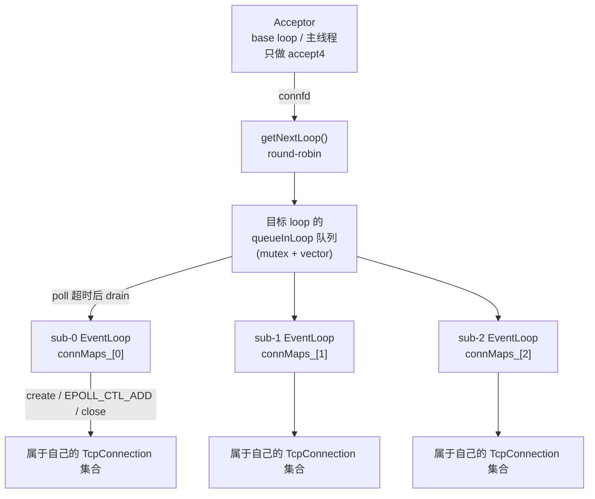

# 13 Day12：主 Acceptor 分配新连接
***
作者：abnb250/山中鹤鸣  
博客：https://www.cnblogs.com/abnb250  
交流群：1062464078 
[点击返回目录](https://www.cnblogs.com/abnb250/articles/23526793)

<br>

<br>

## 第十二天任务描述
***
- 主线程 `Acceptor` 只负责 `accept`
- 新连接按轮询分配给 sub EventLoop
- 连接创建后归属固定，不迁移

<br>

<br>

## 小节一：跨线程的第一道墙——主线程不许造连接，只许投递
***
### 1.1 本节最小必要理论（危机推演式）

**先看清 Day 11 留给你的是什么。**

你现在有 1 个 base loop（主线程）+ N 个 sub loop（N 根线程），每个 sub loop 有自己的 `EpollPoller`、自己的 `channels_`、自己的 `epoll_wait`。但它们**空转**——没有任何 fd 注册进去，因为连接还没分配。今天要把 `Acceptor` 接到这套骨架的入口上。

你脑子里的第一版代码，大概率长这样：

```cpp
void EchoServer::onNewConnection(int connfd, const sockaddr_in& peer){
    EventLoop* io = pool_->getNextLoop();                    // 轮询选一个 sub loop
    TcpConnectionPtr conn = TcpConnection::create(io, connfd, peer);  // ← 在主线程造对象
    conn->setMessageCallback(...);
    conn->connectEstablished();                              // ← 主线程里 enableReading
}
```

这段代码**第一行不会报错，第二行不会报错，第三行当场死**。

调用链是这样的：

```text
onNewConnection()                 主线程（base loop）
  → conn->connectEstablished()
      → channel_->enableReading()
          → Channel::update()
              → EventLoop::updateChannel(channel)
                  → assertInLoopThread()          ← Day 11 立的契约在这里执行
                      → abort()
```

**为什么 Day 11 要把 `assertInLoopThread` 写成 `abort` 而不是 `return`？** 因为如果它只是打一行日志然后返回，你就会得到下面这个更难查的版本：

**推演一：`channels_` 被两根线程同时改。**

`EpollPoller::channels_` 是 `std::unordered_map<int, Channel*>`。主线程正在 `channels_[fd] = channel`（插入可能触发 rehash，要挪桶、搬指针），sub 线程的 `epoll_wait` 恰好返回它自己 epfd 上的某个事件，正在 `channels_.find(fd)` 遍历同一条桶链。B 读到的 `Channel*` 可能是 A 写到一半的旧内存。

结果不是“偶发丢数据”，是**随机段错误**，而且 ASan 抓不到——它不是 use-after-free，是纯粹的数据竞争。

**推演二：事件比回调先到。**

`epoll_ctl(EPOLL_CTL_ADD)` 本身是线程安全的，但你注册的是**别的线程**的 epfd。主线程 ADD 完成的那一瞬间，sub 线程的 `epoll_wait` 就可能返回这个 fd 的 `EPOLLIN`，然后 `Channel::handleEvent()` 去调 `readCallback_`——而你的 `setMessageCallback` 还没执行完。轻则空回调丢数据，重则读到半构造的 `TcpConnection`。

**推演三：析构发生在错误的线程。**

这一条最容易漏。`Channel::~Channel()` 会调 `loop_->removeChannel(this)`，`TcpConnection::~TcpConnection()` 会 `channel_.reset()`。只要这个对象的最后一个 `shared_ptr` 在别的线程被释放（比如 Day 8 的连接表在主线程 `erase`），析构就会在错误线程执行 `epoll_ctl` + 改 `channels_`——和推演一一模一样，只是发生在程序退出那一刻，栈里全是析构函数，最难查。

**所以结论不是“加锁”，是“换个动作”。**

主线程只做三件事：**accept 拿到 fd → 选一个 loop → 把“后续动作”打包投递过去**。这叫**投递而不是共享**：

| 做法 | 共享的是什么 | 代价 |
| --- | --- | --- |
| 加锁共享连接对象 | `channels_`、`Buffer`、连接状态 | 每个事件都要抢锁；锁的层级一多就死锁；单线程串行模型被改成共享模型，复杂度爆炸 |
| 投递任务 | 什么都不共享，只传“动作” | 一个 `mutex` + 一个 `vector`，只在入队/出队那一瞬间碰一下 |

**投递的载体：`EventLoop` 自己的任务队列。**

每个 `EventLoop` 内部加两样东西：`std::vector<std::function<void()>> pendingFunctors_` 和一把 `std::mutex`。任何线程都能 `queueInLoop()` 往里塞任务；owner 线程在每轮 `epoll_wait` + 事件分发之后，把整个队列**换出来**，在锁外逐个执行。

**这里有一个必须背下来的细节：先 `swap` 再执行，绝不在持锁时执行任务。**

如果你写成：

```cpp
std::lock_guard<std::mutex> lock(pendingMutex_);
for (auto& f : pendingFunctors_) f();      // ← 错
```

两件事会同时发生：第一，任务里如果又调 `queueInLoop()`（Day 15 的定时器、Day 16 的心跳一定会这么干），就会对同一个**非递归** `std::mutex` 再次上锁——直接死锁；第二，任务里会调业务回调（可能耗时几毫秒），持锁期间所有生产者全被堵在 `queueInLoop` 里。

所以正确姿势是**两次接触锁，中间零持有**：

```cpp
std::vector<Functor> functors;
{
    std::lock_guard<std::mutex> lock(pendingMutex_);
    functors.swap(pendingFunctors_);      // 只交换指针，O(1)
}
for (auto& f : functors) f();             // 锁已经放开
```

**为什么不需要原子变量、内存屏障？** 因为 `mutex` 的 `unlock` → 另一个线程 `lock` 本身就是 happens-before 边。主线程把 `connfd`、`peer` 写进 lambda（捕获即拷贝），塞进队列，解锁；sub 线程上锁把任务取走，执行时读到的一定是主线程写进去的那份。语言层面这是有保证的，不需要你手写 `atomic_thread_fence`。

**今天必须承认的债：没有唤醒。**

`epoll_wait` 阻塞在内核里，你往 `pendingFunctors_` 里塞任务，它**不知道**。它只会在两种情况下返回：有事件、或者超时（Day 11 设的 1000ms）。所以今天的投递是**“最多延迟一个 poll 超时”**的：

> **新连接从 accept 到真正注册进 epoll，最坏要等 1 秒。** 客户端连上来立刻发数据，数据会先在 socket 内核缓冲区里躺着，等服务端 1 秒后把它注册进 epoll，`EPOLLIN` 立刻触发，才回显。

这不是 bug，这是**今天明确记在账上的债**。Day 13 用 `eventfd` 把这笔债还掉：往 eventfd 写 8 字节 → 目标 loop 的 `epoll_wait` 立刻返回 → 任务立刻执行，延迟从 ~1000ms 掉到 ~0ms。今天的验收里我会让你把这 1 秒**量出来**，明天你才知道自己优化掉了什么。

<br>

### 1.2 代码实现与设计意图

**替换 `include/net/EventLoop.h`（在 Day 11 版本上新增块 C5 与两个私有成员）：**

```cpp
// =============================================================================
// EventLoop.h：事件循环——调度者 + 线程身份 + 退出开关 + 跨线程投递。
//
// 本文件组成（自上而下 5 块）：
//   A 头文件      —— atomic / functional / memory / mutex / thread / vector
//   B 前向声明    —— Channel / EpollPoller
//   C public 接口 —— loop / quit / update / remove / 线程身份 / epfd / queueInLoop
//   D private 方法—— doPendingFunctors（只在 owner 线程执行）
//   E private 数据—— poller、owner 线程 id、退出标志、任务队列（队列 + 锁）
//
// 【设计意图】今天起 EventLoop 多了一个身份："跨线程投递的收件箱"。
//   任何线程都可以往里塞任务，但只有 owner 线程能把任务取出来执行——
//   这就是"投递而不是共享"的物理落点。
// =============================================================================
#pragma once

#include <atomic>
#include <functional>
#include <memory>
#include <mutex>
#include <thread>
#include <vector>

namespace reactor{

class Channel;
class EpollPoller;

class EventLoop{
public:
    // ---- 块 C1：任务类型 ----
    // 作用：统一"待办动作"的类型；捕获进来的参数（connfd、peer、shared_ptr）
    // 由 std::function 持有。
    using Functor = std::function<void()>;

    EventLoop();
    ~EventLoop();

    // ---- 块 C2：主循环与退出 ----
    // 作用：loop() 死循环到 quit() 为止；quit() 只置标志，任何线程都可以调。
    void loop();
    void quit();

    // ---- 块 C3：注册转发 ----
    // 作用：Channel 改完事件位后的唯一出口；只接受 owner 线程调用。
    void updateChannel(Channel* channel);
    void removeChannel(Channel* channel);

    // ---- 块 C4：线程身份 ----
    // 【面试考点】isInLoopThread 是"契约查询"，assertInLoopThread 是"违约即死"。
    bool isInLoopThread() const { return threadId_ == std::this_thread::get_id(); }
    void assertInLoopThread() const;

    // ---- 块 C5：观测 ----
    int epfd() const;

    // ---- 块 C6：跨线程投递（今天的新能力）----
    // 作用：任何线程可调；任务会被排进本 loop 的队列，由 owner 线程执行。
    // 【常见坑】它不负责唤醒 epoll_wait —— 今天靠 poll 超时兜底，最多延迟 1000ms。
    //   Day 13 在这里补 eventfd，延迟才会消失。
    void queueInLoop(Functor cb);

private:
    // ---- 块 D：私有方法 ----
    // 作用：把 pendingFunctors_ 整体换出来，在锁外执行；只在 owner 线程调用。
    void doPendingFunctors();

    // ---- 块 E：私有数据 ----
    // E1 调度组
    std::unique_ptr<EpollPoller> poller_;
    const std::thread::id threadId_;   // 构造线程 = owner，之后永不变
    std::atomic<bool> quit_;           // 跨线程可见的退出标志
    bool looping_ = false;             // 只在 owner 线程读写

    // E2 投递组
    // 【常见坑】pendingFunctors_ 是"多生产者、单消费者"队列：push 在锁内，执行必须在锁外。
    std::mutex pendingMutex_;                // 保护下面队列的锁：只在入队/换出时短暂持有
    std::vector<Functor> pendingFunctors_;   // 待办任务队列:别的线程往里塞，owner线程换出执行
};

}//namespace reactor
```

**替换 `src/net/EventLoop.cpp`（新增块 D 的投递实现 + loop() 里的两次 drain）：**

```cpp
// =============================================================================
// EventLoop.cpp：建 poller、认线程、等事件、分发、执行投递任务、退出。
//
// 本文件组成（自上而下 7 块）：
//   A 头文件与常量 —— Channel/EpollPoller 完整类型；kPollTimeoutMs
//   B 构造 / 析构  —— 建 poller，把 owner 线程 id 钉死
//   C loop()       —— 断言线程 → poll → 分发 → 执行任务 → 看退出标志 → 退出前再清一次
//   D quit()       —— 只置原子标志，任何线程可调
//   E 转发函数     —— updateChannel / removeChannel
//   F 身份与观测   —— assertInLoopThread / epfd
//   G 投递实现     —— queueInLoop（加锁入队）/ doPendingFunctors（换出后锁外执行）
//
// 【设计意图】今天把"跨线程动作"变成"队列里的一个元素"，队列随 EventLoop 生灭，
//   所以任务的生命周期天然被 owner 线程管住，不需要额外的引用计数。
// =============================================================================
#include "net/EventLoop.h"

#include "net/Channel.h"
#include "net/EpollPoller.h"

#include <cstdio>
#include <cstdlib>
#include <iostream>
#include <utility>
#include <vector>

namespace reactor{

// ---- 块 A：常量 ----
// 作用：epoll_wait 的等待上限。它同时决定两件事：quit() 后多久能退出、
//   以及投递的任务最晚多久被执行。Day 13 用 eventfd 唤醒后改回 -1。
static constexpr int kPollTimeoutMs = 1000;

// ---- 块 B：构造 / 析构 ----
EventLoop::EventLoop()
    : poller_(std::make_unique<EpollPoller>()),
      threadId_(std::this_thread::get_id()),
      quit_(false) {}

EventLoop::~EventLoop() = default;

// ---- 块 C：loop() ----
void EventLoop::loop(){
    // 【常见坑】这一行必须是第一句：跨线程跑 loop 的写法在这里当场暴露。
    assertInLoopThread();
    looping_ = true;

    std::vector<ActiveChannel> activeChannels;
    while(!quit_.load(std::memory_order_relaxed)){
        activeChannels.clear();
        poller_->poll(kPollTimeoutMs, activeChannels);
        for(auto& ac : activeChannels){
            ac.channel->handleEvent(ac.revents);
        }

        // ---- 子块 C1：每轮结束执行一次投递任务 ----
        // 【设计意图】放在事件分发之后：先处理"已经发生的 IO"，再处理"别人让我做的事"，
        //   顺序稳定，日志好读，也让"关闭连接"这类任务不会插在半个事件处理中间。
        doPendingFunctors();
    }

    // ---- 子块 C2：退出前最后清一次队列 ----
    // 【为什么必须有这一行】TcpServer::stop() 的时序是"先把清表任务投给各 loop，再 quit"。
    //   如果 loop 恰好在 doPendingFunctors 之后、while 判断之前被置了 quit，
    //   这一轮就不会再 drain —— 清表任务永远不执行，连接最后在 main 线程里被析构，
    //   于是 ~Channel → removeChannel → assertInLoopThread，程序在退出时 abort。
    //   补上这一次 drain，配合"投递一定早于 quit"的顺序，任务就不会丢。
    doPendingFunctors();

    looping_ = false;
}

// ---- 块 D：quit() ----
// 【设计意图】只置标志，不做任何同步等待：调用方随后 join，
//   由 owner 线程自己跑到循环条件处退出——线程只能自愿退休。
void EventLoop::quit(){
    quit_.store(true, std::memory_order_relaxed);
}

// ---- 块 E：转发函数 ----
void EventLoop::updateChannel(Channel* channel){
    assertInLoopThread();
    poller_->updateChannel(channel);
}

void EventLoop::removeChannel(Channel* channel){
    assertInLoopThread();
    poller_->removeChannel(channel);
}

// ---- 块 F：身份与观测 ----
void EventLoop::assertInLoopThread() const {
    if(isInLoopThread()) return;
    std::fprintf(stderr, "[FATAL] EventLoop(epfd=%d) used from wrong thread\n", epfd());
    std::cerr << "        current : " << std::this_thread::get_id()
              << "\n        owner   : " << threadId_ << std::endl;
    std::abort();
}

int EventLoop::epfd() const {
    return poller_->epfd();
}

// ---- 块 G：投递实现 ----
void EventLoop::queueInLoop(Functor cb){
    // 【设计意图】整个函数只在 push 这一瞬间持锁：入队是 O(1)，
    //   而且绝不能在这里顺便执行任务——那样就把"多生产者"变成"多线程执行"了。
    {
        std::lock_guard<std::mutex> lock(pendingMutex_);
        pendingFunctors_.push_back(std::move(cb));
    }

    // 【欠债】这里本应是 eventfd 的 write：叫醒可能正阻塞在 epoll_wait 里的 owner 线程。
    //   今天没有它，任务最晚要等一个 poll 超时（1000ms）才被执行。
}

void EventLoop::doPendingFunctors(){
    std::vector<Functor> functors;

    // ---- 子块 G1：换出来，锁立刻放开 ----
    // 【面试考点】swap 而不是 copy：任务只执行一次，换出去比复制一份再清空更省。
    //   更关键的是"锁外执行"——任务里再调 queueInLoop 不会自锁死。
    {
        std::lock_guard<std::mutex> lock(pendingMutex_);
        functors.swap(pendingFunctors_);
    }

    // ---- 子块 G2：执行，全程不持锁 ----
    for(auto& f : functors){
        f();
    }
    // 出了作用域，functors 析构 → 任务里捕获的 shared_ptr 在这里减引用。
    // 本函数只在 owner 线程跑，所以"任务销毁"也发生在 owner 线程，这一点 Day 12 的关停流程会用到。
}

}//namespace reactor
```

<br>

**新建 `examples/day12_queue_test.cpp`（本节唯一的验收程序：证明“投递能到、到在正确线程、要等一个超时”）：**

```cpp
// =============================================================================
// day12_queue_test.cpp：跨线程投递的三条判据——能执行 / 在 owner 线程 / 欠 1 秒。
//
// 本文件组成（自上而下 5 块）：
//   A 头文件与计时    —— EventLoop / EventLoopThreadPool / steady_clock
//   B 起池 + 记身份   —— init 回调里记每个 loop 的 epfd 与 tid（唯一可信的视角）
//   C 主线程投递      —— 每个 loop 投一个任务，记录"投递时刻 → 执行时刻"
//   D 等结果并判定    —— 最长延迟必须落在 (0, 1100]ms：这就是今天欠的债
//   E --direct 反例   —— 主线程直接调 sub loop 的 updateChannel，现场演示 abort
//
// 【设计意图】今天不接 socket。连接分配是下一节的事，
//   本节只回答一个问题：主线程能不能安全地把"动作"交给 sub 线程，代价是多少。
// =============================================================================
#include "net/EventLoop.h"
#include "net/EventLoopThreadPool.h"

#include <atomic>
#include <chrono>
#include <cstdio>
#include <cstdlib>
#include <cstring>
#include <pthread.h>
#include <thread>
#include <vector>

// ---- 块 A：计时 ----
static long long nowMs(){
    using namespace std::chrono;
    return duration_cast<milliseconds>(steady_clock::now().time_since_epoch()).count();
}

static unsigned long tid(){
    return static_cast<unsigned long>(::pthread_self());
}

int main(int argc, char** argv){
    std::size_t n = 3;
    bool direct = false;
    for(int i = 1; i < argc; ++i){
        if(std::strcmp(argv[i], "--direct") == 0) direct = true;
        else n = static_cast<std::size_t>(std::atoi(argv[i]));
    }
    if(n == 0){ std::printf("[FAIL] need n >= 1\n"); return 2; }

    std::printf("[main] tid=%lu n=%zu\n", tid(), n);

    reactor::EventLoop baseLoop;
    reactor::EventLoopThreadPool pool(&baseLoop, "io", n);

    // ---- 块 B：记录每个 loop 的身份 ----
    // 回调在每个 sub 线程里执行（这是唯一能拿到"那个线程视角"的时机），
    // 所以 tid / epfd 只能在这里取，主线程事后打印的 tid 永远是主线程的。
    // 下标用 atomic 发放，避免两个线程拿到同一个编号。
    std::atomic<std::size_t> nextIdx{0};

    pool.start([&](reactor::EventLoop* l){
        const std::size_t i = nextIdx.fetch_add(1);
        std::printf("[io  ] #%zu epfd=%d tid=%lu\n", i, l->epfd(), tid());
    });

    // ---- 块 C：主线程投递 ----
    const long long postedAt = nowMs();
    std::atomic<int> done{0};
    std::vector<long long> latency(n, -1);

    for(std::size_t i = 0; i < n; ++i){
        reactor::EventLoop* target = pool.getNextLoop();
        // 【常见坑】target 必须按值捕获：它是循环里的局部变量，任务执行时这一轮早结束了，
        //   按引用捕获拿到的是悬空引用（而且每轮还会被下一次 getNextLoop 覆盖）。
        target->queueInLoop([&, i, target](){
            latency[i] = nowMs() - postedAt;
            std::printf("[task] #%zu epfd=%d tid=%lu latency=%lldms\n",
                        i, target->epfd(), tid(), latency[i]);
            done.fetch_add(1);
        });
    }
    std::printf("[main] posted %zu tasks\n", n);

    // ---- 块 D：等结果并判定 ----
    const long long deadline = nowMs() + 3000;
    while(done.load() < static_cast<int>(n) && nowMs() < deadline){
        std::this_thread::sleep_for(std::chrono::milliseconds(5));
    }

    bool pass = (done.load() == static_cast<int>(n));
    long long maxLatency = 0;
    for(std::size_t i = 0; i < n; ++i){
        if(latency[i] < 0) pass = false;
        if(latency[i] > maxLatency) maxLatency = latency[i];
    }
    // 超过 1100ms 说明你连"超时兜底"都没有；等于 0 说明你已经偷偷加了唤醒（那是 Day 13）。
    if(maxLatency > 1100) pass = false;

    std::printf("[main] maxLatency=%lldms (expect <=1100, 这就是今天的欠债)\n", maxLatency);
    std::printf("[main] result=%s\n", pass ? "PASS" : "FAIL");

    // ---- 块 E：反例——主线程直接碰 sub loop ----
    if(direct){
        std::printf("[demo] calling updateChannel on a sub loop from main thread...\n");
        std::fflush(stdout);
        pool.loops()[0]->updateChannel(nullptr);   // assertInLoopThread 在这里 abort
        std::printf("[FAIL] wrong-thread access was NOT detected\n");
        return 2;
    }

    pool.stop();
    return pass ? 0 : 1;
}
```

**`CMakeLists.txt` 追加：**

```cmake
# ---- 块 F1：Day 12 任务队列验收 ----
add_executable(day12_queue_test examples/day12_queue_test.cpp)
target_link_libraries(day12_queue_test PRIVATE reactor_net)
```

<br>

### 1.3 现象追踪与验证（如何证明跑通了）

**第一步：编译**

```bash
cmake -S . -B build
cmake --build build -j4
```

**预期**：0 warning、0 error。若报 `no member named 'queueInLoop'`，说明你改的是 `include/net/EventLoop.h` 的旧副本，或者 `EventLoop.cpp` 没重新编译（`cmake --build` 加 `--clean-first` 试一次）。

**第二步：正面跑一遍，把 1 秒的债量出来**

```bash
./build/bin/day12_queue_test 3; echo "exit=$?"
```

**预期**：

```text
[main] tid=139872341000000 n=3
[io  ] #0 epfd=5 tid=139872332609280
[io  ] #1 epfd=6 tid=139872324216576
[io  ] #2 epfd=7 tid=139872315823872
[main] posted 3 tasks
[task] #0 epfd=5 tid=139872332609280 latency=1000ms
[task] #1 epfd=6 tid=139872324216576 latency=1000ms
[task] #2 epfd=7 tid=139872315823872 latency=1000ms
[main] maxLatency=1000ms (expect <=1100, 这就是今天的欠债)
[main] result=PASS
exit=0
```

**四条判据，缺一条都不算过**：

| 输出 | 说明什么 |
| --- | --- |
| `[task]` 的 tid 与 `[io #i]` 的 tid 相同 | 任务真的跑在 owner 线程里，不是主线程代劳 |
| 三个 `epfd` 互不相同 | 任务发给了三条不同的 loop，不是同一个在“假装轮询” |
| `latency≈1000ms` | `epoll_wait` 没被唤醒，只能等超时——**这就是债** |
| `result=PASS`、`exit=0` | 任务没丢、没卡死 |

**看到什么就说明什么**：`latency=1000` 不是“性能不好”，是“机制还没装完”。你现在有了正确的**通道**，缺的只是**踹一脚门**。Day 13 加 `eventfd` 后，这个数字会变成 `0ms` 或 `1ms`——同一个程序、同一行代码，差别只在 `queueInLoop` 末尾那 8 个字节的 `write`。

**第三步：故意越界，确认契约还在**

```bash
./build/bin/day12_queue_test 2 --direct; echo "exit=$?"
```

**预期**：

```text
[main] posted 2 tasks
[task] #0 ...
[task] #1 ...
[main] maxLatency=1000ms ...
[main] result=PASS
[demo] calling updateChannel on a sub loop from main thread...
[FATAL] EventLoop(epfd=5) used from wrong thread
        current : 139872341000000     ← 主线程
        owner   : 139872332609280     ← sub 线程
Aborted (core dumped)
exit=134
```

**看到什么就说明什么**：`queueInLoop` 让“跨线程”这件事有了合法出口，但契约本身一点没松——**绕过队列直接动手，还是当场死**。这两条必须同时成立，缺一个就是“要么没护栏，要么没法干活”。

**第四步：确认没引入空转**

```bash
./build/bin/day12_queue_test 3 &
pid=$!
sleep 0.3
top -p $pid -b -n1 | head -8
wait
```

**预期**：CPU ≈ 0%。如果 CPU 飙起来，说明你把 `doPendingFunctors` 写进了 `while` 里空转（比如加了个“队列非空就 continue”的忙等分支）——队列空的时候必须回到 `epoll_wait` 里睡着。

**第五步：把“投递不等于共享”写进 debug-log**

```bash
cat >> docs/debug-log.md <<'EOF'
## Day 12: 主线程构造 TcpConnection，connectEstablished 第一行就 abort

### 现象
把 Day 8 的 EchoServer 接进 Day 11 的池子，在 Acceptor 回调里直接
TcpConnection::create(ioLoop, connfd, peer) + connectEstablished()，
进程立刻打印
[FATAL] EventLoop(epfd=5) used from wrong thread
        current : <main tid>
        owner   : <sub tid>
并 Aborted (core dumped)，exit=134。
临时注释掉 assertInLoopThread 之后"能跑"，但几个连接之后开始随机段错误，
栈顶在 EpollPoller::poll 的 channels_.find。

### 定位
TcpConnection 的 Channel 绑定的是目标 sub loop，而 enableReading() 会走
Channel::update → EventLoop::updateChannel → EpollPoller::updateChannel，
最终改的是 sub loop 的 channels_（std::unordered_map）。
在主线程调用它，等于让两根线程同时读写同一张表；
更隐蔽的是 epoll_ctl ADD 完成后，sub 线程可能立刻收到 EPOLLIN，
而此时 messageCallback 还没注入完。

### 修复
1) 每个 EventLoop 增加 pendingFunctors_ + pendingMutex_，提供 queueInLoop()；
2) loop() 每轮 poll + 分发之后调 doPendingFunctors()，把队列 swap 出来在锁外执行；
3) Acceptor 回调里只做三件事：accept 到 fd、getNextLoop() 选 loop、queueInLoop 投递
   "建连接"这个动作；所有 Channel 注册都在目标 loop 线程里完成；
4) loop() 退出前再 drain 一次，保证 stop() 投递的"清空连接表"任务不会丢。

### 验证
day12_queue_test 3：任务 tid 与对应 loop 的 tid 相同、三个 epfd 互异、
maxLatency≈1000ms（无 eventfd 唤醒）、exit=0；
--direct 模式稳定 abort 且打印 current / owner 两个线程 id。
EOF
```

<br>

### 1.4 面试表达话术

**面试官问**：“多线程 Reactor 里，主线程 accept 到一条连接之后，怎么把它交给 IO 线程？为什么不直接操作？”

**你回答**：“不能直接操作，因为连接对象的行为全是‘改某个 EventLoop 的内部状态’：`enableReading` 要改那个 loop 的 `epoll` 和 `fd→Channel` 映射，`send` 要碰连接的输出缓冲，析构要 `EPOLL_CTL_DEL`。这些结构在设计上都是**单线程独占**的，我用 `threadId_` + `assertInLoopThread` 把这个前提变成硬契约，跨线程调用直接 abort——这样错误在第一次发生时就被拦下，而不是变成三天后的一次随机崩溃。真正跨线程传递的是**动作**不是**对象**：每个 EventLoop 有一个 `pendingFunctors_` 队列加一把锁，`queueInLoop` 只做加锁 `push_back`；owner 线程每轮 `epoll_wait` 和事件分发结束后，把整个队列 `swap` 出来、**在锁外**执行。锁外执行是关键细节：任务里可能再次 `queueInLoop`（定时器、心跳都会），持锁执行就会对同一个非递归 mutex 二次上锁，直接死锁。可见性不用我操心，mutex 的 unlock/lock 就是 happens-before。第一版有个明确的代价：`epoll_wait` 不知道队列里有东西，只能等超时，所以新连接最多晚 1 秒才被注册；我在测试里把这个延迟量出来（≈1000ms），然后加 `eventfd` 注册进同一个 epoll，`queueInLoop` 里写 8 字节唤醒它，延迟降到 0～1ms。这条路径和 muduo 的做法一致：`runInLoop` 判断同线程直接执行，跨线程才入队并唤醒。”

<br>

<br>

## 小节二：连接表必须拆成 N 份——归属固定，谁的表谁清
***
### 2.1 本节最小必要理论（危机推演式）

**上一节解决了“怎么把动作送过去”，这一节解决“送过去之后，连接归谁管”。**

你已经有一个能用的 `EchoServer`（Day 8）：它持有一个 `std::map<int, TcpConnectionPtr> connections_`，accept 时插入、close 时 `erase`。这个表是连接的**唯一强引用持有者**——没有它，`TcpConnectionPtr` 一离开作用域，连接立刻析构。

现在你把读写搬到了 sub 线程，于是这张表的两个操作分居两根线程：

```text
主线程（base loop）   : connections_[connfd] = conn;     ← 插入
sub 线程（io loop）   : connections_.erase(fd);          ← 关闭时删除
```

`std::map` 不是线程安全的。这不是“可能有问题”，是**一定会出问题**：

- 主线程在 `insert` 触发红黑树旋转、`sub` 线程同时 `erase` → 迭代器/指针错乱 → 段错误；
- 更坏的情况不崩：两个线程对同一个 fd 键一插一删，`erase` 把**刚插进去的新连接**删了 → 新连接在 `send` 之前被析构 → 后续事件打到野指针 → UAF；
- 或者主线程 `erase` 释放了最后一个 `shared_ptr` → `~TcpConnection` 在主线程跑 → `channel_.reset()` → `~Channel` → `loop_->removeChannel()` → **又是那句 assert**。

**第一条结论：连接表不能跟着“服务器”走，必须跟着“loop”走。**

每个 sub loop 一张表，只有它的 owner 线程读写。主线程手里只有一张**外层索引**：`std::map<EventLoop*, ConnectionMap>`。这张外层表在 `start()` 里一次性建好，之后**结构不再变化**——不插入、不删除、不 rehash。于是：

- 主线程：只读外层结构（`find`），拿到“该 loop 的那张表在内存里的位置”；
- sub 线程：只改自己那张表的**值**（插入/删除元素），从不碰外层结构；
- 两根线程之间**没有任何共享的可变结构**，所以**不需要锁**。

这就是“不可变结构 + 可变值”的经典套路。它比“一把大锁保护全局连接表”好在两点：锁的开销没了；更重要的是**错误从“数据竞争”降级成“编译期就能想清楚的归属问题”**。

**第二条结论：连接一旦落地，永不迁移。**

为什么不按“最少连接数”把连接挪到更闲的 loop 上？因为迁移意味着：

1. 连接对象要在两个 `EventLoop` 之间换主人——`Channel` 绑的 `loop_` 要改；
2. 旧 loop 的 `channels_` 要 `DEL`，新 loop 要 `ADD`，中间那个窗口里事件是丢的；
3. 迁移本身是跨线程动作，要排队、要等对方确认，还得处理“迁移途中连接被关了”；
4. 你为了均衡 5% 的负载，引入了 4 类新的竞态。

而且“连接数均衡”本来就不等于“负载均衡”：一条长连接跑满带宽，胜过一百条空闲连接。真要调，Day 14 用压测数据说话——**先有数字，再谈策略**。

所以今天的分配策略就是**轮询（round-robin）**：`getNextLoop()` 取下一个，O(1)、无共享、可预测。Day 11 已经写好了。

**第三条结论：`create` + 注入回调 + `connectEstablished` 必须打包成一个任务。**

这三个动作必须原子地发生在 owner 线程里，中间不能被别的逻辑看见：

```cpp
TcpConnectionPtr conn = TcpConnection::create(ioLoop, connfd, peer);  // ① 造对象
conn->setMessageCallback(...);                                        // ② 注入回调
conn->setCloseCallback(...);                                          // ② 注入回调
conn->connectEstablished();                                           // ③ 设 weak_ptr 回调 + enableReading
```

Day 8 踩过的坑还记得吗：**构造函数里不能设 `Channel` 回调**，因为那时对象还没被 `shared_ptr` 接管，`weak_from_this()` 是空的。所以回调只能在 ② 注入，而 ③ 一执行，`EPOLLIN` 就可能到来。如果 ② 和 ③ 分属两个线程，中间那个窗口就是“事件到了、回调还没设”的黑洞。

**第四条结论（最容易被忽略）：关停顺序是一条不变式，不是随手写的几行。**

`TcpServer::stop()` 的顺序必须是：

```text
1) acceptor_.stop()      主线程：把 listenfd 从 base loop 的 epoll 摘掉，不再有新连接
2) 给每个 io loop 投递"清空自己的表"任务      ← 必须发生在 quit 之前
3) pool_.stop()          先全部 quit，再全部 join
```

为什么 2 必须在 3 之前？因为 `quit()` 之后 loop 会退出循环、回收栈上的 `EventLoop`。如果清表任务比 `quit` 晚到，它就永远不执行——那些连接最后会在 `TcpServer` 析构时、在**主线程**里被释放，而 `~Channel` 一定会调 `loop_->removeChannel()`：loop 还活着时，`assertInLoopThread` 直接 abort，至少日志说得清；loop 已经随线程销毁时，你摸的是已释放的栈内存，变成一段无法用日志解释的段错误。**同一个错误，两种死法，都不该发生。**

反过来，只要满足两条：**所有投递都发生在任何一次 quit 之前** + **`loop()` 退出前再 drain 一次**，就能证明“每个清表任务一定在对应线程退出前执行”——上一节 `loop()` 末尾那行 `doPendingFunctors()` 不是装饰，它就是这条不变式的第二个条件。把这个证明在纸上写一遍，比背十遍“先 quit 再 join”有用。

**还有一个坑：不要在 `stop()` 之后清外层表。**

`connMaps_.clear()` 看起来无害（表里都是空 map 了），但万一有哪个连接没被清掉，这一行就会在**主线程**里析构它。所以正确做法是：**清表动作交给 owner 线程，主线程只负责投递和等待**；外层表里那些 `EventLoop*` 键在 `join` 之后就是野指针了，**永远不要再解引用**（包括不要在日志里打印 `key->epfd()`）。

<br>

### 2.2 代码实现与设计意图

**`include/net/Acceptor.h` 的 public 区补一个 `stop()`：**

```cpp
    // ---- C6 停止接入 ----
    // 作用：把 listenfd 从 epoll 摘掉，但保留 fd（close 留给析构）。
    // 【常见坑】只置 listening_ = false 是自欺欺人：listenfd 还挂在 epoll 里，事件照样来。
    void stop();
```

**`src/net/Acceptor.cpp` 的块 D 追加：**

```cpp
void Acceptor::stop() {
    if (!listening_) return;
    listening_ = false;
    // remove() → EventLoop::removeChannel → EPOLL_CTL_DEL + 擦除 fd→Channel 映射。
    // 【设计意图】必须在 base loop 线程调用；~Acceptor 里 reset 时还会再 remove 一次，
    //   EpollPoller 对"摘一个不存在的 fd"是容忍的（epoll_ctl 返回 ENOENT 被忽略、erase 空操作）。
    acceptChannel_->remove();
}
```

**新建 `include/net/TcpServer.h`：**

```cpp
// =============================================================================
// TcpServer.h：主从 Reactor 的装配层——base 线程 accept，sub 线程持有连接。
//
// 本文件组成（自上而下 4 块）：
//   A 头文件与依赖 —— Acceptor / EventLoopThreadPool / TcpConnection
//   B 类型别名      —— 连接指针、消息回调、连接状态回调、每 loop 的连接表
//   C public 接口   —— 构造 / 回调注入 / start / stop / 观测；禁拷贝
//   D private 区    —— accept 与建连接两个动作 + 五个成员组
//
// 【设计意图】TcpServer 是"装配者"不是"执行者"：
//   它只决定"这条连接交给哪个 loop"，从不亲自读写连接；
//   连接表的每一格都归对应的 loop 线程所有，主线程只持有外层索引。
// =============================================================================
#pragma once

#include "net/Acceptor.h"
#include "net/EventLoopThreadPool.h"
#include "net/TcpConnection.h"

#include <cstddef>
#include <functional>
#include <map>
#include <string>

namespace reactor{

class EventLoop;

class TcpServer{
public:
    // ---- 块 B1：类型别名 ----
    using TcpConnectionPtr = TcpConnection::TcpConnectionPtr;
    using MessageCallback = TcpConnection::MessageCallback;

    // 连接状态回调：连接建立 / 断开时各调一次，用 conn->connected() 区分。
    // 【设计意图】Day 16 的心跳要在这里挂"上线即登记、下线即摘除"，所以今天先留出口。
    using ConnectionCallback = std::function<void(const TcpConnectionPtr&)>;

    // ---- 块 B2：每 loop 一张连接表 ----
    // 【面试考点】值（map）归 sub 线程独占，键（EventLoop*）只由主线程在 start() 里写一次。
    using ConnectionMap = std::map<int, TcpConnectionPtr>;

    // ---- 块 C1：构造 / 析构 ----
    // port 在构造时即刻 bind + listen（连接先进内核 backlog），真正的"开始接入"在 start()。
    TcpServer(EventLoop* baseLoop, int port, std::size_t threadNum,
              std::string name = "server");
    ~TcpServer();

    // 禁拷贝：持有 Acceptor（fd 所有权）与线程池（线程所有权），复制就是双重释放。
    TcpServer(const TcpServer&) = delete;
    TcpServer& operator=(const TcpServer&) = delete;

    // ---- 块 C2：回调注入 ----
    // 【常见坑】必须在 start() 之前调用：连接是在 sub 线程里创建时读取这两个回调的，
    //   start 之后再改，已经建好的连接拿不到新回调，而且是跨线程读写 std::function。
    void setMessageCallback(MessageCallback cb);
    void setConnectionCallback(ConnectionCallback cb);

    // ---- 块 C3：生命周期 ----
    // start：起池 → 建表 → 开始接入；stop：停接入 → 投清表 → quit + join；两者都幂等。
    void start();
    void stop();

    // ---- 块 C4：观测 ----
    int listenfd() const { return acceptor_.listenfd(); }
    std::size_t threadNum() const { return pool_.threadCount(); }
    const std::string& name() const { return name_; }

private:
    // ---- 块 D：private 区 ----
    // D0 动作 1：base 线程里被 Acceptor 回调调用，只做"选 loop + 投递"。
    void onNewConnection(int connfd, const sockaddr_in& peer);

    // D0 动作 2：被投递到目标 loop 后执行，做"造对象 + 注入回调 + 入表 + 注册读事件"。
    void createConnectionInLoop(EventLoop* ioLoop, int connfd, const sockaddr_in& peer);

    // D1 环境组
    EventLoop* baseLoop_;              // 主线程的 base loop，只借用不拥有：
                                       // accept 与"选 loop"都在它上面发生

    // D2 配置组
    const int port_;                   // 监听端口，构造时定死，Acceptor用它bind/listen
    const std::string name_;           // 服务器名，用于日志和sub线程命名(echo-io-0/1)

    // D3 装配组
    // 【常见坑】成员顺序决定析构顺序：acceptor_ 声明在 pool_ 之前 → pool_ 先析构。
    //   但我们显式在 ~TcpServer 里先 stop()，所以这个顺序只在"没 start 过"时兜底。
    Acceptor acceptor_;                // 监听模块：拥有监听fd,只负责accept4，归属base loop
    EventLoopThreadPool pool_;         // N 个 sub loop 的容器：批量启动、轮询分配、并行关停

    // D4 连接组：外层只读、内层分线程写
    std::map<EventLoop*, ConnectionMap> connMaps_; 
                                       // 每loop一张连接表：外层启动后只读，内层归各owner线程

    // D5 回调组
    MessageCallback messageCallback_;  // 业务读回调：收到数据后干什么（由上层注入）
    ConnectionCallback connectionCallback_;  
                                       // 连接状态回调：上线/下线各调一次，用connected()区分

    bool started_ = false;   // 是否已 start：防重复起池、建表、监听  
    bool stopped_ = false;   // 是否已 stop：保证关停只走一遍（幂等）
};

}//namespace reactor
```

**新建 `src/net/TcpServer.cpp`：**

```cpp
// =============================================================================
// TcpServer.cpp：accept → 轮询选 loop → 投递建连接 → sub 线程持有并关闭。
//
// 本文件组成（自上而下 6 块）：
//   A 头文件与小工具 —— EventLoop 完整类型、currentTid、peerToString
//   B 构造 / 析构    —— 挂 Acceptor 回调；析构兜底 stop
//   C start          —— 起池 → 为每条 loop 建空表 → 最后才 listen
//   D onNewConnection—— base 线程：轮询选 loop + 跨线程投递（同线程则直接做）
//   E createConnectionInLoop —— io 线程：create / 注入回调 / 入表 / connectEstablished
//   F stop           —— 停接入 → 各 loop 自己清表 → quit + join
//
// 【设计意图】"主线程只 accept，sub 线程持连接"这条分工，全部体现在 D 与 E 的分工上：
//   D 里没有一行代码碰 TcpConnection，E 里没有一行代码碰 accept。
// =============================================================================
#include "net/TcpServer.h"

#include "net/EventLoop.h"

#include <arpa/inet.h>
#include <pthread.h>
#include <unistd.h>

#include <cstdio>
#include <utility>

namespace reactor{

// ---- 块 A：小工具 ----
static unsigned long currentTid(){
    return static_cast<unsigned long>(::pthread_self());
}

static std::string peerToString(const sockaddr_in& peer){
    char ip[INET_ADDRSTRLEN] = {0};
    ::inet_ntop(AF_INET, &peer.sin_addr, ip, sizeof(ip));
    return std::string(ip) + ":" + std::to_string(ntohs(peer.sin_port));
}

// ---- 块 B：构造 / 析构 ----
TcpServer::TcpServer(EventLoop* baseLoop, int port, std::size_t threadNum, std::string name)
    : baseLoop_(baseLoop),
      port_(port),
      name_(name.empty() ? std::string("server") : std::move(name)),
      acceptor_(baseLoop, port),
      pool_(baseLoop, name_ + "-io", threadNum) {
    // 【设计意图】捕获 this 是安全的：acceptor_ 是成员，一定比 TcpServer 活得短。
    acceptor_.setNewConnectionCallback([this](int connfd, const sockaddr_in& peer){
        onNewConnection(connfd, peer);
    });
}

TcpServer::~TcpServer(){
    stop();
}

// ---- 块 C：start ----
void TcpServer::start(){
    if(started_) return;
    started_ = true;

    // 1) 先起 sub loop。start() 返回时 N 个 loop 已经"就绪且可以收任务"（Day 11 的 startLoop 语义）。
    pool_.start([this](EventLoop* io){
        std::printf("[io] ready epfd=%d tid=%lu\n", io->epfd(), currentTid());
    });

    // 2) 为每条 io loop 建一张空表。从这一刻起，外层 map 的结构不再变化，
    //    所以 sub 线程可以无锁 find，只改自己那一格的值。
    for(EventLoop* io : pool_.loops()){
        connMaps_.emplace(io, ConnectionMap());
    }
    // 单线程模型（threadNum == 0）：池里没有 sub loop，getNextLoop() 会退回 baseLoop_，
    // 所以也要给 baseLoop_ 一张表，否则 createConnectionInLoop 里 at() 直接抛 out_of_range。
    if(connMaps_.empty()){
        connMaps_.emplace(baseLoop_, ConnectionMap());
    }

    // 3) 最后才开接入：保证 accept 到的每一条连接，一定有表可放。
    acceptor_.listen();
    std::printf("[server:%s] listening on %d, io threads=%zu, listenfd=%d\n",
                name_.c_str(), port_, pool_.threadCount(), acceptor_.listenfd());
}

// ---- 块 D：onNewConnection（base 线程）----
void TcpServer::onNewConnection(int connfd, const sockaddr_in& peer){
    // 【面试考点】轮询分配：O(1)、可预测、无跨线程读取。
    //   "最少连接"要读别的 loop 的连接数，那就得加锁或原子，读到的还是过期快照。
    EventLoop* ioLoop = pool_.getNextLoop();

    std::printf("[accept] fd=%d peer=%s -> epfd=%d tid=%lu\n",
                connfd, peerToString(peer).c_str(), ioLoop->epfd(), currentTid());

    // 单线程模型：当前线程就是这条连接的 owner，直接建，别绕一圈（绕了要等 1s）。
    // 注：这个 if/else 就是 runInLoop 的雏形，Day 13 会把它抽成 EventLoop 的正式 API。
    if(ioLoop->isInLoopThread()){
        createConnectionInLoop(ioLoop, connfd, peer);
        return;
    }

    // 多线程模型：把"建连接 + 注入回调 + 注册读事件 + 入表"打包成一个任务投给目标 loop。
    // 【欠债】今天没有 eventfd，目标 loop 要等 poll 超时（1000ms）才醒来执行 —— 新连接最多晚 1 秒。
    // 【常见坑】只投"create"、剩下的回调在主线程设，等于把今天的坑又挖回来一半：
    //   任务一执行 connectEstablished 就可能来事件，回调必须在那之前已经在对象上。
    ioLoop->queueInLoop([this, ioLoop, connfd, peer](){
        createConnectionInLoop(ioLoop, connfd, peer);
    });
}

// ---- 块 E：createConnectionInLoop（io 线程）----
void TcpServer::createConnectionInLoop(EventLoop* ioLoop, int connfd, const sockaddr_in& peer){
    // 进到这里就说明：当前线程就是 ioLoop 的 owner 线程。这一行是"投递成功"的自证。
    ioLoop->assertInLoopThread();

    auto tableIt = connMaps_.find(ioLoop);
    if(tableIt == connMaps_.end()){
        // 不该发生：start() 已为每条 loop 建表。真到了这里，fd 必须归还，绝不泄漏。
        std::fprintf(stderr, "[server:%s] no conn table for epfd=%d, drop fd=%d\n",
                     name_.c_str(), ioLoop->epfd(), connfd);
        ::close(connfd);
        return;
    }
    ConnectionMap& conns = tableIt->second;

    // ---- 子块 E1：造对象 ----
    TcpConnectionPtr conn = TcpConnection::create(ioLoop, connfd, peer);

    // ---- 子块 E2：入表（本线程独占，无锁）----
    // 【设计意图】这张表就是连接的"主人"：它是唯一持久的强引用，erase 即析构。
    conns[connfd] = conn;

    // ---- 子块 E3：注入回调 ----
    conn->setMessageCallback(messageCallback_);

    conn->setCloseCallback([this, ioLoop](const TcpConnectionPtr& c){
        // 【设计意图】关闭回调一定在 io 线程里跑，所以这里 erase 的是"本线程的表"，不需要锁。
        auto it = connMaps_.find(ioLoop);
        if(it != connMaps_.end()){
            it->second.erase(c->fd());
        }
        std::printf("[conn] closed fd=%d epfd=%d tid=%lu\n",
                    c->fd(), ioLoop->epfd(), currentTid());

        // c 是按值传进来的 shared_ptr：表里 erase 之后对象仍然活着，业务回调里可以安全使用。
        if(connectionCallback_) connectionCallback_(c);
    });

    // ---- 子块 E4：注册读事件 ----
    // 【面试考点】这一步必须在 owner 线程、且必须在回调注入之后：
    //   enableReading 一执行，EPOLLIN 就可能在同一轮 epoll_wait 里返回。
    conn->connectEstablished();

    std::printf("[conn] created fd=%d epfd=%d tid=%lu peer=%s\n",
                connfd, ioLoop->epfd(), currentTid(), conn->peerAddrString().c_str());

    if(connectionCallback_) connectionCallback_(conn);
}

// ---- 块 F：stop ----
void TcpServer::stop(){
    if(!started_ || stopped_) return;
    stopped_ = true;

    // 1) 先断接入：listenfd 从 base loop 的 epoll 里摘掉，不再有新的 connfd。
    //    【常见坑】这一步必须在 base loop 线程调用（Acceptor 的 Channel 绑的是它）。
    acceptor_.stop();

    // 2) 把"清空连接表"的任务投给各自的 owner 线程 —— 连接必须在自己的 loop 线程里析构。
    for(auto& kv : connMaps_){
        EventLoop* io = kv.first;
        if(io->isInLoopThread()){
            // 单线程模型：本线程就是 owner，直接清。
            kv.second.clear();
        }else{
            io->queueInLoop([this, io](){
                auto it = connMaps_.find(io);
                if(it != connMaps_.end()) it->second.clear();
            });
        }
    }

    // 3) 先全部 quit，再全部 join（Day 11 的规矩，把 N × 1s 压成 1 × 1s）。
    // 【不变式】所有投递都发生在任何一次 quit() 之前，且 loop() 退出前还会 drain 一次，
    //   所以上面每个 clear 任务一定在对应线程退出前执行 —— 连接一定死在 owner 线程。
    pool_.stop();

    std::printf("[server:%s] stopped\n", name_.c_str());
    // 【常见坑】不要在这里 connMaps_.clear()：键指向的 EventLoop 已经随 sub 线程销毁，
    //   值里万一只剩一条连接，这一行就会在主线程析构它 → ~Channel → assert。让它们留着，
    //   正常情况下值本来就是空 map。
}

}//namespace reactor
```

**新建 `examples/day12_echo_server.cpp`（业务只出现在回调里，库一行业务都没有）：**

```cpp
// =============================================================================
// day12_echo_server.cpp：多线程 echo——base 线程 accept，N 个 sub 线程各管一批连接。
//
// 本文件组成（自上而下 4 块）：
//   A 头文件与参数  —— port / io 线程数
//   B 装配          —— EventLoop + TcpServer
//   C 业务回调      —— 上线/下线打印；收到什么回什么（echo）
//   D 启动          —— start + loop（Ctrl+C 结束）
//
// 【设计意图】Day 9 的 echo_reactor 是单线程版，保留不动；
//   今天这个程序用同一套 Buffer/TcpConnection，只是把执行线程换成了池。
//   对比两者的回调代码：几乎一样 —— 因为"业务不认识线程"，这正是封装成功的证据。
// =============================================================================
#include "base/Buffer.h"
#include "net/EventLoop.h"
#include "net/TcpServer.h"

#include <csignal>
#include <cstdio>
#include <cstdlib>
#include <string>

int main(int argc, char** argv){
    // 【常见坑】对端先关时 send 会触发 SIGPIPE，不忽略就直接杀进程。
    std::signal(SIGPIPE, SIG_IGN);

    const int port = (argc > 1) ? std::atoi(argv[1]) : 8888;
    const std::size_t ioThreads = (argc > 2) ? static_cast<std::size_t>(std::atoi(argv[2])) : 3;

    reactor::EventLoop baseLoop;
    reactor::TcpServer server(&baseLoop, port, ioThreads, "echo");

    // ---- 块 C1：连接状态 ----
    server.setConnectionCallback([](const reactor::TcpServer::TcpConnectionPtr& conn){
        std::printf("[biz ] fd=%d %s peer=%s\n", conn->fd(),
                    conn->connected() ? "online" : "offline",
                    conn->peerAddrString().c_str());
    });

    // ---- 块 C2：业务 ----
    // 【面试考点】这个回调运行在连接所属的 sub 线程里，所以 c->send() 是"本线程操作本连接"，
    //   不需要任何锁 —— 这就是"一条连接只属于一个 loop"换来的红利。
    server.setMessageCallback([](const reactor::TcpServer::TcpConnectionPtr& conn,
                                 reactor::Buffer* buf){
        std::string msg(buf->peek(), buf->readableBytes());
        buf->retrieveAll();                 // 先取走，再回写：避免自引用同一块缓冲区
        conn->send(msg);
    });

    // ---- 块 D：启动 ----
    server.start();
    baseLoop.loop();

    server.stop();
    return 0;
}
```

**`CMakeLists.txt` 追加（`reactor_net` 源文件列表 + 新目标）：**

```cmake
# ---- 块 F2：TcpServer.cpp 入 reactor_net ----
add_library(reactor_net
    src/base/Buffer.cpp
    src/base/ThreadPool.cpp
    src/net/Channel.cpp
    src/net/EpollPoller.cpp
    src/net/EventLoop.cpp
    src/net/Acceptor.cpp
    src/net/TcpConnection.cpp
    src/net/EventLoopThread.cpp
    src/net/EventLoopThreadPool.cpp
    src/net/TcpServer.cpp            # ← 新增
)

# ---- 块 F3：Day 12 多线程 echo 服务端 ----
add_executable(day12_echo_server examples/day12_echo_server.cpp)
target_link_libraries(day12_echo_server PRIVATE reactor_net)
```

<br>

### 2.3 现象追踪与验证（如何证明跑通了）

**第一步：编译**

```bash
cmake -S . -B build
cmake --build build -j4
```

**预期**：0 warning、0 error。若报 `Acceptor has no member named 'stop'`，检查 `Acceptor.h` 的 `stop()` 是不是加在了 `private:` 区。

**第二步：起 3 个 IO 线程，连 3 次，看“决定”和“执行”是不是两根线程**

```bash
./build/bin/day12_echo_server 8888 3
```

另开一个终端：

```bash
for i in 1 2 3; do printf 'hello-%d\n' $i | timeout 5 nc -q 2 127.0.0.1 8888; done
```

**预期（服务端）**：

```text
[io] ready epfd=5 tid=139872332609280
[io] ready epfd=6 tid=139872324216576
[io] ready epfd=7 tid=139872315823872
[server:echo] listening on 8888, io threads=3, listenfd=4
[accept] fd=8 peer=127.0.0.1:51234 -> epfd=5 tid=139872341000000     ← 主线程做决定
[conn] created fd=8 epfd=5 tid=139872332609280 peer=127.0.0.1:51234  ← sub-0 线程执行
[conn] closed fd=8 epfd=5 tid=139872332609280
[accept] fd=8 peer=127.0.0.1:51235 -> epfd=6 tid=139872341000000
[conn] created fd=8 epfd=6 tid=139872324216576 peer=127.0.0.1:51235
...
```

**四条判据**：

| 输出 | 说明什么 |
| --- | --- |
| `[accept]` 的 tid 恒为同一个（主线程） | accept 只在 base loop 里发生，没有第二个线程抢 listenfd |
| `[conn] created` 的 tid 与 `[accept]` 的不同，且与某个 `[io] ready` 相同 | 连接对象真的在目标 loop 的线程里被创建 |
| `epfd` 依次 `5 → 6 → 7` | 轮询分配生效，三条连接落到三个不同的 loop |
| `[conn] closed` 的 `epfd/tid` 与 `created` 完全一致 | **归属固定**：从生到死都是同一条 loop、同一根线程 |

**看到什么就说明什么**：注意 `[accept]` 和 `[conn] created` 之间大约隔了 1 秒——这就是上一节的债，在真实连接路径上现形了。`nc` 感觉不到（它会一直等），但用 `time` 就藏不住。

**第三步：用 `strace -tt` 把这 1 秒钉死在时间轴上**

```bash
ASAN_OPTIONS=detect_leaks=0 strace -f -tt -e trace=accept4,epoll_ctl \
       -o /tmp/day12.strace ./build/bin/day12_echo_server 8888 2
# 另一个终端连一次（-q 2：等 2 秒再退，给 1 秒的投递延迟留余量）
printf 'hi\n' | timeout 5 nc -q 2 127.0.0.1 8888
```

然后：

```bash
grep -E 'accept4|EPOLL_CTL_ADD' /tmp/day12.strace | tail -4
```

**预期**（时间戳是示意，关键是差值）：

```text
139872341000 1712345678.123456 accept4(4, {sa_family=AF_INET, ...}, [16], SOCK_NONBLOCK|SOCK_CLOEXEC) = 8
139872332609 1712345679.111222 epoll_ctl(5, EPOLL_CTL_ADD, 8, {events=EPOLLIN, data={u32=8}}) = 0
```

**看到什么就说明什么**：行首的 **pid 不同**（accept4 在主线程、epoll_ctl 在 sub 线程），时间戳差 **~1 秒**。这两个事实合起来就是今天的全部设计：**动作跨了线程，通道还没装唤醒**。Day 13 在这一行前面补一个 `eventfd` 的 `write`，时间差会从 1 秒变成 0.000x 秒——同一个 grep，你会看到两条时间戳几乎贴身。

**第四步：反例——把投递去掉，看它在真实路径上怎么死**

把 `onNewConnection` 里最后那几行临时改成直接调用（看完立刻改回来，别提交）：

```cpp
    // 临时：跳过投递，在主线程直接建连接
    createConnectionInLoop(ioLoop, connfd, peer);
    return;
```

重新编译、起服务、连一次：

```bash
cmake --build build -j4 && ./build/bin/day12_echo_server 8888 3
# 另一个终端
printf 'hi\n' | timeout 5 nc -q 2 127.0.0.1 8888
```

**预期**：

```text
[accept] fd=8 peer=127.0.0.1:51234 -> epfd=5 tid=139872341000000
[FATAL] EventLoop(epfd=5) used from wrong thread
        current : 139872341000000
        owner   : 139872332609280
Aborted (core dumped)
```

**看到什么就说明什么**：它死在 `createConnectionInLoop` 的第一行 `assertInLoopThread()`，连 `epoll_ctl` 都没走到。这就是“**先把契约立起来，再谈功能**”的收益——错误在你写错的那一行就被拦下，而不是变成压测时某个连接莫名丢包。

**第五步：反例——在主线程清表，让连接死在错误线程**

第一版很容易这么写 `stop()`（“先把表清了，再关线程”看起来更干净）：

```cpp
void TcpServer::stop(){
    if(!started_ || stopped_) return;
    stopped_ = true;
    acceptor_.stop();
    connMaps_.clear();      // ← 临时：在主线程清表
    pool_.stop();
}
```

再在 `examples/day12_echo_server.cpp` 里临时加一个“500ms 后优雅退出”（记得 `#include <chrono>` 和 `<thread>`）：

```cpp
    server.start();
    // 临时：500ms 后让 base loop 主动退出，模拟“优雅关停”
    std::thread([&]{
        std::this_thread::sleep_for(std::chrono::milliseconds(500));
        baseLoop.quit();
    }).detach();
    baseLoop.loop();
```

编译、起服务，连一个 `nc` **保持不关**，等它 500ms 后开始退出：

```bash
cmake --build build -j4 && ./build/bin/day12_echo_server 8888 3
# 另一个终端：连上就别断
nc 127.0.0.1 8888
```

**预期**：

```text
[conn] created fd=8 epfd=5 tid=139872332609280 ...
[FATAL] EventLoop(epfd=5) used from wrong thread
        current : 139872341000000     ← 主线程在析构连接
        owner   : 139872332609280     ← 这条连接真正的 owner
Aborted (core dumped)
```

**看到什么就说明什么**：`connMaps_.clear()` 在**主线程**跑，释放了最后一个 `shared_ptr`，于是 `~TcpConnection → channel_.reset() → ~Channel → loop_->removeChannel()` 全在主线程执行。此时 sub loop 还活着，`assertInLoopThread` 精确地告诉你“当前线程 vs owner 线程”。把这两行临时改动都恢复（`stop()` 换回“投递清表任务”、`main` 去掉临时线程），再跑一次，同样的操作会安静退出——**这一正一反，就是“关停顺序是不变式”这句话的全部价值**。

**第六步：写进 debug-log（两条，都是真雷）**

```bash
cat >> docs/debug-log.md <<'EOF'
## Day 12: 关停时进程 abort，栈顶在 ~Channel → removeChannel

### 现象
多线程 echo 跑几分钟后 Ctrl+C / 或让 base loop 主动 quit，进程在退出最后一步打印
[FATAL] EventLoop(epfd=5) used from wrong thread
然后 Aborted (core dumped)。Ctrl+C 强制杀进程时反而看不到（来不及析构）。

### 定位
TcpServer 的 connMaps_ 是成员，析构发生在 main 线程。如果连接没在
它所属的 sub loop 里被清掉，最后一个 shared_ptr 就会在 main 线程释放，
~TcpConnection → channel_.reset() → ~Channel → loop_->removeChannel()
→ assertInLoopThread → abort。
两种写法都会走到这里：
  ① 直接在 stop() 里 connMaps_.clear()（在主线程清表）；
  ② 清表任务投递晚于 quit，loop 已经退出，任务永远不执行。

### 修复
固定为三段：
1) acceptor_.stop()      停接入（base 线程）
2) 给每条 io loop 投递“清空自己的连接表”     ← 必须早于 quit
3) pool_.stop()          先全 quit 再全 join
并在 EventLoop::loop() 的 while 之后补一次 doPendingFunctors()，
保证“退出前一定把队列清干净”。不变式：投递早于 quit + 退出前 drain
   ⇒ 每个清表任务必在 owner 线程退出前执行。

### 验证
恢复正确顺序后，连接建立/关闭日志的 epfd 与 tid 完全一致；
退出时无 FATAL，exit=0。把第 2 步改成在主线程 connMaps_.clear()，
可稳定复现上面的 abort。
EOF

cat >> docs/debug-log.md <<'EOF'
## Day 12: 新连接要等 1 秒才被回显

### 现象
nc 连上 8888 立刻发数据，服务端要 ~1 秒后才回显。
strace -f -tt 显示 accept4 与目标 loop 的 EPOLL_CTL_ADD 时间戳差约 1.000s，
且两者 pid 不同。

### 定位
连接注册被 queueInLoop 投递到 sub loop，但 queueInLoop 只入队，
没有唤醒阻塞在 epoll_wait 的 owner 线程；owner 只能等 poll 超时
（kPollTimeoutMs = 1000）返回后才 doPendingFunctors。

### 修复（Day 13）
在 EventLoop 里创建 eventfd 并注册进 epoll（EPOLLIN），
queueInLoop 入队后往 eventfd 写 8 字节；owner 线程被唤醒后
读掉计数并执行任务；poll 超时可同时改回 -1。
另把“同线程直接执行、跨线程才入队”抽成 runInLoop。

### 验证（待 Day 13 完成）
同一 test：latency 从 ~1000ms 降到 0～1ms；
strace 中 accept4 与 EPOLL_CTL_ADD 时间戳差 < 5ms。
EOF
```

<br>

### 2.4 面试表达话术

**面试官问**：“你的连接表放在哪？多线程下怎么保证不出并发问题？”

**你回答**：“连接表跟着 loop 走，不跟着服务器走。每个 sub EventLoop 一张 `map<int, TcpConnectionPtr>`，只有它的 owner 线程能插入、能 `erase`，所以这张表**一把锁都不需要**。主线程只持有一张外层索引 `map<EventLoop*, ConnectionMap>`，这张外层表在 `start()` 里一次性建好，之后结构不再变化——不插入、不删除、不 rehash，因此子线程读结构、改自己的那个值，两者没有交集，既没有数据竞争也没有锁开销。如果做成一张全局表加一把大锁，后果不只是慢：`erase` 释放最后一个 `shared_ptr` 的时候，析构会在**持锁的线程**里跑，而 `~Channel` 会去 `removeChannel` 操作那个 fd 所属 loop 的 epoll 结构，照样跨线程，锁根本保护不了这件事。归属上我坚持‘连接落地后永不迁移’，因为迁移要同时动两个 poller 的注册表、要在窗口期丢事件、还要处理迁移途中连接被关的情况，为了几 % 的负载均衡引入几类竞态不划算；分配用轮询，O(1)、无共享、可预测，真要不均就用压测数据说话，而不是拍脑袋加策略。另外关停顺序是不变式：先停 accept，再把‘清空自己的表’投给各 owner 线程，最后才 quit + join；并且 `loop()` 在退出前会再 drain 一次队列。这两条合起来能证明每个清表任务一定在对应线程退出前执行，连接一定死在自己的 loop 线程里。我踩过反面：少投一次，进程退出时就在主线程析构连接，`assertInLoopThread` 直接把进程 abort 在析构栈里。”

<br>

<br>

## 小节三：多客户端并发验收——证明不串包，并把瓶颈说清楚
***
### 3.1 本节最小必要理论（危机推演式）

**“我看到回显了”不是验收。**

Day 8 你开一个 `nc` 敲了 `hello`，看见 `hello` 回来，收工。今天这套系统里，那条路径**一次都没被压过**：

- 你从来没让**两个连接同时**跑，所以“连接 A 的读回调里写到了连接 B 的缓冲区”这种错误没有机会暴露；
- 你从来没让**一条连接发几十条消息**，所以“半包/粘包”的分支没走；
- 你从来没检查过**归属有没有漂移**（同一个 fd 的读事件有没有被别的 loop 处理过）。

**先想清楚“串数据”到底有几种成因，才知道该验证什么：**

| 成因 | 表现 | 今天的防线 |
| --- | --- | --- |
| 缓冲区跨线程共享 | A 的回显发到了 B 的 socket 上 | 一个连接一套 `Buffer`，只在 owner 线程读写 |
| 归属漂移 | 同一个 fd 的事件被两个 loop 处理，`channels_` 里一份、`epoll` 里两份 | 落地即固定、永不迁移；`epfd`/`tid` 在 created 与 closed 日志里必须一致 |
| 连接表键冲突 | fd 复用后新连接被老连接的 `erase` 误删 | 一张表只归一个线程，插入/删除天然串行 |

**所以验收的方式是：给每条消息打上“它属于哪条连接”的标记，让程序自己判对错。**

Day 9 已经给你造好了这把锥子：`day9_echo_client` 会发 `cNN-#NNNN:xxxx\n`，收到后逐字节比对 `makeLine(clientId, seq, payload)`。只要服务端把 A 的数据回了 B，比对必然 `mismatch`；只要半包被当成整包，长度必然不对。**它不靠眼睛，它靠退出码。**

今天的压测形态要升级成“**6 条连接同时跑**”，而不是 6 次顺序跑：并发才会让“两个 loop 同时动”这件事真正发生。

**顺手把瓶颈列出来——这是 Day 14 的输入，也是简历上“我优化了什么”的素材：**

| 瓶颈 | 现状 | 量级 |
| --- | --- | --- |
| 新连接注册延迟 | 无 `eventfd`，等 poll 超时 | **~1000ms**（最刺眼，Day 13 还） |
| accept 单点 | 只有 base 线程 `accept4` | 连接建立速率上限 ≈ 单核 accept 循环；短连接压测时先撞它 |
| 每连接 2 次 `epoll_ctl` | ADD + DEL | 10 万连接 = 20 万次系统调用 |
| IO 线程数 | 3 根，纯 IO + 回调 | 绑定核数；`top -H` 看是否均衡 |
| 业务计算 | 全在 io 线程里（echo 是纯搬运，暂时无害） | Day 14 上线程池后才分离 |
| 死连接 | 没有心跳，`recv=0` 才回收 | 半开连接会一直占表（Day 16） |

**怎么发现“分布不均”？** 不要用眼睛数日志，用一条命令数：

```bash
grep -o 'created fd=[0-9]* epfd=[0-9]*' /tmp/server.log | awk -F'epfd=' '{print $2}' | sort | uniq -c
```

输出 `2 5 / 2 6 / 2 7` 就是完美轮询；输出 `6 5` 说明你其实只起了一条 IO 线程（或者 `getNextLoop` 被某个分支绕过了）。

<br>

### 3.2 代码实现与设计意图

新建一个可复用的并发验收脚本（Day 18 压测直接改造它）：

```bash
#!/usr/bin/env bash
# =============================================================================
# day12_multi_client.sh：N 条连接并发 echo，自己判对错。
#
# 用法：./scripts/day12_multi_client.sh [port] [clients] [rounds]
#   默认：8888 端口、6 条连接、每连接 50 轮、每轮 1400 字节 payload。
#
# 判定：任何一条客户端退出码非 0（mismatch / sendFailed / 超时）→ 整体失败。
# =============================================================================
set -u

PORT=${1:-8888}
CLIENTS=${2:-6}
ROUNDS=${3:-50}
OUT=/tmp/day12_clients
mkdir -p "$OUT"

pids=()
for i in $(seq 0 $((CLIENTS - 1))); do
    ./build/bin/day9_echo_client "$PORT" "$i" "$ROUNDS" 1400 0 \
        > "$OUT/client_$i.log" 2>&1 &
    pids+=($!)
done

fail=0
for i in "${!pids[@]}"; do
    if wait "${pids[$i]}"; then
        :
    else
        echo "[FAIL] client $i exit=$?"
        fail=1
    fi
    cat "$OUT/client_$i.log"
done

if [ "$fail" -ne 0 ]; then
    echo "[RESULT] FAIL"
    exit 1
fi

echo "[RESULT] PASS: $CLIENTS clients x $ROUNDS rounds, no mismatch"
```

**`docs/architecture.md` 追加第 12 节（连同 mermaid 图一起，Day 18 的 README 直接复用）：**

````markdown
## 12. 连接分配（Day 12）

- 分工：**base loop（主线程）只 `accept4`**；选中的 sub loop 负责该连接的全部读写与关闭。
- 分配：`EventLoopThreadPool::getNextLoop()` 轮询；`threadNum == 0` 时退回 base loop。
- 归属：连接创建后**永不迁移**；每张连接表只归一个 loop 线程所有。
- 投递：主线程用 `EventLoop::queueInLoop()` 把“建连接”送到目标 loop 的队列，
  owner 线程在每次 `epoll_wait` + 分发之后执行（`doPendingFunctors`）。
- 已知债：没有 `eventfd` 唤醒，新连接最坏延迟一个 poll 超时（1000ms）；Day 13 还。



| 规矩 | 原因 |
| --- | --- |
| 连接表跟着 loop 走，不跟着 TcpServer 走 | `erase` 释放最后一个 `shared_ptr`，析构必须在 owner 线程 |
| 外层 `map<EventLoop*, ConnectionMap>` 启动后只读 | 子线程才能无锁 `find`，没有 rehash 风险 |
| `create` + 注入回调 + `connectEstablished` 打包成一个任务 | 中间任何窗口都可能来事件（`EPOLLIN` 在 ADD 后立刻可能就绪） |
| 关停：停 accept → 投清表 → quit + join | 投递晚于 quit 就等于没投；连接会死在主线程 |
| `loop()` 退出前再 drain 一次 | 保证“投递早于 quit”的不变式成立 |

- 下一步（Day 13）：`eventfd` 唤醒 + `runInLoop`，把新连接延迟从 ~1000ms 降到 ~0ms。
````

<br>

### 3.3 现象追踪与验证（如何证明跑通了）

**第一步：编译 + 起服务，日志落地**

```bash
cmake -S . -B build
cmake --build build -j4
./build/bin/day12_echo_server 8888 3 2>&1 | tee /tmp/day12_server.log
```

**第二步：6 条连接并发跑，程序自己判对错**

另开终端：

```bash
chmod +x scripts/day12_multi_client.sh
./scripts/day12_multi_client.sh 8888 6 50; echo "exit=$?"
```

**预期**：

```text
[client 00] ok=50 mismatch=0 sendFailed=0 payload=1400 splitMs=0
[client 01] ok=50 mismatch=0 sendFailed=0 payload=1400 splitMs=0
...
[client 05] ok=50 mismatch=0 sendFailed=0 payload=1400 splitMs=0
[RESULT] PASS: 6 clients x 50 rounds, no mismatch
exit=0
```

**看到什么就说明什么**：`mismatch=0` 是“不串包”的**机器判据**；`sendFailed=0` 说明服务端没有在中途关掉连接（如果 sub 线程在错误线程析构，客户端会先看到 `sendFailed`）。6 × 50 = 300 条 1411 字节的消息全部逐字节对上了。

**第三步：数分配，证明是“分摊”不是“全堆在一条线程”**

```bash
grep -o 'created fd=[0-9]* epfd=[0-9]*' /tmp/day12_server.log \
  | awk -F'epfd=' '{print $2}' | sort | uniq -c
```

**预期**（6 条连接、3 个 loop）：

```text
      2 5
      2 6
      2 7
```

**看到什么就说明什么**：`2/2/2` 就是轮询的物理形态。如果是 `6 5`，说明 `getNextLoop()` 没被调用（比如你偷懒写成 `pool_.loops()[0]`）；如果是 `4 1 1`，说明你在某个分支里重复取了 loop，轮询游标被多推了一次。

**第四步：证明归属没漂移（每一条连接，生与死都在同一根线程）**

```bash
grep -E '\[conn\] (created|closed)' /tmp/day12_server.log | head -12
```

**预期**（节选，注意同一个 fd 的两行 `epfd/tid` 必须相同）：

```text
[conn] created fd=8  epfd=5 tid=139872332609280 peer=127.0.0.1:51234
[conn] closed  fd=8  epfd=5 tid=139872332609280
[conn] created fd=9  epfd=6 tid=139872324216576 peer=127.0.0.1:51235
[conn] closed  fd=9  epfd=6 tid=139872324216576
```

**看到什么就说明什么**：`fd → epfd → tid` 三元组全程不变，就是“归属固定、不迁移”的定义。如果出现 `created epfd=5` 而 `closed epfd=6`，说明有代码在搬连接（或者 fd 复用后键冲突覆盖了老连接）——那是最危险的 bug，客户端会表现为“偶尔一条连接收不到回显”。

**第五步：`top -H` 看线程负载，`ps -L` 认线程名**

```bash
./build/bin/day12_echo_server 8888 3 &
pid=$!
sleep 0.3
ps -L -o pid,tid,comm -p $pid          # 预期：main + echo-io-0/1/2
./scripts/day12_multi_client.sh 8888 9 200 > /dev/null
top -H -b -n1 -p $pid | head -16       # 预期：三根 io 线程各有 CPU，不是一根吃满
kill $pid
```

**看到什么就说明什么**：三根 `echo-io-*` 都有 CPU 时间 = 连接真的分摊了；只有一根吃满、另两根挂零 = 分配出了问题。这就是 Day 14 压测时“线性扩展了吗”的第一手证据。

**第六步（可选但强烈建议）：把“分布不均”变成可复现的实验**

临时把 `onNewConnection` 里的 `pool_.getNextLoop()` 改成：

```cpp
    static EventLoop* sticky = nullptr;                 // 临时：永远用第一条 loop
    if (!sticky) sticky = pool_.getNextLoop();
    EventLoop* ioLoop = sticky;
```

重新编译、跑 9 条连接，再数一遍分配（预期 `9 5`），然后跑 `top -H`（预期一根线程吃满）。

**看到什么就说明什么**：你会亲眼看到“连接全堆在一条 loop 上”时长什么样。改回来。**这个实验的意义**：以后面试官问“你怎么知道你的多线程真的多线程了”，你的答案是“我故意做坏过一次，知道坏掉长什么样，也知道用什么命令看”。

**第七步：收尾——把“不串包”的判据写进 README（Day 18 会用）**

```markdown
## 验收（Day 12）

- 6 连接 × 50 轮 × 1400B 并发 echo：`ok=50 mismatch=0`（6/6 通过）
- 3 个 IO 线程轮询分配：连接数 2/2/2
- 每条连接 `fd → epfd → tid` 全程不变（归属固定，不迁移）
- 已知债：新连接注册延迟 ≤1000ms，Day 13 用 eventfd 消除
```

<br>

### 3.4 面试表达话术

**面试官问**：“你怎么证明你的多线程服务器不会串包？如果压测时偶尔丢数据，你怎么定位？”

**你回答**：“先说‘串包’的三种成因，再说验证手段。成因一是缓冲区被跨线程共享，二是连接归属漂移——同一个 fd 的事件被两个 loop 处理，三是连接表键冲突导致新连接被老的 `erase` 误删。我的设计上是把三者一起掐掉：一个连接一套 `Buffer`、一个 `Channel`、只属于一个 loop；`create` 之后永不迁移；每个 loop 一张自己的连接表，插入和删除天然串行，所以那些 `Buffer` 从头到尾只有一根线程碰。验证不靠眼睛：客户端给每条消息打唯一编号 `cNN-#NNNN`、定长 payload，收到后逐字节比对，错一个就 `mismatch`；6 条连接并发、每连接 50 轮，最后看退出码。归属漂移我用日志证明——连接创建和关闭都打印 `epfd` 和 `tid`，同一个 fd 的两行必须完全一致，出现不一致就说明有代码在搬连接。定位丢数据时我会按这个顺序切：先看客户端 `mismatch` 还是 `sendFailed`（前者是串包，后者是连接被提前关），再看服务端 created/closed 日志的 `epfd/tid` 是否成对，然后用 `epfd` 把问题锁到某一根 IO 线程，最后 `strace -f` 跟那根线程的 `recv/send/epoll_ctl`。另外我给每条连接分配打日志，用 `grep | uniq -c` 数分布，用 `top -H` 看三根 io 线程的 CPU——如果只有一根吃满，那不是性能问题，是分配逻辑写错了。”

<br>

<br>

## 小节四：提交 GitHub
***
先说清今天到底改了什么，别把“新增队列”和“连接分配”混成一件事：

- `EventLoop` 从“单线程执行器”升级为“**可以接收跨线程投递的执行器**”：`queueInLoop` 入队，owner 线程在每轮事件分发后 `doPendingFunctors` 执行；
- `TcpServer` 是新的**装配层**：base 线程只 `accept4` + 选 loop + 投递，sub 线程负责 `create / 注册 / 入表 / 关闭`；
- `Acceptor` 补了 `stop()`，让“优雅关停”能真的先断开接入。

提交 GitHub：

```bash
git add .
git commit -m "feat: assign connection to sub loop"
git push
```

提交前 `git status` 确认这些文件都进了暂存区：

- `include/net/EventLoop.h`（新增 `Functor` / `queueInLoop` / `doPendingFunctors` / `pendingMutex_` / `pendingFunctors_`）
- `src/net/EventLoop.cpp`（`loop()` 每轮 drain + 退出前 final drain；`queueInLoop` / `doPendingFunctors` 实现）
- `include/net/Acceptor.h` / `src/net/Acceptor.cpp`（新增 `stop()`：从 epoll 摘掉 listenfd）
- `include/net/TcpServer.h` / `src/net/TcpServer.cpp`（新增：每 loop 一张连接表 + 轮询分配 + 投递建连接 + 三段式关停）
- `examples/day12_queue_test.cpp`（投递三条判据 + `--direct` 违约演示）
- `examples/day12_echo_server.cpp`（多线程 echo：base accept、N 个 sub 读写）
- `scripts/day12_multi_client.sh`（6 连接并发验收脚本）
- `CMakeLists.txt`（`TcpServer.cpp` 入 `reactor_net`，新增 `day12_queue_test` / `day12_echo_server` 两个目标）
- `docs/architecture.md`（新增第 12 节：连接分配 + mermaid 图 + 5 条规矩）
- `docs/debug-log.md`（Day 12 两条：关停时序 abort、新连接 1 秒延迟）

**提交前自查三条**（不过就别 commit）：

1. `./build/bin/day12_queue_test 3` → `result=PASS`、`maxLatency≈1000ms`；
2. `./build/bin/day12_echo_server 8888 3` + `./scripts/day12_multi_client.sh 8888 6 50` → `[RESULT] PASS`；
3. 日志里每条连接 `created` 与 `closed` 的 `epfd/tid` 完全一致。

<br>

<br>

<br>

<br>

<br>

<br>

<br>

<br>

<br>

<br>
